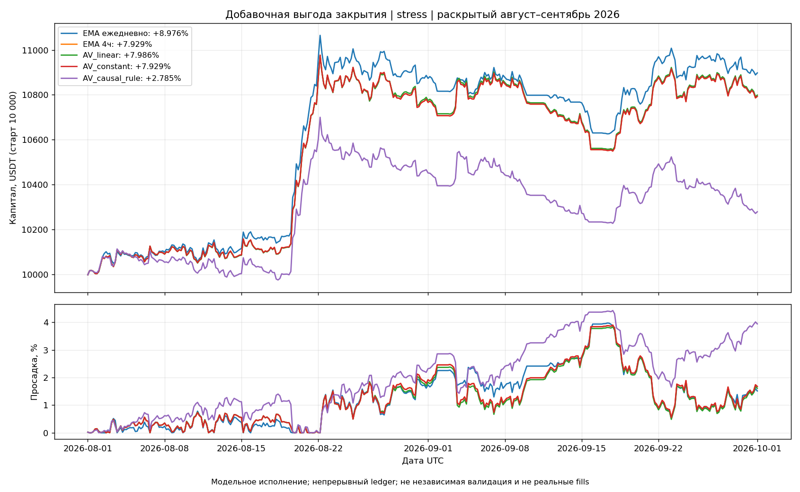
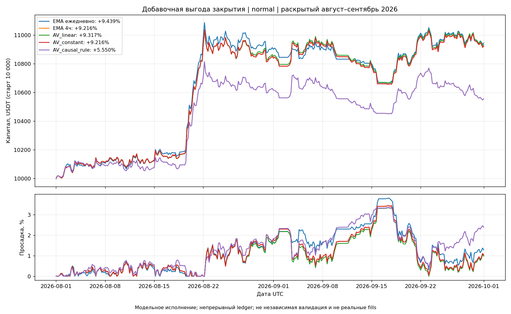

# Добавочная выгода действия: итог исследовательского эксперимента

Период: 1 августа — 30 сентября 2026, UTC. Период ранее раскрыт. Исполнение OHLCV-модельное, не квалифицированные реальные fills. Все торговые полномочия false.

## Что изменилось и что проверено

Одна pooled linear6: шесть признаков + intercept, семь параметров, ridge 0,01, uniform для всех исходов. Переобучение каждые 72 часа; отдельный train-only scaler и SHA на каждом origin. Горизонт, шаг labels и решения — 4 часа. Purge 7 баров плюс точная доступность label после fill-delay.

Уточнение до обучения: hold означает исходный EMA-rebalance, не сохранение units. В label сравниваются полные портфельные ветки с одним cash, фактическим delta-переходом и общими конечными units. Изменение корреляционного риска других активов входит в цель. Конечное восстановление — только граница label: в replay нет фиктивных trades и принудительного восстановления.

Funding до весны 2026 отсутствует, 27–31 июля есть пропуск. Net-labels построены на полностью покрытых блоках 1 мая — 27 июля 12:00 и 1 августа — 1 октября. Более ранние цены служат признакам/риску, но не маскируются под net-labels. Отдельные reference-сегменты открыто начинают cash=10 000; финансовый replay августа–сентября не сбрасывает капитал.

Синтетические проверки, bit-exact hold-parity с EMA в normal/stress, dataset/fold/index/model/scaler hashes и общий primary/audit bootstrap проверены. Бюджет: 21 линейное обучение; три фиксированных политики × два cost-сценария; никаких новых порогов, GA или MLP.

## Результат после stress-costs

| Политика | Net, % | DD, % | Экспозиция, % | Оборот / старт | Fills | Удержание, ч |
|---|---:|---:|---:|---:|---:|---:|
| R0_EMA_daily | +8.9758 | 3.9690 | 19.877 | 7.360 | 351 | 141.18 |
| R1_EMA_4h | +7.9292 | 3.8971 | 20.474 | 20.576 | 1989 | 61.75 |
| AV_linear | +7.9860 | 3.8320 | 20.369 | 21.295 | 1988 | 56.24 |
| AV_constant | +7.9292 | 3.8971 | 20.474 | 20.576 | 1989 | 61.75 |
| AV_causal_rule | +2.7847 | 4.4224 | 16.051 | 45.447 | 1963 | 11.34 |

AV_constant — train-only средняя net-добавка. AV_causal_rule — отрицательная последняя 4h-доходность в bps минус фиксированные 28 bps stress-roundtrip. Никогда не вмешиваться — EMA 4h, не новый обученный контроль.

## Labels и качество прогноза

| Сегмент | Labels | Среднее, bps | Положительные, % | Endpoint caps, % |
|---|---:|---:|---:|---:|
| train | 1461 | -24.940 | 38.125 | 0.000 |
| evaluation | 1747 | -35.318 | 35.203 | 0.000 |

| Прогноз | RMSE, bps | MAE, bps | Прогноз >0, % |
|---|---:|---:|---:|
| AV_never | 151.119 | 100.332 | 0.000 |
| AV_linear | 149.617 | 98.169 | 1.088 |
| AV_constant | 147.399 | 96.718 | 0.000 |
| AV_causal_rule | 200.959 | 138.673 | 30.509 |

Эта таблица относится к фиксированным reference-состояниям. Локальная добавка с общей конечной позицией не суммируется в фактический PnL многократных вмешательств.

## Бухгалтерия и парная добавка, stress

| Политика | Gross | Fees | Slippage | Funding | ΔNet к EMA4h | Primary LCB Δ, bps/день | Audit LCB Δ |
|---|---:|---:|---:|---:|---:|---:|---:|
| AV_linear | 1121.63 | 127.77 | 170.36 | -24.90 | +5.68 | -0.3293 | -0.3373 |
| AV_constant | 1105.94 | 123.46 | 164.61 | -24.96 | +0.00 | 0.0000 | 0.0000 |
| AV_causal_rule | 933.99 | 272.68 | 363.58 | -19.26 | -514.45 | -16.7714 | -16.4648 |

Общий замороженный resample bank, nominal alpha=0,0025 для раскрытой цепочки 20 contrasts. Это не полный global multiple-testing correction: число прежних адаптивных решений неполно. Audit seed не заменяет новых данных. Absolute LCB и normal/sensitivity расчёты находятся в analysis.json.

## Перенос состояний reference → новая политика

| Политика | Несовпадение held-state, % | Средняя абсолютная разница доли актива, п.п. | Local labels в новых состояниях | Caps, % |
|---|---:|---:|---:|---:|
| AV_linear | 0.410 | 0.0131 | 1736 | 0.000 |
| AV_constant | 0.000 | 0.0000 | 1747 | 0.000 |
| AV_causal_rule | 14.208 | 0.5508 | 1356 | 0.000 |

Модель не получает portfolio-state признаков: изменение распределения состояний — ограничение, а не автоматически исправленная проблема. Неизменные EMA-входы могут возвращать закрытый актив на следующем decision; такой вход оплачивается как настоящий переход.

## Графики

Stress-график показывает итог после повышенного модельного drag; просадка измерена по доступным 4h/funding/fill marks, не по неизвестному внутрисвечному пути.

Normal — чувствительность исполнения тех же прогнозов, без нового обучения и выбора нового порога.

## Итог и дальнейшие действия

Исследовательский paired+absolute primary/audit gate для AV_linear: False. Это не полный release gate и не prospective evidence. Promotion всегда false.

Не выбирать победителя из трёх политик для реальных денег. Если линейный сигнал не подтверждается, остановить расширение архитектуры и разобрать вклад baseline rebalance, funding и повторных входов. Новая настройка будет отдельной зарегистрированной гипотезой. Если добавка подтверждается, сначала заморозить контракт и оценить длительность нового prospective с учётом зависимости дневных результатов; в этой задаче prospective не открыт.

Семантика, ограниченный бюджет и происхождение попыток зарегистрированы в objective_registry_v10 и registration.json; фактические train cutoffs/indices — folds.json, fit/scaler/model SHA — fit_*.json, непрерывные ledger — replay_*.json. Новый финансовый результат нельзя приписывать старым price-прогнозам.

Дополнительных независимых funding/cost-проверок: 17076. Полномочия credentials/orders/paper/live/runtime/network/promotion остаются false.
