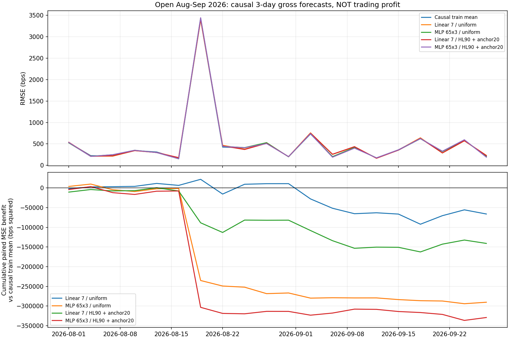

# Компактные прогнозные модели: открытый август–сентябрь 2026

## Что именно сравнивается

Новый зарегистрированный gross predictor, а не обучение на старых заблокированных net-targets. 20 причинных трёхдневных origins, 160 исходов восьми символов; expanding-переобучение каждые три дня. 20 origins — временные группы, не 160 независимых экспериментов. Период уже раскрыт, это не sealed prospective.

Linear: 6→1, 7 параметров. MLP: 6→8 tanh→1, 65 параметров; среднее трёх фиксированных seeds, 195 сохранённых коэффициентов на origin. Scaler/target statistics не входят в число весов сети.

Uniform и half-life 90 дней + **20% uniform anchor**. Взвешены положительные, отрицательные и нулевые исходы; вес зависит только от доступности outcome и purged cutoff. Это не profit-only weighting.

## Результаты прогнозов

| Вариант | RMSE, bps ↓ | MAE, bps ↓ | Верный знак | LCB ΔMSE vs mean | Audit LCB ΔMSE |
|---|---:|---:|---:|---:|---:|
| Zero forecast (not trading equity) | 859.387 | 439.660 | 0.0% | -17240.69 | -17952.99 |
| Causal train mean | 855.172 | 439.252 | 51.9% | 0.00 | 0.00 |
| Linear 7 / uniform | 857.104 | 441.871 | 51.2% | -9204.01 | -8990.72 |
| MLP 65x3 / uniform | 863.621 | 443.237 | 46.9% | -37275.29 | -37712.14 |
| Linear 7 / HL90 + anchor20 | 859.282 | 442.883 | 50.6% | -16588.86 | -17011.24 |
| MLP 65x3 / HL90 + anchor20 | 864.744 | 441.731 | 48.1% | -45779.08 | -46118.66 |

Минимальная диагностическая RMSE среди моделей: **Linear 7 / uniform**. Это descriptive ranking прогнозов, не финансовый победитель, не выбор нового production incumbent. ΔMSE > 0 означает улучшение прогноза относительно причинного train-mean, а не положительную прибыль. Bootstrap общий, блок 2 origins, 4 096 resamples, seeds 3039/7079; односторонний 5% quantile. Бюджет тестирования и старые попытки не скорректированы DSR/PBO.

## Причинность и воспроизводимость

12 источников, 83,232 OHLCV-строк, 10,404 timestamps. Источник с января 2022 до 1 октября 2026 UTC. Хеш каждого файла проверен перед каждым origin; новый банк данных, feature definition, folds, weights, scaler/model SHA и оба resample banks зафиксированы.

Feature-asof origin 00:00, entry следующий open 04:00, exit entry+18 баров, доступность outcome exit+1 бар. Train_end=origin−1 бар, cutoff=train_end−7 баров; inner validation последние 60 дней доступных origins с отдельным purge. Scaler обучается заново на каждом origin; inner scaler не видит validation. Epoch выбирается только на прошлом inner block; L2=0.01, lr=0.001, 120 epochs/patience12 заранее фиксированы. Нет подбора по августу–сентябрю; предшествующие benchmark outcomes причинно добавляются в последующие fit prefixes.

22 детерминированные проверки пройдены. 280 market forecast fits (40 linear + 120 inner MLP + 120 full-prefix refits), 8720 gradient steps; 40 scalers. Никакого pytest, collector, subprocess, ожиданий wall-clock или сети.

| Вариант | ESS origins, диапазон | Масса убыточных исходов | Масса прибыльных исходов |
|---|---:|---:|---:|
| Linear 7 / uniform | 553.0–572.0 | 0.511–0.513 | 0.486–0.489 |
| MLP 65x3 / uniform | 553.0–572.0 | 0.511–0.513 | 0.486–0.489 |
| Linear 7 / HL90 + anchor20 | 423.1–438.9 | 0.509–0.518 | 0.482–0.490 |
| MLP 65x3 / HL90 + anchor20 | 423.1–438.9 | 0.509–0.518 | 0.482–0.490 |

MLP 65x3 / uniform: RMSE отдельных фиксированных seeds [867.0208418199721, 861.159284652783, 867.1819177057159]; выбранные inner epochs [1, 120]. Seeds не независимые outer slices.

MLP 65x3 / HL90 + anchor20: RMSE отдельных фиксированных seeds [866.3928818747806, 860.8228907068811, 871.4874959488388]; выбранные inner epochs [1, 120]. Seeds не независимые outer slices.

## Ограничения и следующий шаг

MSE/верный знак не являются net log-growth. Модели не привязаны к торговым policy thresholds, costs/funding; нет финансовых прогонов и equity curve, потому что денежный ledger для этих прогнозов не рассчитывался. Zero forecast — контроль прогноза, не доходность NoTrade. Архивные GA/EMA результаты нельзя ранжировать рядом с этой RMSE.

Zero-lag candle availability и мгновенная готовность fit — зарегистрированные research assumptions, не измеренный execution latency. MLP seeds и четыре arms увеличивают adaptive testing budget; global registry не интегрирован, DSR/PBO и promotion не вычисляются. Нет подтверждения out-of-sample прибыльности или live readiness.

Дальше: зафиксировать predictor→net-policy контракт без настройки на этом benchmark; обеспечить подтверждённые cost/funding inputs и причинную задержку; сравнить политики через единый shared-capital ledger и текущую net-growth fitness с исследовательскими DD10/20/30%. До этого не подключать GA и не запускать реальную торговлю.

Артефакты: preparation.json, registration.json, sample_bank.npz, audit_resample_banks.npz, origin_00…19.json (модели, прогнозы, scaler/cutoff/fold/weight identities), comparison.json, engineering_checks.json, evidence_receipt.json.
