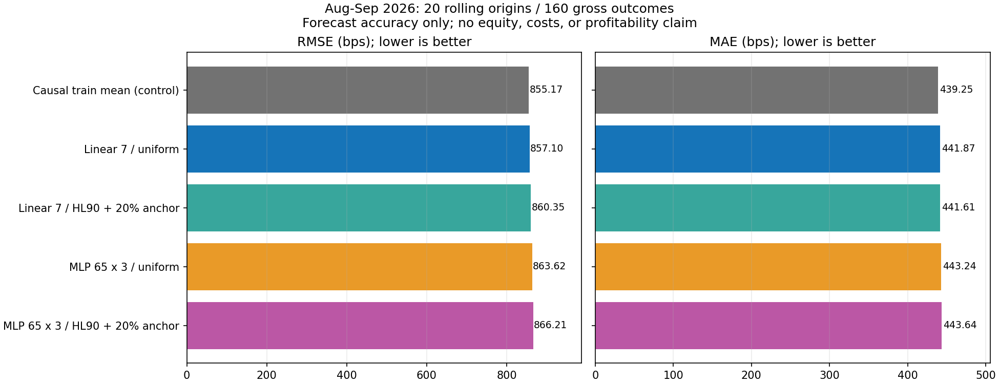

# Выводы исправленного сравнения компактных моделей

**Обучение и сравнение завершены, но подтверждённого выигрыша нет.** Среди четырёх обучаемых arms наименьшая RMSE у linear6/uniform (857.10 bps), однако causal train-mean лучше (855.17 bps). Все четыре audit LCB улучшения MSE относительно train-mean отрицательны. Добавление MLP или recency не подтвердило улучшение на этом открытом периоде. Это не доказательство превосходства linear во всех режимах.

Исправленная recency — нормированная смесь 20% uniform + 80% exponential half-life90, а не raw floor. Первый superseded-прогон сохранён вместе с исходным кодом; 280+280=560 market forecast fits учтены, не скрыты. Данные и оба uniform controls побитово совпадают между попытками.

## Парные различия

Положительное ΔMSE означает, что **первый** вариант имеет меньшую ошибку. Все различия используют тот же заранее зафиксированный audit bank (4 096 circular block samples, блок=2 origins). LCB не скорректирован на историческое multiple-testing.

| Первый вариант | Второй | Среднее ΔMSE, bps² | Audit LCB |
|---|---|---:|---:|
| Linear 7 / uniform | MLP 65 x 3 / uniform | 11214.51 | -4543.73 |
| Linear 7 / HL90 + 20% anchor | MLP 65 x 3 / HL90 + 20% anchor | 10122.37 | -1077.33 |
| Linear 7 / uniform | Linear 7 / HL90 + 20% anchor | 5569.39 | -13534.29 |
| MLP 65 x 3 / uniform | MLP 65 x 3 / HL90 + 20% anchor | 4477.25 | -1334.98 |

## Почему вывод ограничен

Origin с максимальным исходом (индекс 6, 19 августа, вход 04:00 → 22 августа 04:00 UTC) даёт 79.08% суммы квадратов ошибок zero-forecast. Все восемь gross исходов в этом origin положительны: 19.36%–56.38%. Наблюдение оставлено в основной метрике; исключать его ради улучшения ranking нельзя. Это одновременно показывает важность tail-regime и необходимость проверки исходных цен/агрегации этого окна по независимому архиву до экономических выводов; не утверждается, что скачок является ошибкой данных.

MSE и знак оценивают прогноз, не заработанный капитал. HL90 у linear даёт больше правильных знаков (53.1% против 51.2% uniform), но хуже RMSE. Знак сам по себе не учитывает масштаб outcome, комиссии и количество отказов от сделки. Ни один критерий не подменяет net-growth ledger.

Для MLP отдельные seeds, early-stopping epochs и ensembles сохранены в основном отчёте; три сети — 195 весов, не одна модель с 65 весами. Гиперпараметры фиксированы, а архитектуры не имеют равного вычислительного бюджета. Результат относится к этой конфигурации и не оправдывает дальнейший подбор seeds/lr/L2 по августу–сентябрю.

## Проверка и дальнейшее решение

23 регрессии; 50 source/output identities; 160 сохранённых моделей и их прогнозы сверены с samples, train-only scalers, cutoff, folds, весами всех знаков и ESS. Проверка не выполнила новых fits. Никакой сети, collector, pytest или торгового runtime.

Не объявлять нового financial incumbent и не подключать GA на основании этого результата. Следующий узкий шаг: подтвердить происхождение/агрегацию пикового окна; затем заранее зафиксировать predictor→net-policy с abstention и реальными cost/funding inputs, проверить общий ledger и net-growth на уже открытом периоде без изменения моделей по его исходам. Если baseline не побеждён, оставить NoTrade и пересмотреть сигнал на отдельном pre-August development interval, не раздувать нейросеть.

Финансовая validation, equity curve, live/paper, promotion и согласование риска реальных денег не выполнялись. Подробные метрики и identities: [REPORT.md](REPORT.md), comparison.json, reconciliation.json, evidence_receipt.json и analysis_receipt.json.
