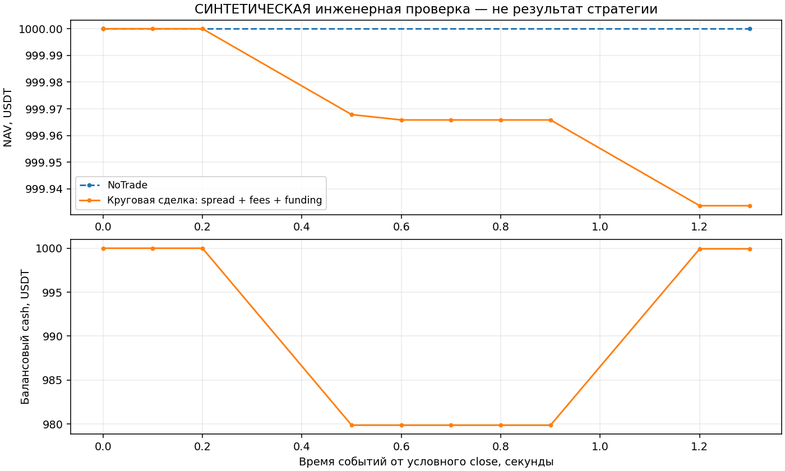

# Compact IOC: инженерный результат, 8 октября 2026

Реализован отдельный ограниченный offline execution kernel. Это не запуск
collector, не обучение и не исторический тест финансовой стратегии.

## Результаты

37 из 37 явных unittest прошли; дополнительно сохранены 8 синтетических
сценариев. Проверены post-close availability и latency, свежесть и clocks
книги, qty/price grid, minimums, защищённая цена, shared liquidity, partial IOC,
отмена остатка, expiry, cash и reduce-only reserves, signed funding,
drawdown-блок новых buys и deterministic checkpoint restore.

При неизменном mark 100 круговая сделка qty 0.201:
buy 100.1 → sell 99.9; начальный NAV 1000 USDT, итог 999.93367000.
Spread = 0.0402 USDT; fees = 0.02412000; funding debit = 0.0020100.
Итог точно равен `1000 − spread − fees − funding`; позиция закрыта.
NoTrade остаётся 1000. Это ожидаемый убыток от издержек без alpha,
а не сравнение торговых моделей. Возобновлённый результат побитово по
каноническому JSON совпадает с непрерывным.

Нижний график показывает балансовый cash. Для доступного cash необходимо
дополнительно вычесть резервы открытых buy IOC; резервы уже контролируются
ядром. Подпись «Свободный cash» в первоначальной иллюстрации была неточной.
Исходная иллюстрация и evidence не переписаны; этот view исправляет только
подпись и пояснение, без перерасчёта ledger или изменения результата.

## Ограничения и следующий шаг

Старое исполнение на next-4h-open и новый post-close clock несовместимы:
старые labels и model hashes нельзя считать заново квалифицированными.
Прочитан лишь provenance одного frozen linear origin; inference и fitting
не выполнялись. Параметры latency/participation/risk пока инженерные примеры.
Верификация реальных fills, margin/liquidation и production adapter отсутствует.

Следующий финансовый шаг требует нового target-clock/label контракта и
исторического L2 с receive/exchange clocks и корректным восстановлением
книги, доказанных rules/fees и observed funding marks за весь интервал.
До этого август–сентябрь не пересчитывается; старые прибыльности и LCB
не меняются. Синтетические volumes не заменяют настоящую ликвидность.

Источники и artifacts сверены с исходным receipt: 10 source hashes и 9
artifact hashes. Новый view привязан к первоначальному manifest отдельным
manifest. Новых fits, market replays и network requests: 0. Все девять
authority/safety flags false; реальные торги и paper не включены.
