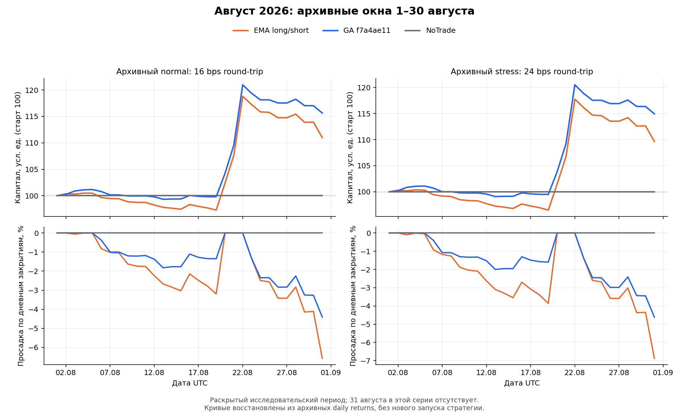
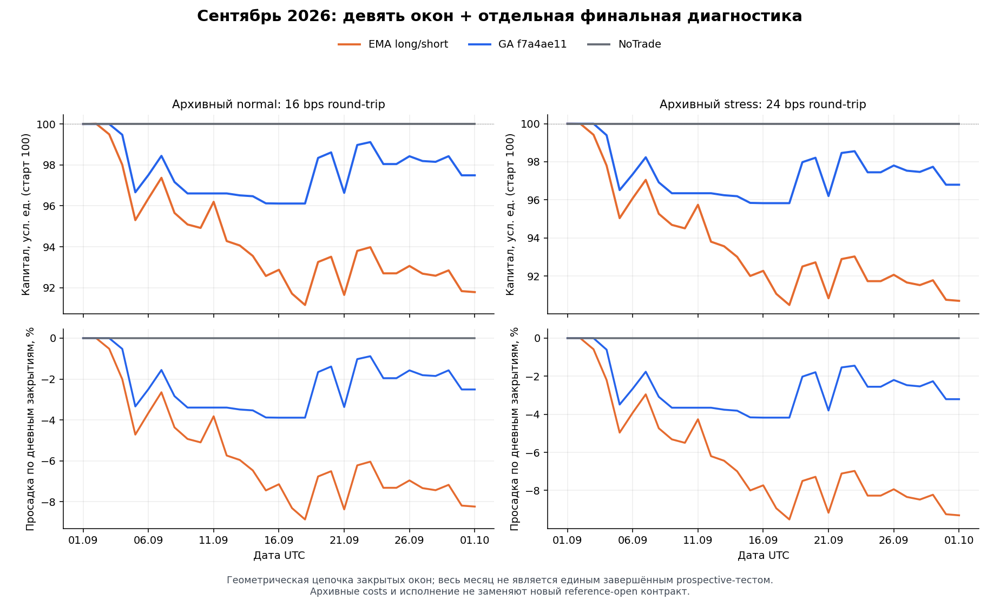
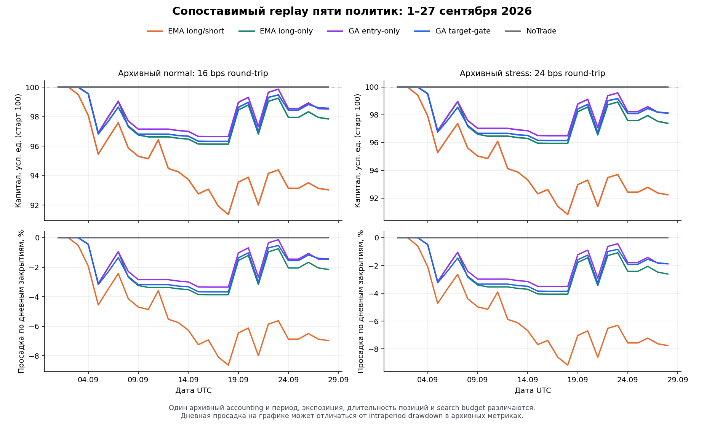

# Genetic Primus: аудит разработки и план следующей исследовательской версии

Дата: 7 октября 2026 года. Цель пользователя: максимизировать прибыль, допуская просадку. Заданный период ретровалидации: август–сентябрь 2026 года.

## 1. Вывод для принятия решения

Главное ограничение проекта — разрыв между несколькими исследовательскими контурами. Старые модели имеют результаты обучения и торговли, но используют различающиеся labels, accounting, границы позиций и правила отбора. Новый причинный контур уже проверяет происхождение данных, timestamps и gross-labels, однако до обучения по экономически согласованной схеме ещё не доведён. Увеличение сети или количества поколений сейчас не устраняет этот разрыв.

В архиве есть сильный августовский эпизод: frozen GA-overlay дал +15,645% при архивных normal costs. В сентябрьской описательной цепочке эта же семья закончила с −2,508%. В отдельном сопоставимом replay пяти политик за 1–27 сентября лучшим остаётся NoTrade. GA уменьшает потери EMA, но его дополнительное преимущество после выравнивания экспозиции и длительности эпизодов не подтверждено.

Следующую версию следует строить вокруг одного непрерывного ledger и одного причинного rolling evaluator. На этой основе сравнить простую линейную модель, малую нейросеть и затем ограниченный GA. Целевую функцию разделить на прогноз, экономический выбор действий и независимую проверку устойчивости. Прибыль оптимизировать на общем капитале; просадку задавать явным ограничением.

**В этой работе выполнен аудит и построены графики по существующим результатам. Нового обучения и новых торговых backtests не было.** Проверены 50 конкретных исходных файлов; их byte identities сохранены в `evidence_receipt.json`. Старые длительные задачи не перечитывались, collector/runtime не запускались.

## 2. Что показывают существующие результаты

### 2.1. Август: положительный эпизод, раскрытый исследовательский период

Период архивной серии: `[2026-08-01, 2026-08-31)`, то есть 30 дней. 31 августа в эту серию не входит. Восстановление equity из daily returns точно совпало с итоговыми значениями архивного summary.

| Политика | Normal net, % | Stress net, % | Статус результата |
|---|---:|---:|---|
| GA overlay f7a4ae11 | +15,6450 | +14,9313 | Раскрытая диагностика, не независимый отбор победителя |
| EMA TrendConsensus | +11,0010 | +9,6560 | Та же архивная схема и период |
| NoTrade | 0 | 0 | Контроль cash |



Начальный капитал нормирован к 100 условным единицам. Costs 16/24 bps round-trip относятся к архивной схеме; эти числа не объявляются измеренными costs нового evaluator.

Дополнительная проверка концентрации: два крупнейших положительных дневных log-return GA, 20 и 21 августа, дали **102,57%** суммарного log-роста за период. Геометрический вклад остальных дней составил **−0,3723%**. Это атрибуция сохранённого ряда, а не контрфактический replay с удалёнными сделками. Она показывает необходимость проверки концентрации прибыли по окнам; сама по себе не доказывает ошибку данных или невозможность торговать редкие сильные движения.

Источник: `revealed_august_diagnostic_v1_20260904/summary.json` и десять `origin_NN.json`.

### 2.2. Сентябрь: девять окон и отдельная завершающая диагностика

Период: `[2026-09-01, 2026-10-01)`. Последнее окно добавлено отдельным post-period diagnostic. В исходном summary прямо записано `prospective_validation_complete=false` и `promotion_gate_evaluated=false`.

| Политика | Normal net, % | Stress net, % |
|---|---:|---:|
| NoTrade | 0 | 0 |
| GA overlay f7a4ae11 | −2,5075 | −3,2052 |
| EMA TrendConsensus | −8,2186 | −9,3054 |



Это геометрическая цепочка закрытых окон. Она полезна для диагностики переносимости августовского результата, но не заменяет единый непрерывный портфельный replay и не превращает все десять окон в завершённый prospective-протокол.

Источник: `prospective_3d_v1_202609/origin_01.json` … `origin_09.json`, `september_final_diagnostic_20261001/origin_10_diagnostic.json`, `verification_and_summary.json`.

### 2.3. Пять политик в одном сентябрьском accounting

Период: `[2026-09-01, 2026-09-28)`, 27 дней. Здесь можно ранжировать terminal net в пределах одной реализации accounting. Экспозиция, длительность позиций и бюджет поиска при этом ещё не уравнены.

| Место | Политика | Normal net, % | Stress net, % | Архивный max DD, % | Сделки |
|---:|---|---:|---:|---:|---:|
| 1 | NoTrade | 0 | 0 | 0 | 0 |
| 2 | GA target-gate | −1,4301 | −1,8719 | 4,0467 | 45 |
| 3 | GA entry-only | −1,4801 | −1,8811 | 3,7228 | 41 |
| 4 | EMA long-only | −2,1519 | −2,6163 | 4,2349 | 48 |
| 5 | EMA long/short | −6,9576 | −7,7631 | 8,8679 | 87 |



Просадка на графиках рассчитана по дневным закрытиям и может быть меньше intraperiod DD из таблицы. Для нового evaluator обязательна equity на каждом 4h mark; дневные картинки будут только представлением более подробного ledger.

Источник: `baseline_economics_audit_v1_20261002/result.json`. Все пять terminal returns восстановлены из архивных daily returns с совпадением до вычислительной точности.

Архивы августа, сентябрьская цепочка и сентябрьский непрерывный replay **не сшиты в одну линию капитала**: различаются границы, accounting и непрерывность позиций. В новом benchmark эта проблема должна быть устранена.

## 3. Путь разработки и проверенные гипотезы

| Этап / гипотеза | Сохранённое свидетельство | Вывод для следующей версии |
|---|---|---|
| V1–V3: эволюция полной торговой политики, больше поколений | V3 development: около +62,86 bps/trade; validation: около −13,46 bps/trade, отрицательный LCB | Сильная подгонка development. Эти числа взяты из предыдущего аудита; новый пересчёт V3 не выполнялся |
| V4: уменьшенная MLP | Manifest `compact_16_8`: 30 входов, 16/8 hidden, 3 выхода, 659 параметров. Strict mean +14,5997 bps/day, LCB −0,6205, DD 53,9110% | Среднего положительного результата недостаточно. Риск и устойчивость не проходят |
| V6/V7: замороженные редкие event thresholds | В прежнем аудите зафиксировано отсутствие достаточной event capacity | Не компенсировать малое число возможностей принудительным увеличением trades |
| V8 Clean | Collector/status/supervisor и локальные safeguards; crash-root исключён из prospective evidence | Это инженерный сборочный контур, а не доказанный новый learner |
| Rolling, purge, common bootstrap, audit bank | Реализованы отдельные модули и последующие проверки причинности | Сохранить и подключить к единому evaluator; наличие модулей не доказывает их применение во всех старых запусках |
| Weekly matrix: expanding/rolling и half-life | Предыдущий аудит: пять ячеек без положительного audit/stress LCB и без promotion passes | Recency этой реализации не доказана; повторять широкую матрицу сейчас не нужно |
| Sparse binary overlay вместо полной стратегии | Frozen f7a4ae11: четыре legacy features, пять коэффициентов, три ненулевых | Хороший компактный контроль; снижение оборота ещё не означает дополнительный predictive edge |
| Августовский успех overlay | +15,645% normal, но paired HAC LCB vs EMA отрицательный; сильная концентрация на двух днях | Проверять зависимость от режима и отдельных окон |
| Warm-start | 10 origins, 240 evaluations warm и 240 cold суммарно; 9 совпадающих winners; 0 screen passes | Warm-start — инструмент эффективности/стабильности, не подтверждённый источник alpha |
| Entry-only вместо target-gate | В общем сентябрьском replay результаты близки, обе политики отрицательны | Правило выхода связано с фильтром входа; его нельзя менять незаметно |
| GA действительно выбирает лучшие episodes | Attribution v3: 16 контролей, 15 различных target-путей; GA лучше одного контроля, normal paired LCB около −5,20 bps/day | Преимущество отбора не подтверждено. Контроли сильно ограничены совпадающей геометрией; это не универсальное опровержение GA |
| Ridge uniform против half-life 90d | Четыре arms, winner=None, validation=None. Uniform: −8,506% / −7,971% normal для 2/4 features; half-life: 0 сделок, 0 return | Recency дала abstention, а не прибыль. Период training screen — 20×3 дня с 1 июня, фактически июнь–июль, а не один июнь |
| Relative momentum | Предыдущий аудит: отрицательные normal/stress и LCB на development screen | Обязательный простой контроль, но готового устойчивого победителя нет |
| Market-relative reversal | Последний пилот: 20 origins / 60 дней, 36 cash days, normal −2,0830%. Отрицательный slope ограничен `min(0, …)`; архивный аудит сообщает нулевой slope на всех origins | Знак был гипотезой. Нулевая slope превращает модель в intercept и меняет смысл торгов; фиксированную sign-constraint нельзя считать найденным сигналом |
| Причинный data/label/accounting путь октября | 82 800 OHLCV-строк → 4 592 feature rows → 4 568 gross samples → 4 568 заблокированных net-inputs | Причинность и lineage стали лучше, но net target values=0, новых fits=0 |

Отрицательные результаты относятся к конкретным реализациям, данным и бюджетам. Они не доказывают, что recency, neural models или genetic search бесполезны вообще. Повторять их следует только после изменения проверяемой причины, а не после очередного увеличения search budget.

### Важная тонкость исходных метрик

У V4 в manifest первоначальный overall LCB +0,3856 bps/day, а в `strict_base16_metrics.json` он уже −0,6205. Для вывода использован strict-результат. Это наглядный пример, почему ranking нельзя собирать из максимальных чисел разных audit banks.

Аудит accounting от 5 октября пометил 100 arithmetic checks как consistent, 15 как unknown, но **ни одной** выбранной оценки не квалифицировал как strict historical accounting verified в исходном контексте. Это ограничение происхождения/семантики исторических запусков, а не заявление, что все их числа неверны.

## 4. Как изменения взаимодействуют и где возникают ошибки

### 4.1. Цепочка, которую нужно зафиксировать целиком

```text
Immutable market snapshot + availability
    → feature snapshot с as-of и schema
    → mature labels / train cutoff / purge
    → scaler + fit на каждом 3-дневном origin
    → прогноз + состояние текущей позиции + costs
    → target allocation / abstention / hysteresis
    → единый cash/quantity/funding ledger
    → equity, drawdown, exposure, turnover
    → inner fitness / выбор кандидата
    → отдельная ретровалидация и audit bank
```

Если изменить один элемент, нужно определить, какие downstream результаты становятся несопоставимыми. Например, перенос entry на следующий open меняет target, доступность labels, стоимость входа, holding interval и финальные метрики. Старый scaler/model не получает новый смысл автоматически.

### 4.2. Конкретные проблемы по коду и артефактам

| Приоритет | Наблюдение | Последствие | Исправление |
|---|---|---|---|
| P0 | `fitness_v4.py:381–382` добавляет evidence/concentration priorities, а ветка `:496` заново создаёт `ranking_key` без них. `rolling_v4.py:382` добавляет `minimum_allowed_fraction=0`, активируя constrained branch | Ограничения сохраняются в failed_gates, но их прежний приоритет отбора теряется. Это проблема search ranking, не доказанный обход final promotion gate | Один builder eligibility/ranking; regression на конфликтующих кандидатах |
| P0 | Evolution сравнивает `ranking_key`; `fitness` расположен после нескольких вещественных LCB | Штрафы, попавшие только в scalar fitness, часто действуют лишь при точном равенстве более ранних полей | Один экономический score после hard feasibility; явная процедура parsimony, а не случайный tie-break |
| P0 | Legacy ridge v2 прогнозирует `gross_open_to_last_close`; новый dataset — следующий open → open через 18 баров | Оценки прогноза, thresholds и исполнения относятся к разным задачам | Versioned target schema; не переносить weights/результаты без нового fit |
| P0 | Новый accounting — изолированный Long/NoTrade interval; legacy v2 учитывает transition costs при сохранении позиции | Принудительный round-trip каждые 3 дня и carry-through policy имеют разный turnover/costs | Сначала выбрать семантику позиции и реализовать все state transitions |
| P0 | 4 568 новых labels подготовлены для одного контекста с origin 22 сентября и cutoff 20 сентября 16:00 UTC | Их нельзя целиком подать в fit для августовских origins: часть labels тогда ещё не была известна | Per-origin admission по зависимостям/as-of, заново выбранная общая 3-дневная сетка |
| P0 | Новые feature samples имеют 2 признака, frozen GA ожидает 4, предлагаемый learner — 6 | Ошибки порядка, значения и scaler возможны даже при совпадающей форме массива | Именованные FeatureView и SHA schema, жёсткая проверка совместимости |
| P0 | Costs/funding/borrow/reference-to-fill не зарегистрированы; текущие net targets None | Новый математически причинный контур пока не задаёт экономическую задачу обучения | Одна конкретная cost-регистрация с provenance и разделением measured/assumed |
| P1 | GA сравнивался с EMA при разной экспозиции/числе эпизодов | Снижение убытка может объясняться большим cash weight | Exposure/duration/turnover-matched controls и простой risk-scaled EMA |
| P1 | Восемь symbols коррелированы, windows и search trials зависимы | Row count и число seeds завышают представление о количестве независимой информации | Resampling целых временных блоков full8, ESS по origins/calendar time |
| P1 | Recency, abstention thresholds, sparsity и fees изменялись совместно | Нельзя приписать итог одному компоненту | Сначала coherent base, затем короткие paired ablations |
| P1 | Август/сентябрь много раз раскрывались; global historical trial count не восстановлен полностью | Обычный nominal LCB не учитывает весь researcher selection | Маркировать revealed benchmark; новый prospective выбирать отдельно |
| P1 | Множество frozen wrappers/receipts не соединены в один market fit/evaluate путь | Возникает цикл «новый guard → новый draft → следующий guard» без экономического эксперимента | Закончить один вертикальный workflow и проверять критерий готовности end-to-end |

Lookback `return_12` при target в 18 баров сам по себе не является утечкой или ошибкой: длина feature history может отличаться от горизонта прогноза. Ошибка возникает, когда фактический entry/exit target не совпадает с обещанным горизонтом или с исполнением.

### 4.3. Что сохраняем из уже проделанной работы

Сохраняем source hashes, final-snapshot disclosure, полный учёт отрицательных/нулевых outcomes, строгий next-open сценарий, purge 7, common bootstrap, независимый audit bank, NoTrade, модель/scaler identity и short-command workflow. Завершённые evidence artifacts остаются неизменными.

Для новых runs code provenance следует привязывать к immutable source snapshot/commit и manifest DAG. Проверка старых результатов должна читать их закреплённые версии, а не требовать вечной неизменности общего рабочего дерева. Увеличивать cap цепочки receipts вместо упрощения зависимостей — плохая долгосрочная архитектура.

## 5. Новая постановка цели и fitness

### 5.1. Экономическая цель

Для фиксированного периода и одинакового стартового капитала максимизация terminal net wealth эквивалентна максимизации суммарного log-роста:

$$g = \frac{1}{T}\sum_{t=1}^{T}\log\left(\frac{E_t}{E_{t-1}}\right).$$

Здесь E — общая mark-to-market equity после costs, T — календарные дни, включая дни cash. Дневной return измеряется на portfolio capital, не на notional выбранных сделок.

Риск задаётся ограничениями:

$$\max g_{normal},\qquad MDD\le D,\quad\sum_i|w_i|\le1,$$

плюс ограничения на концентрацию, ликвидность/оборот и корректность accounting. Отрицательный капитал, нечисловые значения, нарушение причинности и неверная сверка ledger — безусловный reject.

Пользователь допускает просадку, но численное D ещё не выбрано. Для **ретроисследования** следует показать три заранее заданных risk budgets: 10%, 20%, 30%, и Pareto frontier «прибыль—просадка». Это варианты анализа, не разрешение рисковать реальными деньгами. Масштабирование риска рассчитывается причинно на прошлых данных; нельзя задним числом нормировать каждую августовскую equity под желаемый DD.

### 5.2. Разделить три разные оптимизации

1. **Forecast fit:** регуляризованный прогноз будущего 3-дневного изменения цены/экономического outcome; loss сохраняет все исходы. Huber/ridge — базовые кандидаты. Gross forecast head допустим как компонент нового явно зарегистрированного predictor→net-policy дизайна; качество торгов оценивается только через net ledger. Старые draft-запреты не снимаются задним числом.
2. **Policy fitness:** net log-growth на причинных inner walk-forward predictions при заданном risk budget и общих costs. Здесь учитываются реальный turnover, carry и funding.
3. **Validation/admission:** paired net differences, block-bootstrap LCB, stress, temporal stability, drawdown, concentration и audit bank. Эти проверки не должны по много раз превращаться в почти одинаковые штрафы внутри search.

Внутри допустимых кандидатов нужен один явно определённый economic ranking. Если scores статистически неразличимы на inner data, применять заранее заданное one-standard-error правило в пользу меньшей модели и меньшего turnover. Complexity должна также действовать через ограничение архитектуры, L1/L2 и feature selection. Располагать её только после нескольких float LCB в tuple недостаточно.

Издержки уже уменьшают net wealth. Дополнительный штраф за turnover вводить только для отдельного operational/capacity ограничения и с понятными units, иначе комиссия учитывается дважды. Отказаться от требования положительного результата каждого маленького fold: оно смешивает малую мощность с отсутствием сигнала. Вместо этого показывать распределение folds, худшее окно, CVaR и концентрацию, сохраняя общий risk limit.

### 5.3. Recency как контролируемая гипотеза

В первом цикле оставить только **uniform** и **half-life 90 дней + 20% uniform anchor**. Остальные half-lives и rolling-window варианты пока не добавлять.

$$w_t=\frac{0.2}{N}+0.8\frac{\exp(-\ln(2)\,age_t/90)}{\sum_j\exp(-\ln(2)\,age_j/90)}.$$

Вес применяется ко всем исходам. Age отсчитывается от текущего train cutoff, а не от конца всего benchmark. В full8 один временной origin сначала получает общий вес, затем вес распределяется между доступными symbols. Отдельно считать ESS по временным origins:

$$N_{eff}=\frac{(\sum_t w_t)^2}{\sum_t w_t^2}.$$

Так восемь одновременных рядов не маскируют дефицит временной поддержки. На отчётной август–сентябрьской equity recency weights не применяются: все календарные дни отражаются с фактическими денежными изменениями.

### 5.4. Abstention и paired incremental return

NoTrade сохраняется как нулевой economic baseline. Его нельзя заставлять совершать trades ради прохождения minimum-trades gate. Minimum opportunities/ESS определяют возможность оценить модель; realized trades и coverage — отдельные диагностические поля. Cash-policy не считается доказанной alpha-моделью.

Для overlay нужны два сравнения: с NoTrade и с базовой политикой **при сопоставимом риске/экспозиции**. Paired incremental return считается на совпадающих timestamps, одном капитале, одном ledger и одних resample blocks. Положительное отличие от убыточной EMA недостаточно для заявленной цели.

## 6. Архитектура моделей следующего цикла

### 6.1. Общий причинный FeatureStore

Один производитель snapshots, несколько именованных views:

- `legacy_overlay_4`: EMA gap 12/48, EMA slope 12/3, return_12, efficiency_12 — для корректного контроля frozen GA.
- `linear_current_2`: прежние return_12 и efficiency_12 — для проверки эффекта инфраструктурных изменений.
- `forecast_vnext_6`: distance to EMA48, прошлый return_18, efficiency_18, relative return_18 к full8, volatility_48, market breadth относительно EMA48.

Все значения доступны только по завершённым барам. Cross-sectional features используют одну и ту же as-of выборку; отсутствующий symbol не заменяется информацией из будущего. EMA и rolling state имеют общий warmup и закреплённое начало истории. Feature lookbacks, clipping и политика пропусков фиксируются до августовского replay.

Для нового шестипризнакового view нужна история минимум 48 баров; текущего 13-барного хвоста недостаточно для всех новых статистик. Scaler median/IQR переобучается на каждом origin по разрешённым training rows, clipping фиксирован заранее. Feature names/order, scaler, train cutoff, objective и weights входят в model SHA.

### 6.2. Лестница сложности

| Кандидат | Архитектура | Обучаемые параметры | Роль |
|---|---|---:|---|
| NoTrade | Cash | 0 | Economic baseline |
| Fixed EMA long-only / legacy long-short | Замороженные правила | 0 fitted weights | Проверка, есть ли выигрыш у обучения |
| Frozen GA f7a4ae11 | 4→1 linear allow | 5 stored, 3 nonzero | Legacy challenger, без ретюнинга |
| Linear-2 | 2→1 ridge/Huber | 3 | Минимальный мост от текущих samples |
| Linear-6 | 6→1 ridge/elastic regularization | 7 | Основной статистический baseline |
| MLP-8 | 6→8 tanh→1 linear | **65** | Единственная новая нелинейная архитектура первого цикла |

Для MLP: 6×8 + 8 bias + 8×1 + 1 bias = 65. Без symbol embeddings, дополнительных hidden layers, attention и recurrent state в первом цикле. Начать с small initialized weights, L2 и early stopping только по прошлому chronological inner block. Batch sampling/group weighting учитывает origin, а не выдаёт восемь correlated symbols за восемь независимых экспериментов.

Достаточно трёх заранее фиксированных seeds. Их используют для проверки устойчивости и заранее определённого ensemble среднего прогноза, а не для выбора удачного seed по августу–сентябрю. Три сети по 65 параметров — 195 stored weights; seeds не являются независимыми рыночными наблюдениями.

Двухголовая 6→8→2 сеть имела бы 74 параметра; её можно рассмотреть позднее для mean/downside decomposition, если single-head модель покажет сигнал. TCN/LSTM/Transformer пока отложить: обоснования для большей capacity и достаточного effective sample size нет.

### 6.3. Роль GA

GA подключать после появления устойчивого экономического сигнала простой модели на pre-August inner data. Сначала использовать его для ограниченного выбора feature mask, entry buffer/hysteresis и небольшого набора regularization settings; коэффициенты линейного predictor получать устойчивым fit. Эволюция всех весов большой сети не является первым кандидатом.

Контроль — random search по тому же пространству с тем же числом уникальных objective evaluations. Считать также model fits, gradient steps, wall time и cache hits: равные слова «одно обучение» не означают равный бюджет.

Предлагаемый верхний budget отдельного GA-этапа: 3 islands × 8 genomes, до 5 обновлений, **не более 144 objective queries на origin вместе с финальными оценками**; при исчерпании общего cap поколение сокращается. 25% immigrants, часть стартовой популяции от incumbent, остальная — независимые starts. Exact budget и распределение ensemble queries фиксируются до запуска. Это отдельный будущий budget, выше архивного warm-start опыта; автоматического расширения при отрицательном результате нет.

Сначала сравнить одиночный кандидат и заранее определённый top-3 ensemble разных seeds/islands. Top-5 не добавлять одновременно: это ещё одна гипотеза. Functional drift проверять на фиксированной причинно доступной reference panel, отдельно от движения scaler и частоты actions.

## 7. Единый август–сентябрьский протокол

### 7.1. Даты, данные и исследовательский статус

Основной отчётный интервал: `[2026-08-01 00:00 UTC, 2026-10-01 00:00 UTC)`, 61 календарный день. Это **revealed retrospective benchmark**: месяцы уже использовались для сравнения и диагностики. У будущего walk-forward может быть корректная временная причинность, но исследовательская независимость периода от выбора гипотез уже потеряна.

Последний общий 11-source manifest покрывает данные до 28 сентября exclusive. Локально уже существует хвост 28–30 сентября: `Retrodate/genetic_primus_v8_clean_ohlcv_final_20260928_20260930/derived_v1/origin_10_240m.parquet`, 144 rows по metadata, до 1 октября exclusive. Он также использован отдельной архивной финальной диагностикой. Нужен новый объединённый manifest и полная проверка стыков, а не повторное скачивание. В этом аудите читались только metadata хвоста, raw prices не открывались.

Проверить full8 universe, UTC grid, gaps/duplicates, source_rows, OHLCV envelope, continuity на стыках, аномальные price jumps и согласованность 1m→4h там, где 1m доступен. Не удалять экстремальные свечи только за большой PnL: сначала проверить источник.

### 7.2. Rolling execution и граница конца периода

Rebalance/retrain cadence — 3 дня. Начало сетки фиксировать на 1 августа; timestamps всех training opportunities и deployment origins входят в manifest. Current Sep22-anchored samples автоматически не становятся готовым rolling dataset для этой сетки.

Для совместимости с подтверждённым правилом «entry на следующем 4h open, exit через 18 баров» первичный closed-window benchmark содержит **20 полных origins**: 1 августа, 4 августа, …, 27 сентября. Последний entry — 27 сентября 04:00, exit — 30 сентября 04:00; выходная строка доступна после 08:00. Equity отчёт продолжается до 1 октября, остаток периода — cash. Origin 30 сентября не открывается в этой первичной версии: его полный exit был бы уже 3 октября.

Отдельная carry-through версия может использовать те же rebalance boundaries и переносить позицию при неизменном target. Это изменение execution semantics, которое нужно зарегистрировать как отдельную paired ablation. Для origin 30 сентября потребуются данные до его полного выхода в октябре либо заранее определённый mark-to-market terminal report; нельзя незаметно заменить трёхдневную сделку однодневной.

### 7.3. Training и calibration

- Для каждого origin использовать только данные, доступные к его train as-of. Сохранить train as-of = origin−1 bar и purge 7 по зарегистрированной availability semantics.
- Label maturity должна учитывать все зависимости, включая costs/funding arrivals, когда они будут добавлены. Поздно поступивший funding нельзя считать известным только потому, что закрылся exit bar.
- Initial fit и выбор архитектуры/thresholds — на данных до 1 августа. Chronological inner walk-forward блоки взять из pre-August истории, включая разные месяцы 2026 года; все calendar cuts перечислить в manifest.
- В ходе августа–сентября новый fit каждые 3 дня может включать уже созревшие предыдущие outcomes. Правило обновления, гиперпараметры и критерии отбора остаются замороженными.
- Сравнение uniform/HL90 выполняется на совпадающих origins, features, costs и seeds. Scaler считается заново из допустимых данных, независимо для каждой зарегистрированной training policy.
- Для MLP early stopping и выбора regularization используются только прошлые inner blocks. Август–сентябрь не участвует в early stopping, ручном подборе thresholds или выборе лучшего seed.

### 7.4. Обязательные baselines и fairness

NoTrade, фиксированный long-only EMA, legacy long/short EMA, frozen GA, simple time-series momentum, simple mean-reversion и равновесный full8 buy/hold как измеритель market beta. Definitions фиксируются до replay; noisy return_1 baselines полезны как sanity controls, а не как рекомендованные стратегии.

Для обучаемых моделей нужны дополнительные controls: простой risk-scaled EMA, случайное thinning с совпадающей экспозицией/длительностью/оборотом, random search с тем же budget для GA. Сравнивать и raw candidate path, и path с зарегистрированным deployment fallback в cash: иначе gate, переводящий всё в NoTrade, скрывает свойства learner.

Первую новую вертикаль строить для Long/cash, как нынешний reference-open kernel. Legacy long/short EMA пока остаётся отдельным архивным контролем. Для включения её в **общий новый** ranking нужно сначала реализовать Short accounting, signed funding и все переходы между Flat/Long/Short в том же ledger. Short-вариант обучаемой политики — отдельная зарегистрированная ablation; отрицательный прогноз нельзя автоматически объявить готовой short-стратегией. Mean-reversion первого цикла определить как long-only возврат после падения, чтобы не скрывать смену execution domain.

## 8. План работ с завершёнными результатами каждого этапа

### Ограниченная матрица первого цикла

До открытия нового benchmark зафиксировать пять fitted arms: Linear-2 uniform, Linear-6 uniform, Linear-6 HL90, MLP-8 uniform, MLP-8 HL90. Fixed baselines не участвуют в подборе весов. Для первого цикла выбрать weighted squared-error fit с L2; Huber оставить отдельной последующей гипотезой, поскольку робастная loss способна подавлять редкие большие outcomes, существенные для прибыли.

Предлагаемый небольшой pre-August grid L2: `0.0001 / 0.001 / 0.01` при loss, нормированной на сумму sample weights, и target, масштабированном по **training-only** mean/std. Это параметры предстоящего инженерного дизайна, не найденные optimums. Target scaler входит в model SHA и инвертируется перед economic decision. Bias не штрафуется. Для MLP: fixed learning rate 0.001, максимум 120 epochs, patience 12 на прошлом chronological block; batch объединяет целые origin-группы. Конкретную реализацию использовать на CPU с одним worker; новые тяжёлые зависимости для сети на 65 параметров не нужны.

Inner model-selection blocks: март, апрель, май и июнь 2026; финальная pre-August calibration — июль. В каждом блоке используются только полные outcomes, доступные к его концу, с отдельным purge training rows. Поздний июльский origin, чей exit попадает в август, не участвует в pre-August выборе. Историческая основа fit начинается в 2022 году и заканчивается на cutoff соответствующего origin.

После выбора regularization по inner blocks она фиксируется; outer retrain обновляет scaler/weights, но не перебирает grid по августовскому/сентябрьскому результату. Для 20 outer origins это **60 deterministic linear fits** и **120 neural fits** (две arms × три seeds × 20), если все arms допущены по технической готовности. Normal/stress и три risk budgets используют те же forecasts и не вызывают дополнительные fits. Inner fits и policy evaluations учитываются отдельно в registry. GA в эти 180 fits не включён и активируется отдельным этапом после сигнала на pre-August данных.

В ensemble три seeds считаются тремя fitted models, а не тремя независимыми доказательствами alpha. Число 65 обозначает trainable network weights; отдельно в manifest указываются fitted feature/target scaler statistics. Legacy frozen GA должен явно сообщать, заморожен ли scaler: августовские архивы меняли scaler между origins и имели разные полные model SHA при одинаковом genome.

### Этап 0. Зафиксировать один benchmark и экономический контракт

**Работа:** объединить source manifest до 1 октября, закрепить timestamps/FeatureViews/holding semantics, нормализацию капитала и allocation budget; найти локальные источники комиссий, funding/marks и execution calibration. Исторические 16/24 bps оставить только в compatibility replay. Если измеренных данных недостаточно, оформить отдельную явно условную engineering-cost регистрацию и пометить все её результаты соответствующим образом.

**Выход:** один versioned experiment manifest с заполненными полями для конкретного запуска, source inventory, список измеренных и assumed inputs. Не создавать ещё один разрешающий draft с неизвестными costs. Цель: сделать следующий расчёт исполнимым и проверяемым.

**Приёмка:** coverage всего периода, hashes совпадают, cost units и капитал однозначны, все 20 origins перечислены, ни один необходимый input не берётся из будущего. Неизвестная информация отмечена конкретным блокером/сценарием, а не скрытым default.

### Этап 1. Завершить непрерывный accounting

**Работа:** расширить проверенную reference-open математику общим portfolio ledger; реализовать Flat→Flat, Flat→Long, Long→Long, Long→Flat, entry/exit fees, cash reserve, funding, marks, terminal policy. Сначала closed-window variant, затем отдельно carry-through ablation. Лимит full8 gross exposure ≤1; капитал не размножается по symbols.

**Выход:** один evaluator для всех baselines и learners, ledger на каждом 4h mark, разложение gross/fees/price drag/funding/borrow, модельное состояние и reason codes.

**Приёмка:** cash+position value=equity; accounting attribution согласуется с cash flow; NoTrade сохраняет капитал; перенос Long→Long не создаёт фиктивную пару orders; полный replay и пошаговое resume дают одинаковый результат.

### Этап 2. Собрать причинный fit→decision путь

**Работа:** FeatureStore с legacy/current/new views, per-origin admission, scaler fit, model fit, запись decision/model SHA и состояния позиции. Использовать текущие verified data/label helpers как основу, но пересчитывать cutoff каждого origin.

**Выход:** один origin из уже раскрытого периода, который проходит весь путь до equity и отчёта. Затем шесть последовательных origins, затем весь benchmark.

**Приёмка:** изменение будущих строк не меняет прошлые scalers, models и decisions; same seed+inputs воспроизводимы; label availability и purge соблюдены для каждой training row; model SHA включает scaler и feature schema. Статус «модель обучена» ставится только при реальном fit и сохранённых weights.

### Этап 3. Исправить fitness/ranking и сопоставить baselines

**Работа:** один hard-feasibility builder, один economic score, единый набор units; исправить потерю evidence/concentration priorities; убрать дублирование costs/penalties. Добавить простую явную процедуру parsimony. Пересчитать все baselines на одном evaluator.

**Выход:** baseline report с equity, DD, exposure, turnover и attribution за весь период; контроль, что лучший по score не нарушает более раннее hard-ограничение.

**Приёмка:** crafted кандидат с лучшим LCB, но нарушенным hard gate, не обходит допустимого кандидата; изменение complexity имеет предусмотренный эффект; отсутствие trades не превращается в фиктивную alpha-победу.

### Этап 4. Проверить линейный сигнал и recency

**Работа:** Linear-2 как compatibility control; Linear-6 uniform и Linear-6 HL90+20% anchor. Архитектуры/regularization выбрать по pre-August inner folds. Дать вес всем исходам. Отдельно проверить влияние EMA proposal filter: такой фильтр исключает часть доступного рынку пространства и не должен быть скрытым условием всех learners.

**Выход:** paired ablation: эффект FeatureView, эффект weighting, raw predictions, realized calibration по quantiles, economic score и risk metrics.

**Приёмка:** эффект не объясняется только уменьшением exposure/turnover, избранными symbols или двумя лучшими днями; результаты не разваливаются при заранее заданном stress. При отсутствии сигнала перейти к анализу features/target, не расширять GA.

### Этап 5. Добавить одну малую нейросеть

**Работа:** MLP 6→8→1, 65 параметров; 3 фиксированных seeds; та же выборка, same costs, те же folds, ограниченный regularization/early-stop budget. Uniform/HL90 — только две заранее объявленные arms, если budget допускает обе; не добавлять скрыто новые sizes.

**Выход:** сравнение Linear-6 и MLP-8 на идентичных forecast→policy условиях, ensemble-проверка по заранее фиксированному правилу, parameter/compute accounting.

**Приёмка:** gain больше разброса seeds и не создаётся дополнительным tuning budget; улучшение сохраняется на paired inner checks и audit bank. Если MLP не выигрывает, использовать линейную модель.

### Этап 6. Проверить полезность GA

**Работа:** после pre-August signal gate ограниченный GA структуры/thresholds, islands/immigrants/warm-start с зарегистрированным cap. Random search — равнобюджетный контроль. Ensemble — отдельные учтённые evaluations.

**Выход:** attribution улучшения GA: выбор признаков, forecast quality, abstention, exposure, duration и turnover. Registry содержит все попытки и ошибки, а не только winners.

**Приёмка:** GA добавляет paired net benefit к простой модели и random search при сопоставимом риске; иначе genetic search остаётся отключённым компонентом.

### Этап 7. Один замороженный август–сентябрьский replay

**Работа:** выполнить полный 61-дневный отчётный период по зафиксированному протоколу; расчёт по одному origin за короткую команду, workers=1, без фоновых процессов и collector. Повтор после исправления бага маркируется новой engineering revision; исходный run сохраняется.

**Выход:** единый отчёт по всем политикам, месячные и 3-дневные breakdowns, normal/stress, risk-budget frontier. После открытия результатов параметры этого benchmark не подгоняются с повторным заявлением о независимой валидации.

**Приёмка:** весь период покрыт, все origins завершены/явно объяснены, ledger сверяется с terminal wealth, графики обязательны даже при убытке/нулевых trades. В отчёте отдельно raw challenger и admitted deployment path.

### Этап 8. Устойчивость и выбор применения

**Работа:** paired temporal block-bootstrap по совместным full8 timestamps; заранее фиксированный основной block length и ограниченная sensitivity, независимый audit seed bank. Leave-one-origin/month/symbol analysis, concentration, drift, spread/funding/latency sensitivity. DSR/PBO использовать как дополнительные diagnostics с явным учётом неполного исторического trial registry, не как восстановленное доказательство чистого OOS.

**Выход:** либо evidence-пакет кандидата, либо конкретное решение «signal/данные/исполнение не подтверждены» с причиной. Не заменять отрицательное заключение новым свободным поиском на тех же месяцах.

**Приёмка:** net преимущество относительно cash, разумного простого baseline и controls; положительный stress result в зарегистрированной модели costs; риск в бюджете; концентрация и drift объяснимы; независимый audit не меняет вывод. 20 origins дают ограниченную статистическую мощность — неопределённость показывается явно.

### Этап 9. Применение подтверждённой модели

После retrospective evidence — заранее запечатанный новый временной интервал, затем shadow/paper с сопоставлением planned/observed execution, fault injection и operational reconciliation. Единственный финальный анализ; промежуточные проверки — качество данных и техника, а не подбор модели по текущему PnL.

Длительность prospective рассчитывается из выбранного минимально различимого эффекта, temporal variance и error budget. При пороге экономической полезности ровно 0 нельзя гарантировать конечный размер выборки для сколь угодно маленькой положительной alpha. Нужна отдельная power curve по нескольким effect sizes, а не ещё один произвольный месяц ожидания.

Любое применение к реальным деньгам потребует отдельного решения с утверждённым capital/DD budget и проверенной operational системой. Этот план не меняет текущие выключенные trading flags.

## 9. Обязательный стандарт тестов и отчётов

### Минимальный набор проверок

| Проверка | Что предотвращает |
|---|---|
| Future perturbation / as-of admission | Leakage через labels, scaler, funding или cross-sectional features |
| Entry/exit boundary и purge ±1 ms | Скрытое изменение горизонта/мaturity |
| Feature names/order + scaler SHA | Применение weights к другой модели данных |
| Четыре position transitions и terminal close | Повторные fees, пропущенный exit, потерю unrealized PnL |
| Shared-capital full8 accounting | Восьмикратное увеличение капитала или двойную нормализацию |
| Common/audit bootstrap identities | Оценку разных genomes разным случайным шумом |
| Ranking counterexamples | Потерю hard priorities после переопределения tuple |
| Uniform/recency loss с отрицательными/нулевыми outcomes | Взвешивание только успехов |
| Full replay против checkpoint resume | Изменение predictions/ledger после рестарта ПК |
| Empty/late/corrupted input fail-closed | Случайное использование неполных данных |

Проверки должны быть изолированы от collector/network/runtime. Сначала static check и py_compile одного изменённого файла, затем короткий чистый пример, потом один origin. Запрещённые ранее tape-checker/collector replay pytest не входят в этот план. На этом ПК не запускать parallel workers, длительные цепочки команд и неограниченный stdout; прогресс сохранять на диск атомарно и печатать компактные счётчики.

### Графики каждого торгового теста

1. **Накопленный капитал** в quote-валюте и нормированный старт 100: модели и baselines, normal/stress, одинаковые даты и общий капитал.
2. **Drawdown и underwater duration** по полному 4h ledger; intrabar risk отдельно, только если имеются подходящие данные.
3. **Exposure, cash, positions и turnover** во времени — чтобы видеть, откуда возникло преимущество.
4. **PnL attribution**: reference gross, fees, spread/price drag, funding, borrow; по месяцам, origins и symbols.
5. **Paired incremental equity** относительно NoTrade, EMA и лучшего простого learner, с оговорённым способом нормализации.
6. **Model diagnostics**: predictions против realized outcomes, trade/abstention coverage, train/calibration losses, drift, active features, effective sample size.

Все графики сохранять PNG и SVG. Не показывать только финальную доходность. На equity отмечать origin/retrain boundaries и fallback periods. Отсутствующие дни не интерполировать как состоявшиеся сделки.

### Обязательные поля отчёта

Run/objective ID; commit/source snapshot; dataset/folds/bootstrap/cutoff hashes; месяцы и timezone; model/scaler SHA на каждом решении; feature/target schemas; параметров на модель и ensemble; полный search/fit budget; seed list; начальный/конечный капитал; gross/net/cost decomposition; 4h max DD и duration; exposure/turnover; trades/opportunities/ESS; normal/stress; paired confidence results; provenance класса observed/assumed; failures и missing data; границы применимости.

Один report generator должен строить метрики и графики из одного ledger. Ручное копирование «лучших» метрик из разных report directories исключается.

## 10. Какой следующий рабочий результат нужен

Ближайшая законченная единица работы — **один origin полного offline workflow**: объединённый manifest → per-origin training admission → реальный scaler/fit простой модели → policy decision → общий cash/position ledger → equity и отчёт. Перед этим требуется законченная cost-регистрация для выбранного уровня evidence и исправленный ranking.

После успешного origin не добавлять новые архитектуры: расширить тот же workflow на шесть origins и затем на весь август–сентябрь. Нелинейность, recency и GA подключать по отдельным проверяемым вопросам с общими метриками. Так работа начнёт регулярно выдавать сопоставимые экономические результаты вместо очередного набора отдельных safeguards.

## Приложение. Артефакты этого аудита

- `facts.json` — извлечённые метрики, строки daily returns, контексты моделей и состояние текущего pipeline.
- `evidence_receipt.json` — hashes 50 использованных файлов и всех автоматически созданных figures/facts.
- `figures/august_archive.png` / `.svg`.
- `figures/september_archive.png` / `.svg`.
- `figures/september_comparable_replay.png` / `.svg`.
- Генератор: `tools/build_genetic_primus_development_review_20261007.py`.

Генератор проверил совпадение всех восстановленных terminal equities с archive summaries и неизменность входов. Все три PNG визуально просмотрены: подписи, легенды и captions читаемы, обрезаний не обнаружено. Markdown-отчёт — отдельный editorial artifact; он не изменяет immutable receipts предыдущих экспериментов.
