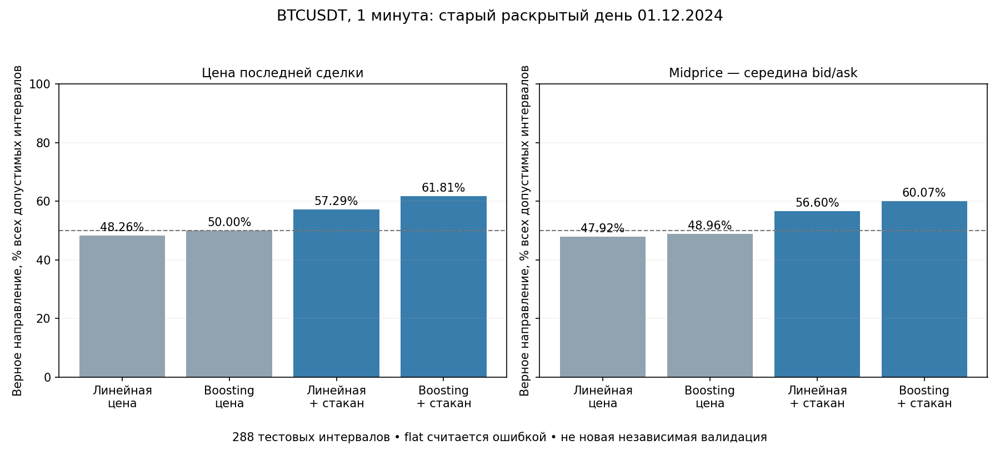
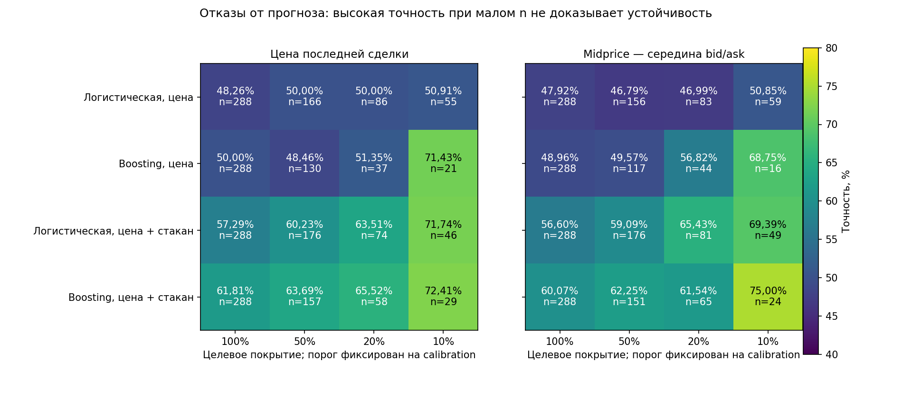

# Многодневная проверка стаканных прогнозов: готовность и инженерный результат

Дата: 13 октября 2026. Статус: **DATA_INSUFFICIENT для многодневной проверки**.

## Итог

Реализован отдельный offline evaluator для минутного направления BTCUSDT: две компактные модели, одинаковые price-only контроли, отдельно обучаемые цели last-trade и midprice. Выполнены восемь инженерных обучений на ранее раскрытом дне. Новая многодневная валидация НЕ выполнена: из 60 требуемых совпадающих дневных пар trades/L2 имеется одна.

Boosting со стаканом получил 61,81% для last-trade и 60,07% для midprice при полном покрытии. Это 288 минут последней части одного известного дня, не доказательство переносимого преимущества, достижения 80–90% или торговой прибыли.

## Данные и измерительная семантика

- Пара источников: `bitget-futures_trades_2024-12-01_BTCUSDT.csv.gz` и `bitget-futures_incremental_book_L2_2024-12-01_BTCUSDT.csv.gz` в `C:/Users/anton/Downloads`.
- Book ticker от 01.01.2025 исключён: дата не совпадает. Других совпадающих raw-пар в проверенных Downloads, Retrodate и Reports не обнаружено.
- 1 440 receipt-clock минут. До новой проверки свежести было 1 410 допустимых минут; теперь 1402. Устаревшая последняя сделка: 8 минут; устаревший стакан: 0. Первые 30 минут — warmup.
- Фильтр свежести одинаков для обеих целей и всех моделей: возраст сделки/стакана не более 5 секунд. В label допустимы только свежие начальная и конечная точки.
- Источник стакана по предыдущему аудиту: 23 346 510 snapshot-строк, а не проверенная цепочка delta. Sequence completeness не подтверждена; реальные fills здесь не моделируются.
- Все события строго раньше границы минуты. При восстановлении микросекунд из float-миллисекунд применено округление вместо усечения: это устраняет ошибку преобразования на 1 мкс. Первый prepare был остановлен этой проверкой до создания банка и до обучения.
- Price-only: 6 признаков; price+book: те же 6 плюс spread, bid/ask depth5, depth imbalance, изменение глубины, microprice offset и возраст стакана. Линейные модели: 7 и 14 параметров. Boosting ограничен 32 деревьями, максимум 7 листьев; MLP/GA не добавлялись.

Цель — знак изменения цены через одну минуту. Flat сохраняется отдельным исходом и считается ошибкой бинарного прогноза. Основная accuracy = correct / emitted; nonflat accuracy — дополнительная. Midprice равен (bid + ask) / 2; это не цена гарантированного исполнения.

## Инженерный расчёт на известном дне

Разбиение: первые 60% дня для train, следующие 20% для calibration, последние 20% для теста. Purge 7 минут на обеих границах с проверкой зрелости label. Test: 19:12–23:59 UTC, 288 решений; endpoint последнего label — 00:00 следующего дня. Это исключение для однодневной инженерной проверки, НЕ обещанный режим train30d/cal7d/retrain3d.

| Модель | Last-trade, все интервалы | Midprice, все интервалы | n на каждую цель |
|---|---:|---:|---:|
| Логистическая, цена | 48,26% | 47,92% | 288 |
| Boosting, цена | 50,00% | 48,96% | 288 |
| Логистическая, цена + стакан | 57,29% | 56,60% | 288 |
| Boosting, цена + стакан | 61,81% | 60,07% | 288 |

Рисунок 1. Проверяется, исчезает ли преимущество стакана при смене цели на midprice. На этом дне оно не исчезает; независимая устойчивость не установлена. Пунктир 50% — ориентир, а не универсальная ожидаемая accuracy random при наличии flat.

| Цель | Random | Majority train-only | Momentum 1m | Down / Flat / Up |
|---|---:|---:|---:|---|
| Цена последней сделки | 53,12% | 47,22% | 52,08% | 136 / 2 / 150 |
| Midprice — середина bid/ask | 52,43% | 47,22% | 52,43% | 136 / 4 / 148 |

Совпадение самих last-trade и midprice labels: 98,26%. Цели обучались раздельно; один и тот же сохранённый price-прогноз не выдавался за новую модель.

Рисунок 2. Coverage — целевое значение на calibration; фактическое покрытие теста может отличаться. n указан в каждой ячейке. Высокий процент на нескольких десятках прогнозов не является подтверждением 80–90%. Доверительные интервалы для одного дня намеренно не рассчитывались.

## Протокол настоящей многодневной проверки

1. Получить 60 подряд полных UTC-дней BTCUSDT одной площадки: 30 дней контекста + 30 дней нового исторического теста. Даты выбрать по доступности, не по результатам стратегии; test-исходы не изучать до фиксации дат и SHA. Это ограниченный исследовательский batch, не обоснованная мощностью финальная проверка.
2. Квалифицировать по одному дню: bank/source/code SHA, строгий receipt clock, 1440 границ, не менее 1350 свежих минут, bid<ask, causal midpoint, согласованные price-признаки. Для incremental необходимы начальный snapshot и подтверждённая sequence continuity. Автоматическая проверка метаданных и hash не доказывает происхождение/полноту биржевых данных.
3. Зафиксировать manifest, даты, 10 origins, hashes и cutoff. Rolling window 30 дней содержит 7 дней calibration; для fit остаётся примерно 23 дня. Purge 7 баров на train→cal и cal→origin. Горизонт/шаг примеров/решений — 1 минута; retrain — 3 дня. Запрещены интерполяция и labels через пропуск/границу архива.
4. На origin один общий time-based sample до 4000 строк, отдельное исключение flat только при fit каждой цели. Price/book используют одни и те же обучающие строки данной цели и одинаковую price-часть scaler. Всего 8 моделей на origin, максимум 80 fit; не выполнять их до data freeze.
5. Пороги покрытий 100/50/20/10% только на calibration. Ledger хранит SHA модели через явный model-index lookup для каждого прогноза. Цена сделки и midprice не смешиваются.
6. Единственный финальный анализ после всех 10 origins. Общие 3-календарно-дневные block-bootstrap банки, 1000 повторов, два seed. Одна max-t family из 128 сравнений: две модели × две цели × четыре покрытия × четыре контроля × два способа сопоставления. Основной сигнал — парная добавка на одинаковой candidate-mask; own-policy-mask — дополнительный анализ. Нет emissions в bootstrap → нет положительного вывода.
7. Новый prospective-контракт от предыдущей работы не изменён. Эти модели туда не включены задним числом. При наличии эффекта всё равно потребуется новый согласованный независимый период; accuracy не равна прибыли.

## Проверки и воспроизводимость

| Проверка | Свидетельство | Статус |
|---|---|---|
| Синтаксис отдельных новых файлов, без pytest | py_compile | PASS |
| Метки, gaps, purge, prefix-invariance, scaler, thresholds | checks_*.json, 11 проверок | PASS |
| Повторный расчёт без обучения: 8 моделей / 32 metrics | engineering_audit.json | PASS |
| Синтетический полный final scorer: 30 дней / 10 origins / 128 пар | statistics_engineering_audit.json | PASS |
| Идентичные candidate/parent дают нулевую добавку и обе LCB=0 | statistics_engineering_audit.json | PASS |
| Один день не может запечатать многодневный тест | engineering_audit.json | FAIL-CLOSED |
| Реальные многодневные fit / тест | data_freeze.json отсутствует | DATA_INSUFFICIENT |

Фактические обучения этого этапа: 8 исторических инженерных + 6 синтетических (два запуска проверок по три). Synthetic statistics fixture не обучает моделей: его `.joblib` — текстовые hash-only заглушки, не для загрузки. Поле `fits=80` внутри fixture обозначает ожидаемый счётчик протокола, а не реальные обучения. Реальных multiday fit: 0.

Изменены/добавлены только отдельные файлы direction-book research и registry v18. Старые модели не перезаписывались. Все семь разрешений credentials/orders/paper/live/runtime/network/promotion — false. Никаких collector, pytest, сетевых запросов, торгов или фоновых процессов не запускалось.

## Остаточные ограничения и следующий шаг

- Главный блокер — данные, не архитектура. Имеется одна из 60 требуемых пар; не хватает 59 дополнительных дней, примыкающих к ней, либо полного другого 60-дневного блока. Старый день может быть train/context, но не новым test.
- `prepare` преобразует именно уже предоставленный известный день. Для новых raw L2 потребуется отдельно проверить/зафиксировать их преобразователь в стандартизированные minute banks. `qualify`, `freeze`, `fit_origin` и `score` готовы для таких банков; raw-features при qualification заново не вычисляются. Timestamp provenance — проверяемое утверждение builder, не криптографическое доказательство causal preprocessing.
- Финальный scorer проверен полностью на синтетике, но ещё не на реальном многодневном датасете. 30 дней теста и 3-дневный block не гарантируют статистическую мощность и не охватывают все режимы.
- Следующее действие: получить совпадающие локальные trades/L2 для выбранного блока, проверить один новый день, затем фиксировать data manifest и начинать bounded-origin прогоны. Без данных не увеличивать число моделей и не повторять старый day-test ради более красивой accuracy.

## Артефакты

- `registration.json`, `configs/genetic_primus_objective_registry_v18.json`: frozen protocol/учёт попыток.
- `known_day_results.json`: все 32 metric cells; `target_diagnostics.json`: контроли/labels.
- `known_day_engineering/receipt.json` и `forecast_ledger.npz`: folds, cutoff, thresholds, model SHA.
- `available_days.json`, `known_day_preparation.json`, `qualification_*`: данные и качество.
- `engineering_audit.json`, `statistics_engineering_audit.json`: независимый пересчёт и синтетические проверки.
- Отчёт — Markdown/PNG; DOCX не запрашивался, не создавался и не рендерился.
