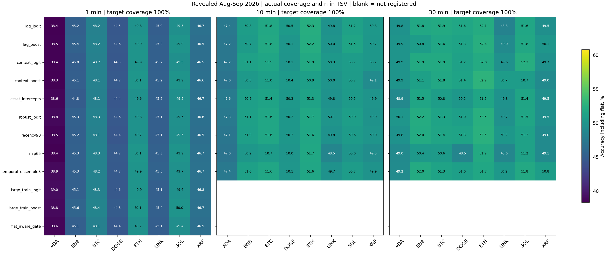
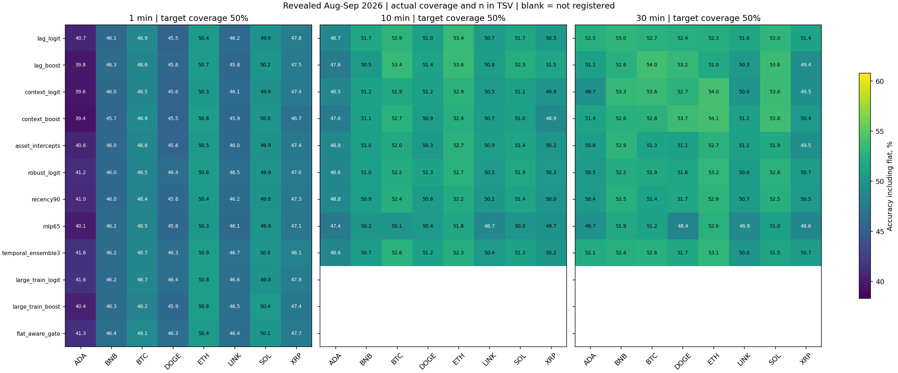
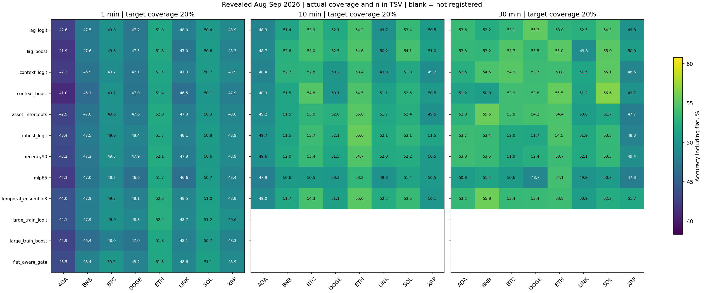
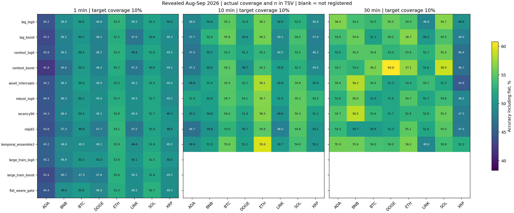
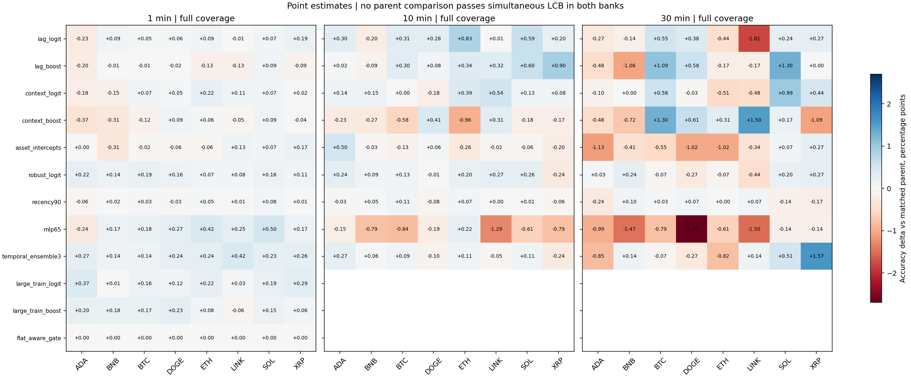
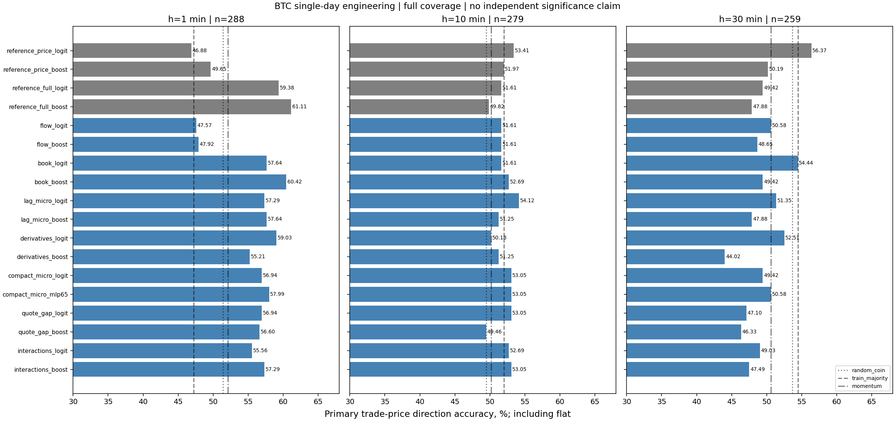

# Проверка гипотез на новых прогнозных моделях — 13 октября 2026

Выполнено 621 новое обучение: 567 в основном пакете и 54 в микроструктурном. Рассмотрены все 20 записей архивного журнала и последние direction-эксперименты. Новые модели покрывают 9 тем/12 конфигураций OHLCV и 7 дополнительных микроструктурных тем.
Ни один из 960 основных вариантов asset/horizon/model/coverage не имеет положительного simultaneous paired LCB относительно прежней модели в обоих seed banks. Это отсутствие подтверждения при данном бюджете и периоде, не доказательство нулевой предсказуемости.

## Контракт и данные

Основной период: 01.08–30.09.2026, ранее раскрытые исследовательские данные. 8 валют, горизонты 1/10/30m, направление следующего полного бара, решение на каждой соответствующей сетке. Up/down/flat не заменяются медианой, dead zone или торговым сигналом. Flat сохранён и считается ошибкой бинарного прогноза в основной accuracy; nonflat accuracy показана отдельно.
Train+calibration = 30 дней, последние 7 — calibration; purge 7 баров на обеих границах. Retrain каждые 3 дня, scaler/quantiles только train, labels созревшие. 4000 одинаковых времён train для обычных моделей; 16000 для зарегистрированной проверки объёма данных, с сохранением исходных 4000. Это увеличение данных, не смена train-window.
Пороги 100/50/20/10% по прошлым confidence scores отдельно для каждой валюты и origin. Test coverage фактический; test quantiles не применяются. Для flat-aware gate направление ровно прежнее; меняется только оценка вероятности успеха отбора.
Контроли: random, train-only majority, momentum. Parent_same_mask проверяет направление на той же новой маске; parent_policy сравнивает обе политики отбора при одинаковом целевом, но не обязательно одинаковом фактическом покрытии.
Общие circular bootstrap блоки по 3 календарных дня, 1000 повторов, два seed bank; max-t поправка на все 4800 сравнений. Отдельный seed не является новыми данными. Историческое полное число адаптивных попыток неизвестно, что отмечено в registry; эти интервалы исследовательские.

## Все новые основные конфигурации

Δ ниже — медиана изменения full-coverage accuracy по восьми валютам, в процентных пунктах. Знак по месяцам показан как дополнительная описательная проверка, не независимая валидация.

| Модель | Что проверено | Горизонт | Median Δ, п.п. | Положительных валют | Положительны оба месяца |
|---|---|---:|---:|---:|---:|
| lag_logit | Лаги return/body/volume 1/2/3/6 баров, logistic (25 коэффициентов) | 1m | +0.066 | 6/8 | 3/8 |
| lag_logit | Лаги return/body/volume 1/2/3/6 баров, logistic (25 коэффициентов) | 10m | +0.290 | 7/8 | 3/8 |
| lag_logit | Лаги return/body/volume 1/2/3/6 баров, logistic (25 коэффициентов) | 30m | +0.051 | 4/8 | 0/8 |
| lag_boost | Те же 24 признака с ограниченным boosting | 1m | -0.052 | 1/8 | 0/8 |
| lag_boost | Те же 24 признака с ограниченным boosting | 10m | +0.307 | 7/8 | 4/8 |
| lag_boost | Те же 24 признака с ограниченным boosting | 30m | -0.085 | 3/8 | 3/8 |
| context_logit | Час/день/неделя, волатильность дня, рыночный контекст и время UTC (21 коэффициент) | 1m | +0.060 | 6/8 | 1/8 |
| context_logit | Час/день/неделя, волатильность дня, рыночный контекст и время UTC (21 коэффициент) | 10m | +0.131 | 6/8 | 2/8 |
| context_logit | Час/день/неделя, волатильность дня, рыночный контекст и время UTC (21 коэффициент) | 30m | -0.017 | 3/8 | 3/8 |
| context_boost | Нелинейные зависимости тех же контекстных признаков | 1m | -0.046 | 3/8 | 0/8 |
| context_boost | Нелинейные зависимости тех же контекстных признаков | 10m | -0.205 | 2/8 | 1/8 |
| context_boost | Нелинейные зависимости тех же контекстных признаков | 30m | +0.239 | 5/8 | 4/8 |
| asset_intercepts | Общие slopes и отдельные intercepts валют (20 коэффициентов) | 1m | -0.010 | 4/8 | 2/8 |
| asset_intercepts | Общие slopes и отдельные intercepts валют (20 коэффициентов) | 10m | -0.046 | 2/8 | 1/8 |
| asset_intercepts | Общие slopes и отдельные intercepts валют (20 коэффициентов) | 30m | -0.478 | 2/8 | 1/8 |
| robust_logit | Train-only winsorization 0.5/99.5 percentiles (13 коэффициентов) | 1m | +0.148 | 8/8 | 7/8 |
| robust_logit | Train-only winsorization 0.5/99.5 percentiles (13 коэффициентов) | 10m | +0.165 | 6/8 | 4/8 |
| robust_logit | Train-only winsorization 0.5/99.5 percentiles (13 коэффициентов) | 30m | -0.017 | 4/8 | 2/8 |
| recency90 | Half-life 90d; веса и положительным, и отрицательным исходам (13 коэффициентов) | 1m | +0.017 | 6/8 | 4/8 |
| recency90 | Half-life 90d; веса и положительным, и отрицательным исходам (13 коэффициентов) | 10m | +0.006 | 4/8 | 2/8 |
| recency90 | Half-life 90d; веса и положительным, и отрицательным исходам (13 коэффициентов) | 30m | +0.017 | 4/8 | 1/8 |
| mlp65 | MLP 6→8→1, 65 параметров, alpha=10, лимит 80 итераций | 1m | +0.218 | 7/8 | 6/8 |
| mlp65 | MLP 6→8→1, 65 параметров, alpha=10, лимит 80 итераций | 10m | -0.700 | 1/8 | 0/8 |
| mlp65 | MLP 6→8→1, 65 параметров, alpha=10, лимит 80 итераций | 30m | -0.888 | 0/8 | 0/8 |
| temporal_ensemble3 | Среднее текущей и двух предыдущих causal logistic моделей; новых fit нет | 1m | +0.240 | 8/8 | 5/8 |
| temporal_ensemble3 | Среднее текущей и двух предыдущих causal logistic моделей; новых fit нет | 10m | +0.074 | 5/8 | 2/8 |
| temporal_ensemble3 | Среднее текущей и двух предыдущих causal logistic моделей; новых fit нет | 30m | +0.034 | 4/8 | 2/8 |
| large_train_logit | 16000 времён обучения вместо 4000; исходная подвыборка сохранена (13 коэффициентов) | 1m | +0.175 | 8/8 | 6/8 |
| large_train_boost | Тот же расширенный train bank с boosting | 1m | +0.161 | 7/8 | 4/8 |
| flat_aware_gate | Отдельный move/flat classifier меняет только отказы; 26 коэффициентов с direction-parent | 1m | +0.000 | 0/8 | 0/8 |

Положительных simultaneous LCB против parent-policy в обоих банках: 0/960. Положительных сигналов против parent_same_mask и всех контролей: 0/960. Положительных политик отбора против parent-policy и всех контролей: 0/960.
Предупреждения сходимости: 63 forecast artifacts, все MLP65. Лимит 80 итераций недостаточен для критерия LBFGS convergence. Числа относятся к фиксированной ограниченной конфигурации; отсутствие выигрыша не отвергает нейросетевую архитектуру. По test-результату лимиты не увеличивались.
Half-life 90d на 23-дневной части train меняет веса умеренно; это не тест всех возможных recency-окон. Kish ESS в metadata отражает неравномерность весов, а не число независимых наблюдений. Положительные и отрицательные обучающие исходы получают веса.
Полное разделение моделей по валютам ранее ухудшало результаты; здесь проверены только отдельные intercepts при общих slopes. Большое число валют не подменяет индивидуальные результаты: все 960 строк и confusion matrices сохранены.

## Наблюдаемые максимумы

Эти строки выбраны после расчёта для описания и не являются независимо отобранными победителями.

| Горизонт | Модель / валюта | Accuracy | Actual coverage | Emitted n |
|---|---|---:|---:|---:|
| 1m | mlp65 / ETH/USDT | 50.10% | 100.00% | 87840 |
| 1m | mlp65 / ETH/USDT | 53.11% | 10.32% | 9065 |
| 10m | lag_logit / ETH/USDT | 52.35% | 100.00% | 8784 |
| 10m | temporal_ensemble3 / ETH/USDT | 59.57% | 9.63% | 846 |
| 30m | context_boost / ETH/USDT | 52.87% | 100.00% | 2928 |
| 30m | context_boost / DOGE/USDT | 60.78% | 8.71% | 255 |

## Что дала микроструктура

BTCUSDT за 01.12.2024 — отдельный однодневный инженерный тест. Первые 60% дня train, следующие 20% calibration, последние 20% test, maturity purge 7*h минут. Все 18 моделей имеют одинаковые допустимые строки. Прогноз через 1/10/30m при решении каждую минуту; labels 10/30m перекрываются. Инференциальные CI по одному дню не выдаются.
Проверены flow-only, book-only, лаги micro-признаков, OI/mark/index/displayed funding, компактные 6 признаков с logistic/MLP65, trade-mid gap и взаимодействия flow/book. Данные derivatives доступны по receipt clock; displayed funding известен в момент публикации и не является реализованным будущим платежом.
Quote extraction независимо совпала с исходным atomic book по spread и возрасту во всех 1440 минутах. Архив с именем incremental L2 фактически состоит из snapshots; sequence completeness не доказана. Jan-2025 book_ticker не смешивался с Dec-2024 данными.

| Модель | 1m accuracy | 10m accuracy | 30m accuracy |
|---|---:|---:|---:|
| reference_price_logit | 46.88% | 53.41% | 56.37% |
| reference_price_boost | 49.65% | 51.97% | 50.19% |
| reference_full_logit | 59.38% | 51.61% | 49.42% |
| reference_full_boost | 61.11% | 49.82% | 47.88% |
| flow_logit | 47.57% | 51.61% | 50.58% |
| flow_boost | 47.92% | 51.61% | 48.65% |
| book_logit | 57.64% | 51.61% | 54.44% |
| book_boost | 60.42% | 52.69% | 49.42% |
| lag_micro_logit | 57.29% | 54.12% | 51.35% |
| lag_micro_boost | 57.64% | 51.25% | 47.88% |
| derivatives_logit | 59.03% | 50.18% | 52.51% |
| derivatives_boost | 55.21% | 51.25% | 44.02% |
| compact_micro_logit | 56.94% | 53.05% | 49.42% |
| compact_micro_mlp65 | 57.99% | 53.05% | 50.58% |
| quote_gap_logit | 56.94% | 53.05% | 47.10% |
| quote_gap_boost | 56.60% | 49.46% | 46.33% |
| interactions_logit | 55.56% | 52.69% | 49.03% |
| interactions_boost | 57.29% | 53.05% | 47.49% |

Лучшая минутная модель осталась reference_full_boost: 61.11% на 288 прогнозах. Для тех же прогнозов диагностическая midprice accuracy: 60.76% на всех интервалах, 61.62% без flat; flat=4. Это другая цель, приведённая отдельно; модели обучались на trade-price направлении.
Book-only boosting почти повторяет результат full; flow-only, derivatives, quote gap и новая компактная MLP не улучшили его на полном покрытии. Это локальная атрибуция на одном дне, не глобальное опровержение этих источников информации.
При отказах максимум остался у reference_full_boost/10m: 77,78% на 18 прогнозах. Большая точность на маленьком отобранном наборе не доказывает достижение устойчивых 80–90%.

## Архив и ограничения

Все 20 архивных гипотез перечислены в HYPOTHESIS_INVENTORY_RU.md. Закрытые торговые стратегии не переоткрывались и не перенастраивались на их раскрытом OOS. Новые эксперименты относятся к другой задаче: прогнозу направления без исполнения и PnL.
Недоступны исходные Glassnode данные/код авторов и publication vintages, синхронные многодневные L2/trades, point-in-time новости/sentiment. Эти гипотезы остаются data-blocked; OHLCV или price forecasts не выдаются за их воспроизведение.
Полный prospective-интервал ещё не завершён. Новый пакет не подмешан в ранее замороженный контракт других моделей. Независимых улучшений, разрешений на реальные деньги и публикации новых торговых артефактов нет.

## Дальнейшие действия

1. Приоритет — многодневный matched trades/L2 набор: проверить два небольших предиктора price+book и price+book+flow с одной зарегистрированной абляцией. Показывать trade- и midprice цели раздельно.
2. Из OHLCV оставить для узкого подтверждения лаги на 10m и робастный/временной ансамбль на 1m. Наблюдаемые сдвиги малы; это кандидаты следующего опыта, не одобренные модели.
3. Проверять только несколько заранее выбранных вариантов на новом времени после фиксации протокола. Ранее раскрытый август–сентябрь остаётся исследовательским.
4. Если возвращаться к MLP65, отдельно зарегистрировать достаточный optimisation budget и критерий train-only convergence до анализа нового теста; текущий warning нельзя трактовать как бесполезность всей архитектуры.
5. On-chain и sentiment проверять после получения данных с доказуемыми публикационными часами. Увеличение нейросети или GA само по себе не добавит отсутствующую информацию.

## Артефакты

statistics_excel_ru.tsv — 960 строк × 18 колонок; results.json — все метрики, месяцы, confusion, контроли и paired CI. Micro TSV — 216 строк × 15 колонок; midprice diagnostic отделён от primary.
Проверено 630 основных forecast artifacts, 20160 порогов и 54 micro модели. Все model/data/fold/cutoff/registration hashes сохранены. Credentials/orders/paper/live/runtime/network/promotion=false; финансовых replay нет.

