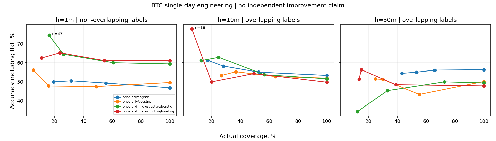

# Микроструктурный инженерный эксперимент

Аудит содержимого: 23 346 510 строк is_snapshot=true, 0 delta-строк. Несмотря на имя incremental_book_L2, этот файл содержит повторные снимки верхних уровней. Проверка восстановления настоящих incremental deltas на нём не выполнена.

BTCUSDT, Bitget futures, 1 декабря 2024. Один день, не независимая проверка устойчивости и не подтверждение улучшения.
Локальные trades и incremental L2. Стакан восстанавливается атомарными пакетами. Используется clock получения; данные ровно на границе решения исключаются. Номера последовательности отсутствуют: незаметную потерю delta доказать нельзя.
Цель: изменение последней полученной цены сделки через 1/10/30 минут. Решение каждую минуту; labels 10/30m перекрываются. Эта постановка отличается от OHLCV benchmark и показана отдельно.
Одинаковые допустимые строки для price-only и price+microstructure. Первые 60% дня — train, следующие 20% — calibration, последние 20% — test; purge 7*h минут на обеих границах. Порог по прошлой калибровке, без test quantiles.
Небольшие выборки, единственный актив/день. Доверительные интервалы и заявления о статистическом улучшении не выдаются.

| Горизонт | Признаки | Модель | Test n | Accuracy 100% | Random | Majority | Momentum |
|---|---|---|---:|---:|---:|---:|---:|
| 1m | price_only | logistic | 288 | 46.88% | 51.39% | 47.22% | 52.08% |
| 1m | price_only | boosting | 288 | 49.65% | 51.39% | 47.22% | 52.08% |
| 1m | price_and_microstructure | logistic | 288 | 59.38% | 51.39% | 47.22% | 52.08% |
| 1m | price_and_microstructure | boosting | 288 | 61.11% | 51.39% | 47.22% | 52.08% |
| 10m | price_only | logistic | 279 | 53.41% | 49.46% | 51.97% | 50.18% |
| 10m | price_only | boosting | 279 | 51.97% | 49.46% | 51.97% | 50.18% |
| 10m | price_and_microstructure | logistic | 279 | 51.61% | 49.46% | 51.97% | 50.18% |
| 10m | price_and_microstructure | boosting | 279 | 49.82% | 49.46% | 51.97% | 50.18% |
| 30m | price_only | logistic | 259 | 56.37% | 53.67% | 54.44% | 50.58% |
| 30m | price_only | boosting | 259 | 50.19% | 53.67% | 54.44% | 50.58% |
| 30m | price_and_microstructure | logistic | 259 | 49.42% | 53.67% | 54.44% | 50.58% |
| 30m | price_and_microstructure | boosting | 259 | 47.88% | 53.67% | 54.44% | 50.58% |

Все 48 строк с отказами и flat находятся в results.json. Разрешения runtime/network/orders/promotion остаются false.
