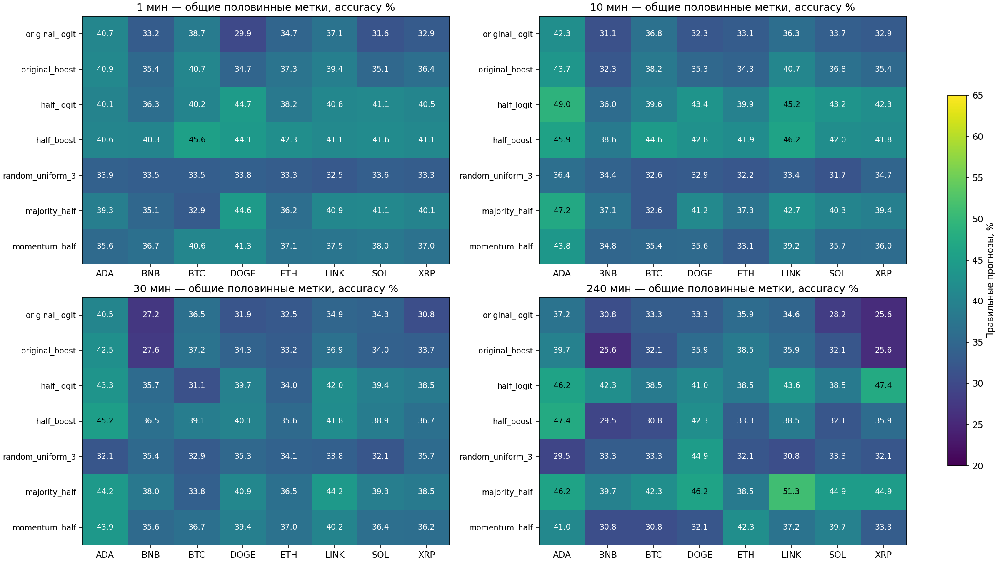
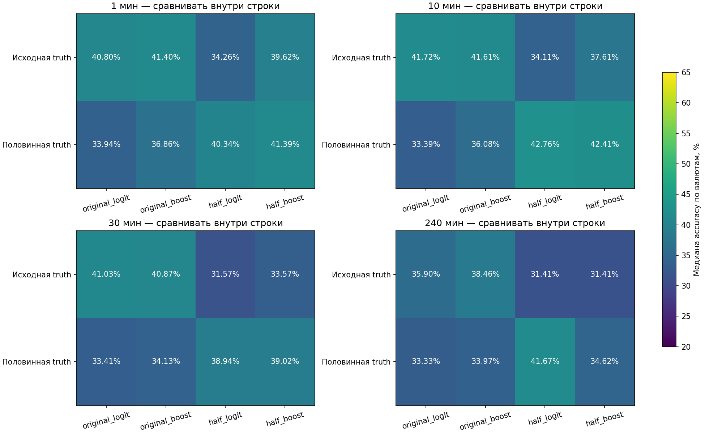
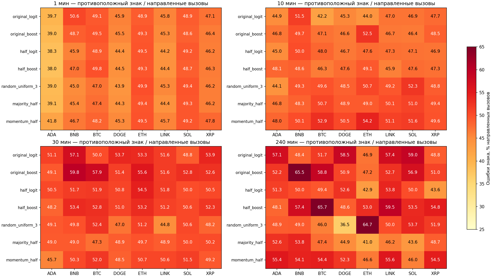
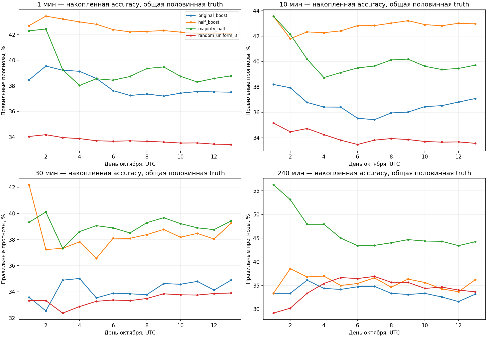

# Октябрь: переобучение на половинной нейтральной полосе

Период нового исторического теста: 1–13 октября 2026 UTC. Дата расчёта: 14 октября 2026.

## Итог

На общей половинной truth заново обученные half-модели точнее исходных моделей, применённых к этим более узким меткам. Но общий устойчивый выигрыш по всем зарегистрированным контролям и обеим метрикам не подтверждён: полный исследовательский gate **0/64**. Ни 80%, ни 90% accuracy не получены. Особенно слабое место — 4h: half-модели по медиане уступили majority_half. Это короткий новый исторический тест, не prospective и не финальная независимая валидация.

| Горизонт | Original logit на half truth, % | Half logit на той же truth, % | Original boost на half truth, % | Half boost на той же truth, % | Majority half, % | Random 3, % |
|---:|---:|---:|---:|---:|---:|---:|
| 1 мин | 33.94 | 40.34 | 36.86 | 41.39 | 39.72 | 33.49 |
| 10 мин | 33.39 | 42.76 | 36.08 | 42.41 | 39.82 | 33.15 |
| 30 мин | 33.41 | 38.94 | 34.13 | 39.02 | 38.86 | 33.97 |
| 240 мин | 33.33 | 41.67 | 33.97 | 34.62 | 44.87 | 32.69 |

Все значения — медианы по восьми валютам. Разность медиан не является парной оценкой эффекта; все paired comparisons и их одновременные LCB сохранены в results.json.

## Данные и квалификация

Разрешённая публичная REST-загрузка Bitget USDT-FUTURES market candles: 149760 строк 1m по ADA, BNB, BTC, DOGE, ETH, LINK, SOL, XRP. Каждый актив — 18720 минут; последний open time 13.10 23:59 UTC. 40 symbol/batch parquet, один общий october_full8_1m.parquet, 216 raw ответов с SHA; дополнительно был один предварительный запрос 10 минут BTC. Пропусков, дублей и сдвигов нет. Хвосты 100 минут совпали между candles/history-candles в 40 случаях; оба endpoint одного провайдера, это не независимая проверка цен. Граница старого и нового массива: open/предыдущий close совпали для всех активов.

Описание формата и ограничений endpoint: [официальная документация Bitget](https://www.bitget.com/docs/catalog/market/market-data). Это OHLCV last-trade/market candles, не стакан, mark/funding или доказательство исполнимости сделок. Загрузка записана отдельно от research и runtime; все network_allowed/credentials/orders/paper/live/runtime/promotion флаги моделей false.

Историческая часть исходных OHLCV и всех 12 признаков воспроизвелась точно на четырёх горизонтах. Новые признаки вычисляются тем же frozen direction_multiscale_v1/features pipeline. Входные данные, code, scaler, folds, model SHA и cutoffs закреплены в registration.json и метаданных моделей.

## Постановка и причинность

r = 100 × (close[t+h] / close[t] − 1). Down: r<−δ; neutral: |r|≤δ; up: r>δ. Исходные δ: 0,020 / 0,064 / 0,109 / 0,320%; half δ: 0,010 / 0,032 / 0,0545 / 0,160% для 1m/10m/30m/240m. Zero-band — диагностический чистый знак с отдельным exact-zero neutral. Все прогнозы делаются на каждом допустимом интервале, покрытие 100%; часть прогнозов neutral.

Pooled обучение по восьми активам; результаты отдельно по валютам. Пять origins: 1/4/7/10/13 октября; последний блок один день. Rolling 30d включает 7d calibration, фактический train примерно 23d минус purge. Calibration не использовалась для настройки. Только созревшие labels; purge 7 баров соответствующего горизонта; endpoints строго до cutoffs. На каждом origin новый невзвешенный scaler mean/std, только train; uniform веса всех трёх исходов. Общая выборка максимум 4000 временных строк для обеих полос; одинаковый seed и preprocessing.

## Архитектуры и бюджет

Logistic: 12 признаков, 39 номинальных multiclass коэффициентов (softmax избыточность), C=0,1, max_iter=120, tol=1e−6. Boosting: 32 итерации, 3 дерева на итерацию, до 7 листьев, min leaf=128, learning rate=0,08, L2=10, early stopping отключён; до 672 leaf values плюс splits. Никаких новых признаков, MLP, GA, class balancing, recency или tuning в этом опыте.

Сохранено **80 моделей**, warning=0, prior fallback не потребовался. В v1 первого origin успешно выполнились logit и boost fits, но boost не сохранился из-за отсутствующего описательного поля maximum_leaf_values. v2 добавляет ровно это поле (оно не передаётся в estimator constructor), импортирует сохранённый logit без повторного fit и выполняет оставшиеся 79. **Полный фактический расход — 81 estimator fit**, включая один fit с ошибкой сохранения. Все старые файлы оставлены неизменными. Связанные registries v25/v26 сохраняют историю ошибки и metadata-only amendment, не скрывая её новым успешным названием.

## Ошибки направления

Знаменатель следующей таблицы — только вызовы вверх/вниз. Raw opposite означает любой противоположный знак, даже внутри полосы. Beyond-band opposite требует противоположного движения за половинной полосой. Neutral forecasts не засчитываются как правильные направленные прогнозы; при нулевых calls доля не определена. Доли от всех интервалов и ошибки при фактически ненулевых изменениях доступны в подробностях.

| Мин | Модель | Направленные вызовы / все, % | Raw opposite / вызовы, % | Opposite за half полосой / вызовы, % |
|---:|---|---:|---:|---:|
| 1 | original_boost | 51.94 | 47.49 | 42.52 |
| 1 | half_boost | 91.70 | 46.69 | 39.83 |
| 1 | half_logit | 99.24 | 46.08 | 39.06 |
| 1 | random_uniform_3 | 66.58 | 45.77 | 39.31 |
| 10 | original_boost | 54.78 | 46.95 | 41.37 |
| 10 | half_boost | 96.63 | 47.60 | 38.91 |
| 10 | half_logit | 99.76 | 47.20 | 37.95 |
| 10 | random_uniform_3 | 67.25 | 49.28 | 41.51 |
| 30 | original_boost | 54.25 | 52.73 | 45.65 |
| 30 | half_boost | 96.55 | 51.74 | 42.83 |
| 30 | half_logit | 100.00 | 51.24 | 40.95 |
| 30 | random_uniform_3 | 66.67 | 49.44 | 38.79 |
| 240 | original_boost | 64.10 | 52.45 | 48.04 |
| 240 | half_boost | 92.31 | 54.16 | 47.64 |
| 240 | half_logit | 100.00 | 50.00 | 40.38 |
| 240 | random_uniform_3 | 65.38 | 49.51 | 41.67 |

## Неопределённость и аудит

1152 полные строки метрик: 12 методов × 8 активов × 4 горизонта × 3 определения truth. Для обученных моделей сохранены marginal CI accuracy/macro-F1; log-loss и multiclass Brier также оцениваются на одинаковых labels. Основное семейство — 512 парных сравнений: half logit/boost против matched original и random_uniform_3/majority_half/momentum_half, accuracy и macro-F1, все активы/горизонты. Односторонние max-t LCB одновременно по семейству, в двух общих banks, 1000 повторов, circular calendar blocks 3 дня.

Всего 13 календарных дней, примерно четыре трёхдневных блока зависимости: интервалы и max-t здесь нестабильны, особенно на 4h (78 примеров на актив). Новый bootstrap seed не создаёт независимых данных. Результаты нельзя экстраполировать на год или трактовать как доказательство торговой прибыли. Это prequential replay: последующие origins законно используют созревшие ранние октябрьские labels, но не будущие относительно origin.

Пройдены 9 pure checks, включая future-suffix invariance и strict endpoints. Repeat-predict всех 80 артефактов точный; независимое накопление confusion совпало. Второй audit независимо проверил 1152 metric cells, 512 paired comparisons, обе bootstrap banks и max-t LCB; прямые boolean-счётчики raw opposite проверены в 384 ячейках. Проверено 1995 старых artifact hashes и 326 input pins; registry entries сохранены.

Рисунок 1. Сравнение обучающих полос на одной половинной truth по каждой валюте; не смешивает разные labels в одном ranking.

Рисунок 2. Оценивать эффект модели следует внутри строки. Диагональное сравнение original/original против half/half меняет задачу и не доказывает улучшения.

Рисунок 3. Доля любого противоположного знака среди направленных вызовов; показывает, дала ли узкая полоса сильный directional signal.

Рисунок 4. Накопленная accuracy на общих half labels по календарным дням, pooled counts активов. Не кривая капитала и не независимые дневные наблюдения; короткий период ограничивает выводы.

## Решение и следующий этап

Не объявлять половинную полосу победителем по улучшению относительно модели, обученной на другой truth. На 1m/10m/30m есть наблюдаемый эффект adaptation к новым labels, но сильный перевес над простыми контролями и устойчивое direction skill не подтверждены всем зарегистрированным gate. На 4h majority остаётся важным отрицательным контролем. Сохранить оба контракта и не расширять архитектуру/поиск по этим 13 дням.

Следующий небольшой шаг — зафиксировать shortlist из простых моделей и оба определения truth, затем накопить существенно более длинный новый участок. До нового опыта определить требуемую длину по зависимости результатов и величине эффекта; текущие 13 дней не решают эту задачу. Если нужна минутная информативность, отдельный приоритет — многодневные causal L2/trades features; OHLCV-порог сам по себе информацию не создаёт. Торговой прибыли, fees/funding, исполнения и promotion этот опыт не проверяет.

## Артефакты

OHLCV parquet: Retrodate/genetic_primus_direction_october_20261001_20261013_v1/october_full8_1m.parquet. Raw provenance: тот же каталог/raw и data_audit.json. Model inputs: direction_october_halfband_v1_20261014/data, неизменные с начала опыта. Модели/forecasts/метрики: текущий v2 каталог; execution_accounting.json — полный fit budget; registration.json — контракт; comparison_audit.json/audit_*m.json — проверки; DETAILS_RU.md — все методы/валюты/labels; календарные блоки — block_results.json.

Навык научно-технических отчётов использован для явных источников, формул, знаменателей, audit trail и ограничений. Отчёты Markdown/JSON и PNG; DOCX/XLSX не создавались. Старый runtime, API-ключи, ордера, paper/live не затрагивались.
