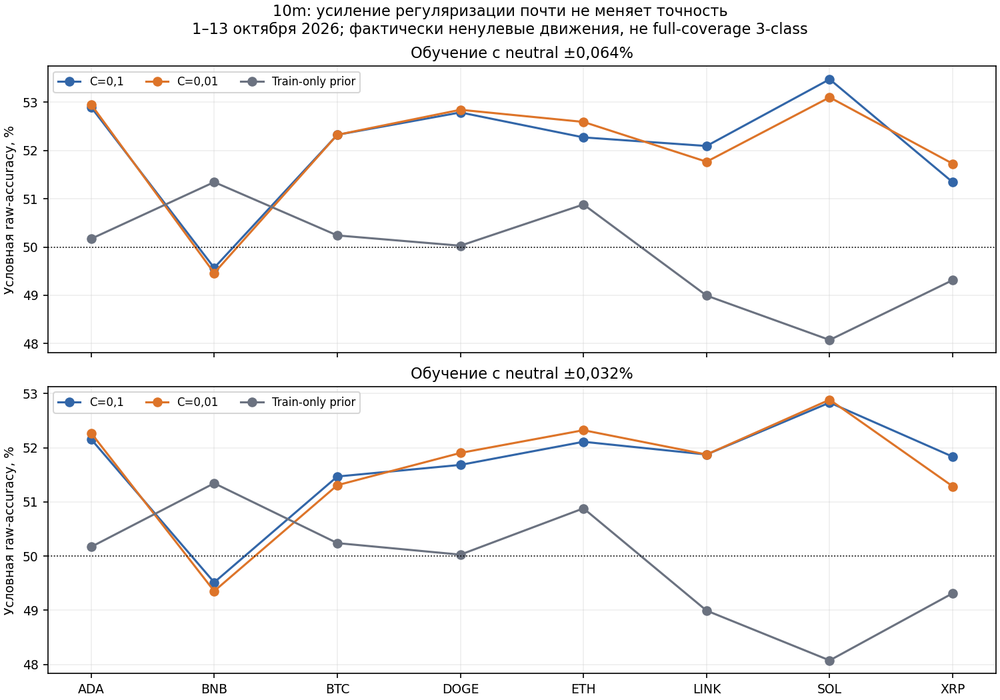
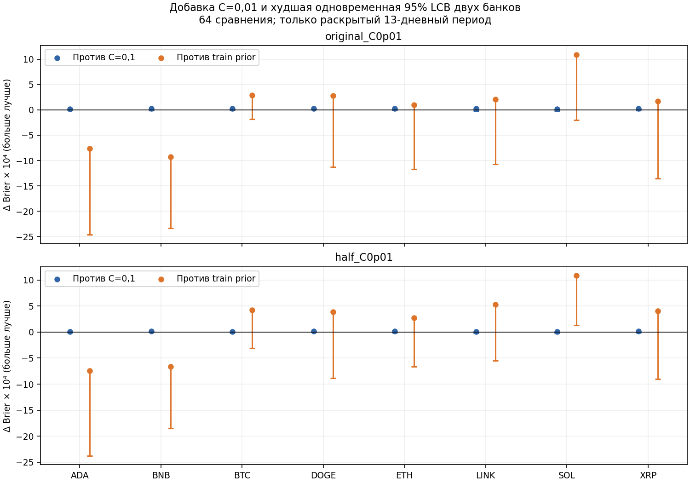
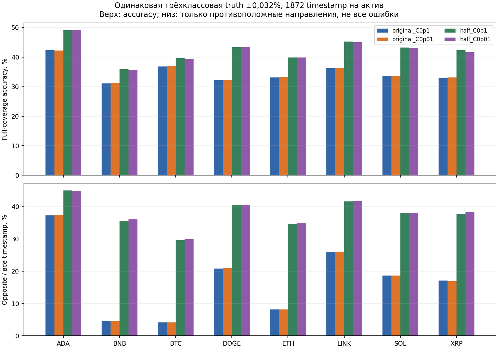

# Logistic 10m: единственная проверка усиления регуляризации

Дата отчёта: 18 октября 2026 года. Статус: раскрытое адаптивное историческое исследование, не новая валидация и не допуск к торгам.

## Итог

Уменьшение C с 0,1 до 0,01 немного снизило вероятностные ошибки, но не дало подтверждённого улучшения: 0 из 16 задач прошли зарегистрированный совместный gate. Медианная точность условного направления остаётся около 52%, а не 80–90%. Нового сигнала, пригодного для торговли, этот эксперимент не доказывает.

## Что изменили и что сохранили

Изменена только сила L2-регуляризации: меньшее C означает больший штраф. Архитектура прежняя: pooled multiclass logistic, 12 причинных OHLCV-признаков, 39 номинальных параметров, включая intercept (3 × (12 + 1)); softmax имеет избыточность. Две обучающие разметки: нейтральная полоса ±0,064% и ±0,032%. Веса uniform для всех исходов, включая убытки и neutral. Новые микроструктурные признаки не добавлялись.

Период 1–13 октября 2026 включительно по UTC: 13 календарных дней, 1872 десятиминутных timestamp на актив, 8 активов. Origins: 1/4/7/10/13 октября, только причинное обучение, собственный train-only scaler на origin, те же train/cal индексы и purge 7 баров. Окно 30 дней включает 7 дней calibration; это не 30 полных дней estimator-training. Десять базовых моделей C=0,1 не переобучались: прогнозы и контроли переиспользованы побитно.

Выполнено ровно 10 новых estimator fits: 5 origins × 2 полосы. Предупреждений 0. Прогноз на каждом допустимом timestamp; здесь нет отбора по уверенности. Цена сравнивается от close до следующего 10m close; используемые timestamps — close-time. Ни сеть, ни торговый evaluator не запускались.

## Что именно измеряется

Первичная диагностическая задача: только при фактически ненулевом raw-return p(up | down или up) = p(up) / [p(down) + p(up)]. При нулевой сумме используется 0,5. Исключение фактически неизменившихся цен нужно только для этой условной метрики, оно не исполнимо как live-фильтр. Условный знак принудительно считается также там, где исходный трёхклассовый argmax был neutral. Поэтому точность в следующей таблице нельзя выдавать за точность реальных направленных вызовов или full-coverage трёхклассовую accuracy.

Для y ∈ {0,1}: Brier = mean[(p−y)²]; log-loss = −mean[y ln p + (1−y) ln(1−p)] с clipping 10⁻¹⁵. Меньше лучше. AUC — ранговое качество без выбора порога. Random coin имеет фиксированный случайный бинарный вызов для accuracy, но честную вероятность 0,5 для proper losses и AUC. Prior — причинная train-only частота raw-направлений на каждом origin/активе, а не большинство итогового теста.

### Медианы по восьми активам (не pooled-результат)

| Метод | Accuracy, % | AUC | Brier ↓ | Log-loss ↓ |
|---|---:|---:|---:|---:|
| original_C0p1 | 52,30 | 0,52589 | 0,249863 | 0,692880 |
| original_C0p01 | 52,46 | 0,52603 | 0,249836 | 0,692825 |
| half_C0p1 | 51,86 | 0,52813 | 0,249649 | 0,692490 |
| half_C0p01 | 51,89 | 0,52814 | 0,249637 | 0,692468 |
| train_prior | 50,10 | 0,50335 | 0,250009 | 0,693165 |
| random_coin | 49,80 | 0,50000 | 0,250000 | 0,693147 |

Подпись: наблюдаемая условная точность; интервалы приведены в подробных таблицах, а не на этом описательном графике. Это не трёхклассовая accuracy.

### Поактивные изменения proper loss

Δ = ошибка контроля − ошибка нового C=0,01; положительное значение лучше. Число точечных улучшений не заменяет проверку неопределённости.

| Новая модель | Контроль | Brier: лучше / 8 | Log-loss: лучше / 8 | LCB > 0 в обоих банках, Brier / Log-loss |
|---|---|---:|---:|---:|
| original_C0p01 | original_C0p1 | 8 | 8 | 1 / 1 |
| original_C0p01 | train_prior | 6 | 6 | 0 / 0 |
| half_C0p01 | half_C0p1 | 8 | 8 | 0 / 0 |
| half_C0p01 | train_prior | 6 | 6 | 1 / 1 |

Подпись: точка — наблюдаемая добавка; отрезок идёт до худшей из двух одновременных 95% нижних границ. Семейство фиксировано до fits: 64 сравнения (2 challenger × 2 контроля × 2 loss × 8 активов). Все активы в каждом draw используют общие дни, сохраняя межактивную зависимость.

## Полная трёхклассовая задача — отдельно

Все 1872 timestamp на актив включены, фактически неизменившиеся цены не удалены. Truth имеет состояния down / neutral / up, границы neutral включены. Оба набора моделей cross-score на ±0,064%, ±0,032% и строго нулевой полосе. Разные ширины neutral нельзя сравнивать по accuracy как одинаковую задачу. Подробнее: DETAILS_RU.md.

Подпись: на каждом столбце одна и та же truth ±0,032%, все timestamp; справа считаются только down→up и up→down, а не neutral-ошибки. Чем меньше направленных вызовов, тем механически меньше может быть эта доля: покрытие приводится рядом в подробных таблицах.

## Статистическая и инженерная проверка

Повторно использованы два заранее замороженных calendar block-bootstrap банка: seeds 2026101426 / 2026101427, 1000 повторов, блок 3 дня, 13 дней. В обеих версиях банк сэмплирует одинаковые дни для всех моделей. Одновременная max-t нижняя граница рассчитана по семейству 64. Gate требует положительной LCB обеих proper losses против соответствующего C=0,1 и train-prior в обоих банках, отдельно для каждого актива и полосы. Прошло 0/16. Это локальный исследовательский gate, не глобальная поправка за всю историю разработки.

Отдельный audit пересчитал из frozen-ledgers 48 условных метрик, 216 трёхклассовых ячеек, 64 парных сравнения, все draws обоих банков, 288 pointwise интервалов и max-t. AUC дополнительно проверен ранговой формулой с ties; confusion-derived метрики — независимо. Все 13 дней и 144 timestamp в каждом дне сохранены. SHA источников, folds, scaler, models, ledgers, конфигов и bootstrap банков зафиксированы транзитивно в registration и delivery manifest. Exact-predict/scaler/fold audit выполнен для всех 10 новых моделей.

Первый scorer после успешного обучения перезаписывал дневную агрегацию предыдущего origin. Контроль bootstrap поймал нулевой знаменатель и остановил расчёт до записи результатов. Попытка раскрыта в score_failure_disclosure.json, исходный frozen-код не переписан; исправление зарегистрировано scoring_v2 (registry v29). Скорректированный scorer агрегирует объединённые прогнозы один раз, проверяет полный знаменатель и каждый день. Повторных fits из-за исправления не было.

## Ограничения и следующий шаг

13 дней дают лишь 4 полных трёхдневных блока и остаток: uncertainty/bootstrap при таком количестве блоков сами нестабильны. Исследователь неоднократно видел этот период; второй seed bank не делает его независимым. Измеряется направление цены OHLCV, не прибыль, исполнимость, комиссии или slippage. Сохранённые joblib — исследовательские артефакты, не production-модели.

Не расширять сейчас перебор C, порогов и архитектур на этом же октябре. Слабое изменение калибровки не решает нехватку сигнала. Следующее содержательное действие — согласовать и зафиксировать действительно будущий период с полным freeze до его начала; старый DRAFT не является sealed/scheduled. До этого допустим отдельный инженерный аудит причинности и качества признаков без настройки по результату. Если нужен новый источник сигнала (например, order-flow), это отдельный контракт и данные; имеющийся OHLCV его не содержит. Автоскачивание, новое обучение и новый период этой задачей не запускались.

Все credentials/orders/paper/live/runtime/network/promotion разрешения остаются false. Реальные деньги и торговый runtime не затронуты.

## Проверяемые артефакты

- registration.json, scoring_registration_v2.json — предрегистрация и поправка scorer.
- model_audit.json, statistical_audit.json — точное воспроизведение и независимый пересчёт.
- results.json, daily_metrics.npz — все ячейки, дневные агрегаты и draws.
- DETAILS_RU.md, report_statistics.json — поактивные таблицы и числовые данные отчёта.
- delivery_manifest.json — финальная фиксация файлов; появился после визуальной проверки рисунков.
