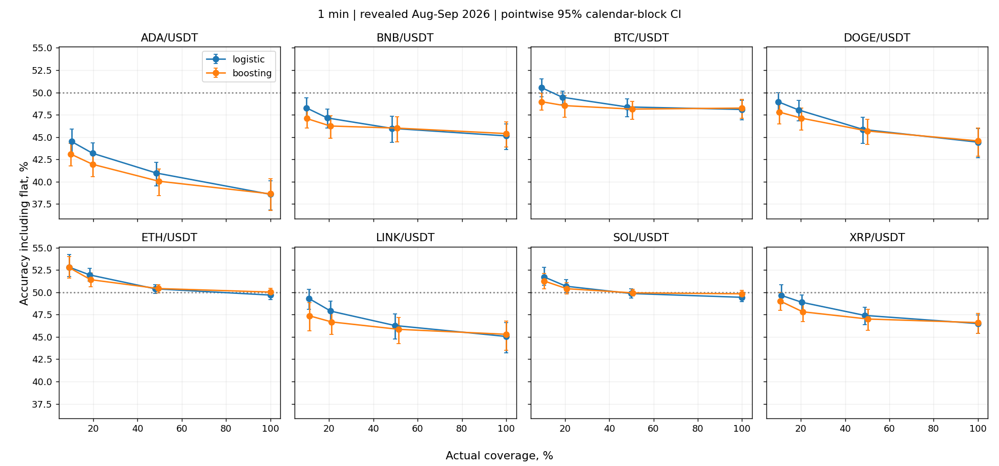
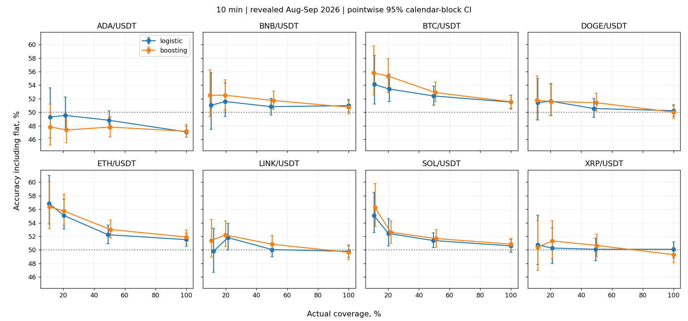
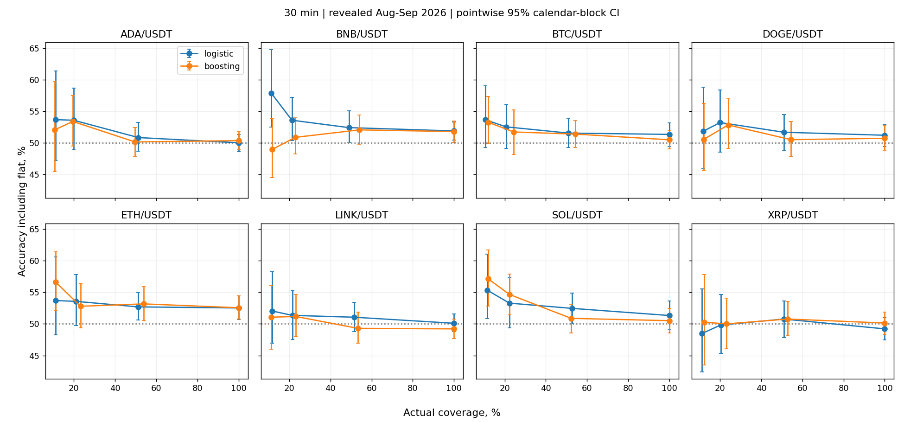
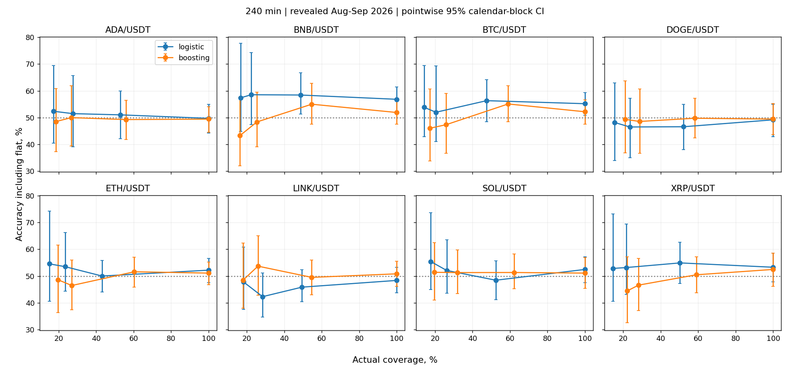

# Прогноз направления и отказы: исследовательский расчёт

Полный анализ и статус всех пяти пунктов: [DIRECTION_RESEARCH_PROGRESS_20261013.md](../DIRECTION_RESEARCH_PROGRESS_20261013.md).

Поправка future contract v2 внесена до открытия новых данных и сохранена отдельно от v1. Устранены невыполнимые sample floors для 4h/10% coverage: минимум 50 nonflat emitted и 30 emitted days. Это не гарантия мощности; положительные simultaneous paired LCB против всех контролей остаются обязательны. Исторические модели и пороги не изменены.

Линия 50% на графиках — ориентир; при наличии flat точность random на всех интервалах ниже 50%. Восемь положительных исследовательских сравнений против всех контролей относятся только к минутному ADA; новые данные этим не заменены.

Период: 1 августа — 30 сентября 2026, ранее раскрытые данные. Независимых улучшений не установлено этим экспериментом.

Цель: знак close[t+1] − close[t]. Flat сохраняется и считается ошибкой бинарного прогноза; условная точность без flat показана отдельно.
Пороги по каждому активу выбираются по семи предыдущим календарным дням, без исходов и без ранжирования тестовых прогнозов. Фактическое покрытие может отличаться от целевого.
30-дневное окно включает 7 дней калибровки. Между train/calibration и calibration/test — purge 7 баров. Scaler обучается на train. На 4h калибровочная выборка мала; пороги 10% особенно нестабильны.
Общие для всех сравнений circular bootstrap блоки по 3 календарных дня, 2000 повторов; второй seed — проверка вычислительной устойчивости, не новые данные. Max-t поправка на все 768 сравнений с контролями; интервалы графиков точечные.

| Горизонт | Модель | Target coverage | Actual coverage, диапазон по активам | Accuracy, диапазон по активам |
|---|---|---:|---:|---:|
| 1m | logistic | 100% | 100.00–100.00% | 38.59–49.68% |
| 1m | logistic | 50% | 48.02–49.99% | 40.98–50.38% |
| 1m | logistic | 20% | 18.36–20.69% | 43.19–51.94% |
| 1m | logistic | 10% | 9.07–11.09% | 44.50–52.81% |
| 1m | boosting | 100% | 100.00–100.00% | 38.65–50.02% |
| 1m | boosting | 50% | 49.34–51.41% | 40.06–50.41% |
| 1m | boosting | 20% | 18.81–21.14% | 41.95–51.41% |
| 1m | boosting | 10% | 8.98–11.03% | 43.09–52.77% |
| 10m | logistic | 100% | 100.00–100.00% | 47.11–51.51% |
| 10m | logistic | 50% | 48.10–50.25% | 48.82–52.41% |
| 10m | logistic | 20% | 19.71–21.45% | 49.54–55.09% |
| 10m | logistic | 10% | 10.44–12.09% | 49.31–56.85% |
| 10m | boosting | 100% | 100.00–100.00% | 47.20–51.90% |
| 10m | boosting | 50% | 49.68–51.20% | 47.82–53.01% |
| 10m | boosting | 20% | 19.66–22.03% | 47.39–55.75% |
| 10m | boosting | 10% | 9.71–11.57% | 47.86–56.36% |
| 30m | logistic | 100% | 100.00–100.00% | 49.21–52.53% |
| 30m | logistic | 50% | 48.98–52.73% | 50.77–52.70% |
| 30m | logistic | 20% | 19.88–22.30% | 49.83–53.61% |
| 30m | logistic | 10% | 10.69–11.85% | 48.47–57.93% |
| 30m | boosting | 100% | 100.00–100.00% | 49.21–52.56% |
| 30m | boosting | 50% | 49.62–54.47% | 49.30–53.17% |
| 30m | boosting | 20% | 19.50–24.42% | 50.00–54.66% |
| 30m | boosting | 10% | 10.62–12.23% | 48.97–57.14% |
| 240m | logistic | 100% | 100.00–100.00% | 48.36–56.83% |
| 240m | logistic | 50% | 43.17–53.01% | 45.86–58.43% |
| 240m | logistic | 20% | 20.49–28.42% | 42.31–58.54% |
| 240m | logistic | 10% | 14.21–18.31% | 47.76–57.38% |
| 240m | boosting | 100% | 100.00–100.00% | 49.45–52.46% |
| 240m | boosting | 50% | 54.64–62.30% | 49.27–55.09% |
| 240m | boosting | 20% | 25.41–31.97% | 46.46–53.68% |
| 240m | boosting | 10% | 16.39–22.13% | 43.33–51.39% |

Это диапазоны разных активов, а не единая точность портфеля или рейтинг победителей.

Все 256 строк, confusion matrix, flat, месяцы, paired contrasts и оба bootstrap находятся в results.json; таблица TSV содержит основные метрики.
Новый интервал: 14 октября 2026 — 11 января 2027 включительно (90 дней), единственный финальный анализ. Это срок контракта, не доказанная гарантия мощности. Данные отсутствуют; независимая проверка не выполнена.
Микроструктура и on-chain — отдельные эксперименты; результаты этого OHLCV расчёта не выдают их за выполненные.
Credentials/orders/paper/live/runtime/network/promotion остаются false.

