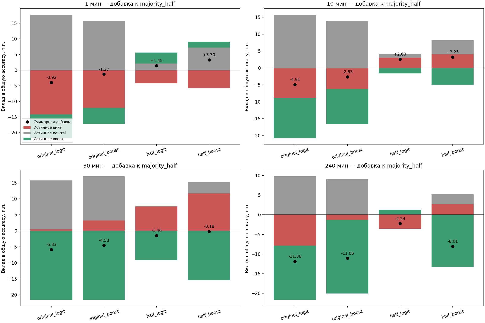
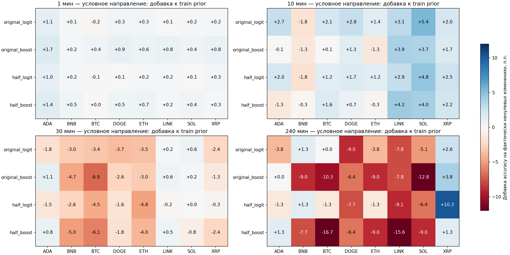
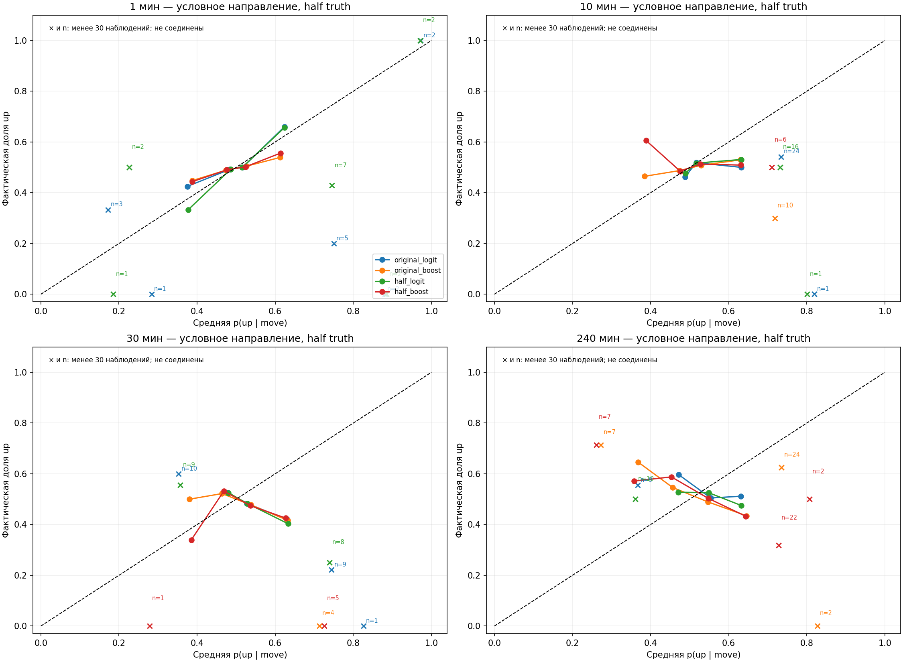
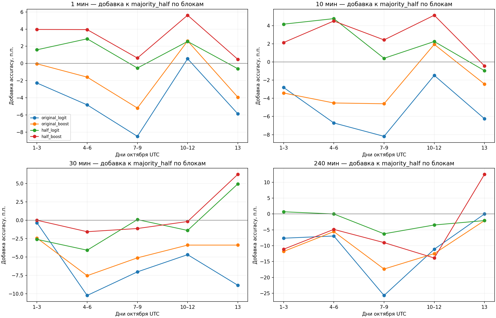

# Почему трёхрежимная точность не стала сильным прогнозом направления

Frozen данные: 1–13 октября 2026 UTC. Диагностика 14 октября 2026, без новых fits, сети и изменений прогнозов.

## Главный вывод

У boosting на 1m и 10m положительная добавка общей трёхклассовой accuracy обеспечена главным образом распознаванием neutral, а не улучшением направленных классов. На 1m half_boost получает +3,30 п.п. к majority_half: +7,24 п.п. neutral и −3,94 п.п. суммарно down/up. На 10m +3,25 п.п. ≈ +4,17 neutral −0,91 down/up (компоненты округлены). Поэтому более высокая трёхрежимная accuracy не означает, что вектор направления угадывается на 80–90%.

Half_logit на 10m — единственный из двух half-вариантов с небольшим положительным медианным Brier improvement чистого направления в этом раскрытом отрезке. Условная direction accuracy 51,86% против 50,10% у train-only prior, AUC около 0,528. Это описательный кандидат, не подтверждённый новый winner: прежний одновременный gate остался 0/64; 13 календарных дней недостаточно для устойчивых выводов.

Исходная original_logit на 10m имеет условную accuracy 52,30%, то есть немного выше half_logit, при AUC 0,5259 и Brier improvement +0,000162. У half_logit AUC 0,5281 и Brier improvement +0,000385. Разные метрики не дают единого победителя; сужение полосы не доказало превосходства именно направления. Обе версии сохранены в черновике следующего сравнения.

Двухэтапная `neutral_direction_hierarchy` уже входила в расширенную матрицу 14 октября (предыдущий общий gate 0/336). Разделение ролей detector/direction в этом отчёте — интерпретация, не предложение заново реализовать уже проверенную иерархию. Без новой направленной информации перестановка этих блоков не гарантирует улучшения.

## Точная атрибуция общей accuracy

Для всех интервалов ∆accuracy = [N(correct_model)−N(correct_majority)]/N. Разложение по истинным down/neutral/up точно суммируется в общую разницу. Эквивалентно ∆accuracy = (wins−losses)/N, где wins: model верна, majority ошиблась; losses: наоборот. Это арифметическая атрибуция, не причинная атрибуция торговой прибыли. Ни PnL, ни сделки здесь не вычислялись.

| Мин | Модель | ∆ к majority_half, п.п. | Вклад down, п.п. | Вклад neutral, п.п. | Вклад up, п.п. | Положительных блоков из 5 |
|---:|---|---:|---:|---:|---:|---:|
| 1 | half_logit | +1.45 | -4.19 | +2.15 | +3.49 | 3 |
| 1 | half_boost | +3.30 | -5.76 | +7.24 | +1.81 | 5 |
| 10 | half_logit | +2.60 | +3.04 | +1.16 | -1.60 | 4 |
| 10 | half_boost | +3.25 | +4.06 | +4.17 | -4.97 | 4 |
| 30 | half_logit | -1.46 | +7.61 | +0.04 | -9.11 | 2 |
| 30 | half_boost | -0.18 | +11.70 | +3.53 | -15.40 | 1 |
| 240 | half_logit | -2.24 | -3.53 | +0.16 | +1.12 | 1 |
| 240 | half_boost | -8.01 | +2.72 | +2.56 | -13.30 | 1 |

Здесь pooled counts восьми валют, а не медиана их accuracy. Поэтому цифры отличаются от медиан предыдущего отчёта. Календарные блоки: четыре по три дня и последний один день; они не равны по весу, а 5/5 положительных блоков сами по себе не являются новым significance gate.

## Качество именно направления

Из frozen вероятностей вычисляется p_dir(up)=p(up)/(p(up)+p(down)). Для диагностики направление выбирается на ВСЕХ фактически движущихся интервалах, включая случаи, когда исходный argmax трёх состояний был neutral. Чистый знак: фактическое движение r≠0; полоса 0 сохраняет exact-zero отдельным классом. При p_dir=0,5 выбирается down. Это условная задача с изменённой оценкой решений, не основная 100%-coverage трёхклассовая accuracy и не отказная торговая политика.

Контроль — train-only Laplace prior направления для той же truth и тех же mature train indices. Raw sign prior заново вычислен только на сохранённых исходных train rows, без fit. Brier improvement = Brier_prior−Brier_model: положительное значение лучше. AUC измеряет ранжирование; высокая accuracy majority при дисбалансе не доказывает directional signal.

| Мин | Half-модель | Условная direction accuracy, % | Train prior, % | AUC | Brier improvement | Calls с уверенностью ≥80%* |
|---:|---|---:|---:|---:|---:|---:|
| 1 | half_logit | 50.21 | 50.09 | 0.5033 | -0.000128 | 5 / 137152 |
| 1 | half_boost | 50.51 | 50.09 | 0.5066 | -0.000517 | 0 / 137152 |
| 10 | half_logit | 51.86 | 50.10 | 0.5281 | +0.000385 | 1 / 14705 |
| 10 | half_boost | 51.32 | 50.10 | 0.5137 | -0.000708 | 0 / 14705 |
| 30 | half_logit | 48.34 | 50.04 | 0.4711 | -0.002475 | 0 / 4954 |
| 30 | half_boost | 47.56 | 50.04 | 0.4799 | -0.004764 | 0 / 4954 |
| 240 | half_logit | 50.00 | 53.55 | 0.4639 | -0.007084 | 0 / 623 |
| 240 | half_boost | 47.44 | 53.55 | 0.4240 | -0.029947 | 2 / 623 |

* Это confidence модели, не фактическая точность. Фиксированные уровни 80/90% используются только описательно; решения и thresholds не менялись. Высокоуверенных случаев единицы или ноль, поэтому нельзя заявить 80–90% достигнутой accuracy на содержательном покрытии. Таблица accuracy/AUC/Brier — медианы по восьми валютам; confidence counts — суммы.

## Устойчивость и ограничения

Для каждой ячейки сохранены wins/losses, разложение down/neutral/up и marginal 95% CI добавки. Два общих calendar bootstrap banks исходного опыта, blocks 3 дня; нового hypothesis gate нет. Показаны исключение любой одной валюты и любого одного календарного блока. Эти проверки описательные и не создают новые независимые данные.

| Мин | Модель | ∆ pooled, п.п. | Range при исключении валюты, п.п. | Range при исключении блока, п.п. | 95% CI bank0, п.п. |
|---:|---|---:|---|---|---|
| 1 | half_logit | +1.45 | [+0.61; +1.68] | [+1.02; +2.05] | [+0.24; +2.67] |
| 1 | half_boost | +3.30 | [+1.95; +3.84] | [+2.61; +4.11] | [+1.38; +5.36] |
| 10 | half_logit | +2.60 | [+1.98; +3.14] | [+1.95; +3.26] | [+1.32; +4.21] |
| 10 | half_boost | +3.25 | [+2.00; +3.89] | [+2.68; +3.59] | [+1.74; +4.65] |
| 30 | half_logit | -1.46 | [-1.69; -1.28] | [-2.00; -0.68] | [-3.59; +0.68] |
| 30 | half_boost | -0.18 | [-0.96; +0.14] | [-0.72; +0.23] | [-1.80; +1.38] |
| 240 | half_logit | -2.24 | [-2.93; -1.47] | [-3.12; -1.04] | [-5.77; +1.45] |
| 240 | half_boost | -8.01 | [-9.34; -7.33] | [-9.72; -6.25] | [-11.86; -4.49] |

## Длительность нового теста

Подготовлены 256 сценариев для эффекта +1/+2/+3/+5 п.п. к majority_half: 2 модели × 4 горизонта × 8 валют. Только четыре полных трёхдневных блока используются для оценки σ; последний неполный день остаётся в основном отчёте, но не в variance estimate. При предполагаемых независимых стационарных блоках B≈[(z(1−0,05/64)+z(0,8))σ/δ]², дни=3×ceil(B). Дополнительно используется верхняя 90% chi-square оценка σ. Ни независимость, ни стационарность здесь не доказаны; при четырёх блоках это только грубый sensitivity calculation.

Файл duration_scenarios.json содержит точечные и осторожные оценки. Они часто существенно превышают 90 дней, особенно на 4h. Это НЕ рекомендация ждать годы: огромные значения показывают, что малая выборка, слабый эффект и широкое семейство не позволяют обосновать точную длительность. Нельзя честно обещать, что 90 дней автоматически дадут достаточную power или 80% точности.

future_protocol_DRAFT.json сохраняет маленький набор: прежние uniform logit/boost, обе обучающие полосы, все восемь валют и четыре горизонта, тот же causal retrain/scaler/purge. Предложен инженерный минимум 90 новых календарных дней с началом не раньше 15 октября, но окончательный интервал НЕ запечатан, не запланирован и не запущен. Никакой автоматической загрузки, обучения, анализа или promotion. Перед sealed опытом нужно утвердить primary estimand, допустимое семейство сравнений, эффект и длительность; не выбирать их по новому тесту.

## План дальнейшей разработки

1. Прекратить перебор нейтральных полос как способ получить 80–90% направленной accuracy: полоса меняет задачу, но не создаёт информацию.
2. Разделить роли. Boosting 1m/10m можно рассматривать как detector нейтральности; half_logit 10m — как слабый directional candidate для новой проверки. Это гипотезы по раскрытым данным, не разрешение на замену моделей.
3. До нового обучения выбрать одну конкретную ошибку: калибровка/регуляризация вероятностей направления либо новые причинные данные. Подбирать C/пороги на октябрьском тесте нельзя; если менять, нужен отдельный development контракт с ограниченным бюджетом и последующий новый тест.
4. Для minute directional skill нужны проверки новых информационных признаков — многодневных синхронных trades/L2 с доказанной доступностью. OHLCV volume нельзя выдавать за истинный buy/sell imbalance. Сеть на этом этапе не открывалась; новый сбор потребует отдельного разрешения.
5. Сначала исследовательское подтверждение, затем отдельный continuous-ledger финансовый replay с fees/funding/реалистичным исполнением. Даже подтверждённое direction skill не является автоматическим допуском к деньгам.

Рисунок 1. Точная добавка общей accuracy по истинному классу; чёрная точка — сумма. Neutral вклад и directional signal показаны отдельно.

Рисунок 2. Добавка условной точности чистого знака относительно причинного train-only direction prior. Фактически нулевые изменения исключены; neutral predictions модели не исключаются.

Рисунок 3. Fixed-bin калибровка вероятности up на фактических moves половинной truth. Sparse крайние bins могут быть шумными; их counts сохранены в JSON, thresholds не подбирались.

После визуальной проверки bins с менее чем 30 наблюдениями обозначены отдельным × с подписью n и не соединены линиями. Это только оформление графика: все интервалы и bins остались в метриках. Расчётные вероятности, прогнозы и таблицы не изменены; counts и происхождение обновлённого графика — calibration_plot_counts.json.

Рисунок 4. Разброс добавки к majority по заранее заданным блокам октября. Последний блок один день, не три.

## Проверки и артефакты

Проверено 576 парных ячеек, 384 условных ячеек, 1152 marginal CI, независимая prediction-cube атрибуция, Brier и leave-one-out. Parent code/data/model hashes неизменны, registry v27 append-only. Новых estimator fits: 0; source forecasts и цены не менялись. Навык научно-технических отчётов применён для формул, знаменателей, доказательных графиков и явного разделения условной/полной accuracy. Документы Markdown/JSON, PNG; DOCX/XLSX не создавались.

registration.json — контракт диагностики; results_*m.json — ячейки, pooled и conditional; daily_*m.npz — дневные counts; duration_scenarios.json — сценарии длины; future_protocol_DRAFT.json — незапущенный проект проверки; DETAILS_RU.md — все модели и валюты; audit.json — независимые проверки; delivery_manifest.json — hashes. Все credentials/orders/paper/live/runtime/network/promotion разрешения false.
