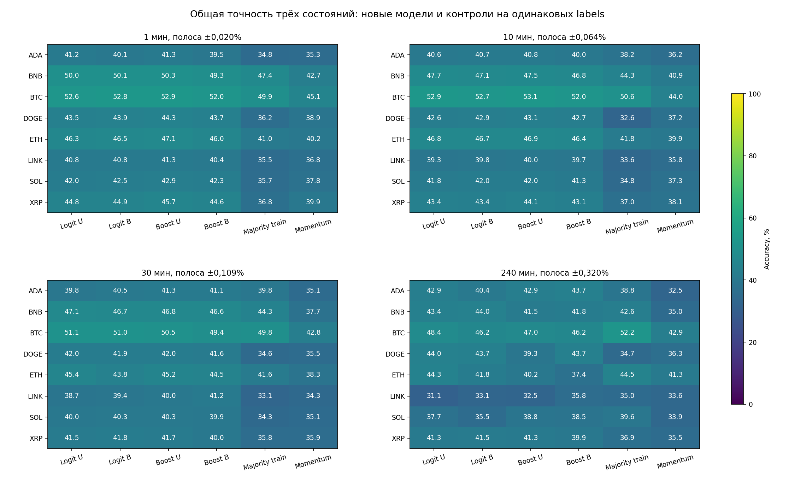
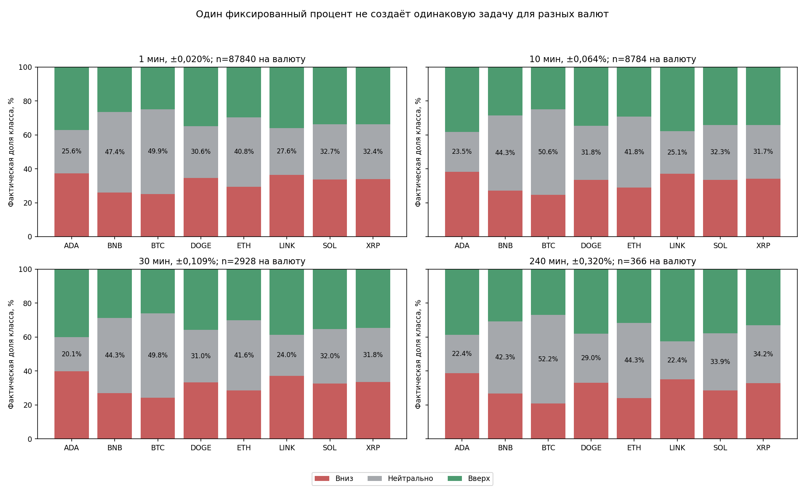
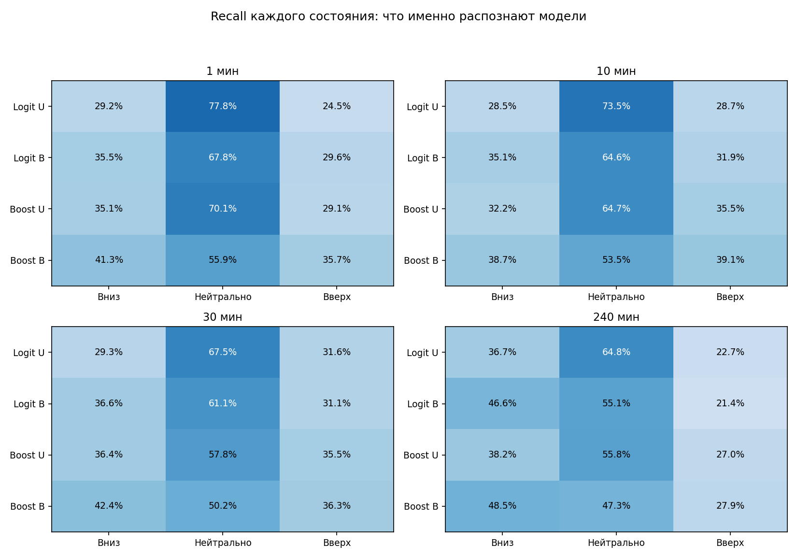

# Фиксированные пороги: полный базовый пересчёт трёхклассовых прогнозов

Дата: 13 октября 2026. Период: **1 августа — 30 сентября 2026 UTC**, 61 календарный день. Режим: раскрытый исторический research, без торговли и без новой независимой валидации.

## Итог

Применены ровно запрошенные пороги: 1 мин ±0,020%; 10 мин ±0,064%; 30 мин ±0,109%; 4 часа ±0,320%. Каждый порог фиксирован для всех восьми валют и всех origins. Это **не** прежний адаптивный per-asset train_q50 и не процент точности модели.

Заново обучены логистическая модель и boosting, каждая с обычными и сбалансированными весами. Выполнены 336 fit, 0 prior-only замен, 0 предупреждений. Пересчитаны все 416 metric cells, включая пять общих контролей и четыре сохранённых старых диагностических прогноза.

Сводка ниже — медианы по восьми валютам, не финансовая доходность и не единый глобальный рейтинг.

| Горизонт | Полоса | Logit U | Logit B | Boost U | Boost B | Majority train |
|---|---:|---:|---:|---:|---:|---:|
| 1 мин | ±0,020% | 44,16% | 44,38% | 45,01% | 44,16% | 36,51% |
| 10 мин | ±0,064% | 43,00% | 43,11% | 43,59% | 42,92% | 37,64% |
| 30 мин | ±0,109% | 41,73% | 41,85% | 41,84% | 41,39% | 37,76% |
| 240 мин | ±0,320% | 43,17% | 41,67% | 40,71% | 40,85% | 39,21% |

U — обычные веса всех обучающих исходов; B — class-balanced веса только по train. Ни одна модель/полоса не выбрана по максимальной тестовой accuracy. Общая accuracy трёх классов не равна условной точности знака и не сравнима напрямую с прежней бинарной accuracy на других labels.

Рисунок 1. Каждая ячейка — доля правильных ответов на полном наборе допустимых интервалов данной валюты и горизонта. Контроли оцениваются на тех же labels. Не показаны здесь legacy-контроли: они есть в полных таблицах, но обучались на иных определениях цели.

## Измерительная семантика

r = 100 × (P после горизонта / P в момент прогноза − 1). Ответ «вниз», если r < −δ; «нейтрально», если |r| ≤ δ; «вверх», если r > δ. Границы включены в нейтральный класс. δ=0,020% соответствует 2 bps, 0,064% — 6,4 bps, 0,109% — 10,9 bps, 0,320% — 32 bps. Нейтрально здесь означает малое, а не обязательно нулевое изменение цены.

Все прогнозы имеют одно из трёх состояний, coverage=100% допустимой сетки. Нейтральный ответ не является отказом от выдачи прогноза и сам по себе не задаёт торговое действие.

## Данные, модели и причинность

- Данные: замороженные `direction_multiscale_v1_20261012/tf_{1,10,30,240}m/{times,closes,features}.npy`. Сохранены hashes 348 входов: 12 массивов и 336 legacy forecast NPZ. Сырые котировки заново не загружались.
- Валюты: ADA, BNB, BTC, DOGE, ETH, LINK, SOL, XRP. Прогноз следующей свечи: горизонт, шаг примеров и частота решений равны 1/10/30/240 минут; retrain — каждые 3 дня.
- 21 origin. Rolling30d включает 7 дней calibration; примерно 23 дня для fit. Purge7 баров на обеих границах, строгая зрелость labels до cutoff. Общий time sample до 4000 времён × 8 валют, совпадающий с прежним strict-boundary протоколом.
- Все labels, включая нейтральные, остаются в train. Отдельный unweighted scaler на каждом origin; одинаковый scaler/labels для четырёх кандидатов. Веса меняют только loss, не scaler или временную выборку.
- Logit: прежние 12 признаков, 3 класса, 39 номинальных коэффициентов, C=0,1, max_iter120. Boosting: 32 итерации, 3 дерева на итерацию, максимум 7 листьев, min_leaf128, L2=10. У boosting максимум 672 leaf values плюс splits; это более сложная модель, чем linear.
- Balanced weights = N/(3 × train_class_count), нормированы до среднего 1. Расчёт только по pooled train. При нехватке 32 исходов любого класса предусмотрен помеченный prior fallback; в этом расчёте он не потребовался.
- Классы вероятностей всегда идут в порядке вниз/нейтрально/вверх. Ledger содержит SHA модели через candidate-index lookup для каждого прогноза/валюты.
- Ни bands, ни hyperparameters, ни веса, ни calibration-пороги не подбирались по текущему test. Сами четыре процента выбраны пользователем после просмотра прежних research-отчётов: это раскрыто как адаптивная история, а не скрыто под видом полностью нового preregistered holdout.

## Состав сравнения

Полный **базовый** пересчёт охватывает два обучаемых семейства и два режима весов, все контроли, восемь валют и четыре горизонта. Расширенная матрица lag/context/recency/MLP/GA в этот ограниченный прогон не включалась; торговые стратегии не переобучались.

Основные контроли: всегда нейтрально, majority train, random с 1/3 на класс, random по train priors, momentum предыдущей свечи с той же полосой. Случайные числа общие и фиксированные.

Legacy diagnostics: сохранённые binary logit/boosting, прежняя ternary train_q50 и ternary ±0,1%. Их ответы заново оценены **на текущих фиксированных labels**, без нового fit. Поэтому абсолютные результаты в таблицах сопоставимы по test-исходам, но legacy обучались на другом target. Их преимущество/проигрыш не доказывает автоматически улучшение самого направления.

## Классы и точность по каждой валюте

Рисунок 2. Одинаковая полоса в процентах даёт разную долю нейтральных исходов для BTC и более волатильных активов. Нельзя сравнивать 45% на этих labels и 47% прежнего train_q50 как изменение качества одной неизменной задачи.

### 1 минут, ±0,020%

n=87840 на каждую валюту.

| Валюта | Нейтральных | Logit U | Logit B | Boost U | Boost B | Majority | Momentum |
|---|---:|---:|---:|---:|---:|---:|---:|
| ADA/USDT | 25,62% | 41,19% | 40,10% | 41,26% | 39,48% | 34,79% | 35,27% |
| BNB/USDT | 47,44% | 50,02% | 50,05% | 50,31% | 49,34% | 47,44% | 42,67% |
| BTC/USDT | 49,95% | 52,57% | 52,82% | 52,95% | 52,04% | 49,95% | 45,06% |
| DOGE/USDT | 30,56% | 43,50% | 43,86% | 44,34% | 43,72% | 36,22% | 38,92% |
| ETH/USDT | 40,83% | 46,29% | 46,54% | 47,11% | 46,01% | 41,02% | 40,16% |
| LINK/USDT | 27,61% | 40,82% | 40,82% | 41,31% | 40,42% | 35,48% | 36,80% |
| SOL/USDT | 32,65% | 42,04% | 42,45% | 42,88% | 42,28% | 35,65% | 37,79% |
| XRP/USDT | 32,36% | 44,83% | 44,90% | 45,68% | 44,60% | 36,79% | 39,88% |

### 10 минут, ±0,064%

n=8784 на каждую валюту.

| Валюта | Нейтральных | Logit U | Logit B | Boost U | Boost B | Majority | Momentum |
|---|---:|---:|---:|---:|---:|---:|---:|
| ADA/USDT | 23,51% | 40,56% | 40,65% | 40,82% | 40,04% | 38,23% | 36,24% |
| BNB/USDT | 44,31% | 47,73% | 47,05% | 47,52% | 46,76% | 44,31% | 40,92% |
| BTC/USDT | 50,57% | 52,95% | 52,71% | 53,09% | 52,00% | 50,57% | 43,98% |
| DOGE/USDT | 31,84% | 42,57% | 42,87% | 43,11% | 42,70% | 32,57% | 37,19% |
| ETH/USDT | 41,78% | 46,84% | 46,73% | 46,86% | 46,37% | 41,78% | 39,95% |
| LINK/USDT | 25,10% | 39,29% | 39,75% | 40,02% | 39,67% | 33,64% | 35,84% |
| SOL/USDT | 32,27% | 41,78% | 41,99% | 41,95% | 41,26% | 34,76% | 37,30% |
| XRP/USDT | 31,74% | 43,44% | 43,35% | 44,07% | 43,15% | 37,04% | 38,08% |

### 30 минут, ±0,109%

n=2928 на каждую валюту.

| Валюта | Нейтральных | Logit U | Logit B | Boost U | Boost B | Majority | Momentum |
|---|---:|---:|---:|---:|---:|---:|---:|
| ADA/USDT | 20,08% | 39,82% | 40,51% | 41,26% | 41,05% | 39,75% | 35,11% |
| BNB/USDT | 44,26% | 47,06% | 46,69% | 46,79% | 46,55% | 44,26% | 37,74% |
| BTC/USDT | 49,76% | 51,06% | 50,96% | 50,48% | 49,42% | 49,76% | 42,76% |
| DOGE/USDT | 30,98% | 42,01% | 41,87% | 41,97% | 41,63% | 34,63% | 35,48% |
| ETH/USDT | 41,56% | 45,42% | 43,82% | 45,18% | 44,54% | 41,56% | 38,29% |
| LINK/USDT | 24,04% | 38,70% | 39,38% | 39,96% | 41,15% | 33,06% | 34,26% |
| SOL/USDT | 32,00% | 39,96% | 40,33% | 40,27% | 39,89% | 34,26% | 35,11% |
| XRP/USDT | 31,83% | 41,46% | 41,84% | 41,70% | 40,03% | 35,76% | 35,89% |

### 240 минут, ±0,320%

n=366 на каждую валюту.

| Валюта | Нейтральных | Logit U | Logit B | Boost U | Boost B | Majority | Momentum |
|---|---:|---:|---:|---:|---:|---:|---:|
| ADA/USDT | 22,40% | 42,90% | 40,44% | 42,90% | 43,72% | 38,80% | 32,51% |
| BNB/USDT | 42,35% | 43,44% | 43,99% | 41,53% | 41,80% | 42,62% | 34,97% |
| BTC/USDT | 52,19% | 48,36% | 46,17% | 46,99% | 46,17% | 52,19% | 42,90% |
| DOGE/USDT | 28,96% | 43,99% | 43,72% | 39,34% | 43,72% | 34,70% | 36,34% |
| ETH/USDT | 44,26% | 44,26% | 41,80% | 40,16% | 37,43% | 44,54% | 41,26% |
| LINK/USDT | 22,40% | 31,15% | 33,06% | 32,51% | 35,79% | 34,97% | 33,61% |
| SOL/USDT | 33,88% | 37,70% | 35,52% | 38,80% | 38,52% | 39,62% | 33,88% |
| XRP/USDT | 34,15% | 41,26% | 41,53% | 41,26% | 39,89% | 36,89% | 35,52% |

## Распознавание направлений и проверка устойчивости

Рисунок 3. Recall каждого фактического состояния, суммирование по восьми валютам только для визуализации. Это не восемь независимых временных выборок. Полные per-asset confusion, precision/recall, macro-F1 и MCC — в `results.json` и [подробных таблицах](DETAILS_RU.md).

Условная точность знака среди **и фактически, и предсказанно** ненейтральных исходов дана отдельно. Она использует известный будущий класс для определения подгруппы, поэтому не является deployable фильтром или полной точностью прогноза. Нейтральные ошибки не выбрасывались из основного accuracy.

Block-bootstrap: 61 день, блок 3 календарных дня, 1000 повторов, два общих seed banks. Одна simultaneous max-t family: 4 кандидата × 5 основных контролей × 8 валют × 4 горизонта × 2 метрики = 1280 сравнений. Legacy диагностические сравнения не выдаются за дополнительный независимый подтверждающий тест.

| Горизонт | Logit U | Logit B | Boost U | Boost B |
|---|---:|---:|---:|---:|
| 1 мин | 0 / 8 | 0 / 8 | 2 / 8 | 1 / 8 |
| 10 мин | 0 / 8 | 0 / 8 | 2 / 8 | 1 / 8 |
| 30 мин | 0 / 8 | 0 / 8 | 0 / 8 | 0 / 8 |
| 240 мин | 0 / 8 | 0 / 8 | 0 / 8 | 0 / 8 |

В этой таблице считаются валюты, где **и accuracy, и macro-F1** имеют положительную simultaneous paired LCB против **всех пяти** основных контролей в **обоих** seed banks. Всего 6 из 128 candidate/asset/horizon задач. Это внутренний research-критерий на раскрытом периоде, не независимая валидация и не допуск к деньгам.

Дополнительно рассчитаны log loss и multiclass Brier для всех новых моделей. Class-balanced loss меняет priors и может ухудшать калибровку вероятностей при реальном class balance; нельзя считать его вероятности автоматически калиброванными или выбирать веса лишь по overall accuracy.

## Проверки и файлы доказательств

| Требование | Реализация / свидетельство | Статус |
|---|---|---|
| Четыре точных фиксированных порога | config, checks.json, каждый ledger band_pct | PASS |
| Настоящие три класса у двух семейств | 336 pinned model files, probabilities[...,3] | PASS |
| Причинный scaler и зрелые labels, purge7 | folds/cutoff SHA, audit_*m.json | PASS |
| Общая сетка и все 8 валют × 4 горизонта | 84 forecast ledgers, n на валюту | PASS |
| Uniform/balanced при прочих равных | одинаковые train indices/scaler, class_weight_mass | PASS |
| Старые прогнозы на тех же новых labels | legacy_predictions, source pins | PASS |
| Пересчёт метрик и парного bootstrap без fit | 4 audit-прогона, 416 cells, 1280 columns | PASS |
| Полная новая независимая валидация | этот период уже раскрыт | НЕ ВЫПОЛНЕНА |

12 детерминированных проверок, 6 синтетических fit, py_compile отдельных файлов. Аудит без переобучения повторно подтвердил labels, пороги, model SHA, mean/std, priors, веса, probability reload parity, log loss/Brier, confusion, accuracy/macro-F1, общие bootstrap banks и финальные simultaneous bounds. Нет предупреждений о сходимости. Входные hashes и версии Python/numpy/sklearn/joblib зафиксированы.

Все семь permissions credentials/orders/paper/live/runtime/network/promotion остаются false. Нет pytest, collector, WebSocket, сетевых запросов, торгов или фоновых процессов. Старые результаты и dirty worktree вне новых scoped research-файлов не менялись; registry обновлён новой версией v22.

## Ограничения и следующий шаг

1. 80–90% точности направления не подтверждены. Рост трёхклассового качества может происходить за счёт предсказуемости масштаба движения/волатильности, а не сильного прогноза знака.
2. Нет единой лучшей архитектуры на всех горизонтах. Не объявлять победителя по сотым долям процента или агрегированию, в котором минутные строки подавляют остальные горизонты.
3. Порог выбран после истории многократных исследований. Ни bootstrap seed, ни новый registry не делают август–сентябрь независимыми. Перед следующим подтверждающим этапом нужен замороженный контракт и действительно новый интервал; существующий prospective-контракт не переписан.
4. Это прогнозный OHLCV-эксперимент. Стаканные single-day/multiday модели, реалистичное исполнение, капитал, costs и funding здесь не пересчитывались; прибыли и доступности реальных fills из accuracy не следует.
5. В дальнейшей исследовательской модели имеет смысл разделить вероятность существенного движения и условный знак, чтобы измерять добавку каждого компонента. Это предложение, не уже выполненное новое обучение.

## Артефакты

- [Полная статистика всех 416 model/control cells](DETAILS_RU.md).
- `results.json`, `results_*m.json`, `summary.json`: цифры и paired confidence bounds.
- `direction_conditioning.json`, `research_comparison_gates.json`: условная диагностика и строгие research counts.
- `origin_*/tf_*m.npz/.json/.joblib`: решения, модель SHA, folds/cutoff, параметры и вероятности.
- `registration.json`, registry v22, `checks.json`, `audit_*m.json`: воспроизводимость.
- Отчёт Markdown/PNG; DOCX не запрашивался и не создавался.
