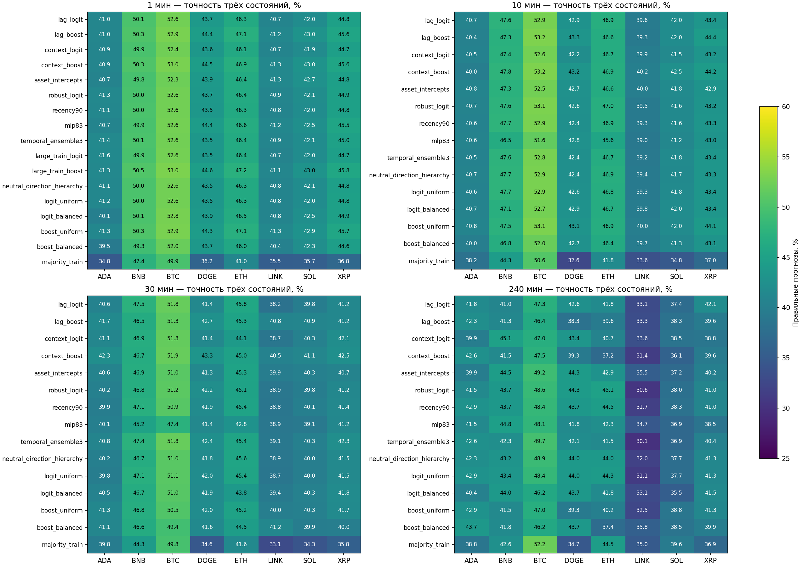
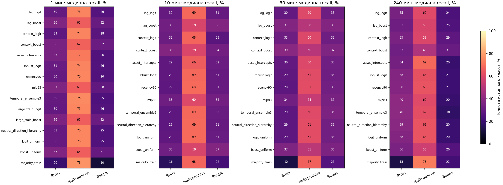
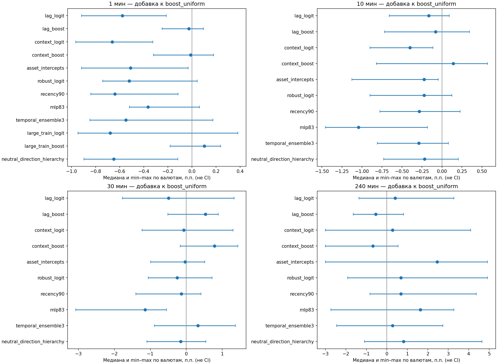

# Расширенная матрица трёхрежимных прогнозов

Дата: 14 октября 2026. Период исследований: 1 августа — 30 сентября 2026 UTC.

## Краткий итог

Расширение не подтвердило общего устойчивого преимущества над базовыми моделями: строгий исследовательский gate прошли **0 из 336** сочетаний модель/валюта/горизонт. Это не доказательство полного отсутствия сигнала: 31 отдельных сравнений с базовыми logit_uniform/boost_uniform имеют положительный одновременный LCB в обоих banks, но не выполняют весь набор критериев. Лучшие наблюдаемые медианы трёхклассовой accuracy — 42,86–45,18%. Ни 80%, ни 90% на полном покрытии не получены.

Получено 882 модельных артефакта и выполнено 882 исторических estimator fits: 714 одиночных, 84×2 для иерархии; ещё 84 ансамбля повторно используют базовые модели без fit. Пять synthetic fits учтены отдельно. Базовые модели и прежние эксперименты не переобучались и не изменялись.

| Горизонт | Лучший новый по медиане accuracy* | Accuracy, % | Лучшая база | База, % | Разница медиан, п.п. |
|---:|---|---:|---|---:|---:|
| 1 мин | large_train_boost | 45.18 | boost_uniform | 45.01 | +0.18 |
| 10 мин | lag_boost | 43.84 | boost_uniform | 43.59 | +0.25 |
| 30 мин | context_boost | 42.86 | logit_balanced | 41.85 | +1.01 |
| 240 мин | recency90 | 43.31 | logit_uniform | 43.17 | +0.14 |

* Постфактум описательный максимум, не заранее выбранный победитель. Разница двух медиан не является парной оценкой эффекта; парные comparisons хранятся отдельно. Максимальная ячейка: context_boost, BTC/USDT, 10 мин — 53.24%; выбирать модель по этому максимуму нельзя.

## Источники и ограничения данных

Исходные OHLCV memmaps times.npy/closes.npy/features.npy — direction_multiscale_v1_20261012. Pooled-модели обучаются сразу на восьми активах; метрики считаются отдельно для ADA, BNB, BTC, DOGE, ETH, LINK, SOL, XRP. Это не восемь независимо обученных моделей. OHLCV не содержит нового полного потока стакана/агрессоров/on-chain. Все input SHA закреплены в registration.json; сохранённые родительские forecasts и модели — direction_ternary_fixed_v1_20261013.

Август–сентябрь уже раскрыт в нескольких исследованиях; пороги также выбраны после их изучения. Прогон зарегистрирован до новых fits, но не является независимой валидацией. Отдельный bootstrap seed не заменяет новые рыночные данные. Неизвестное полное число старых адаптивных попыток не исправляется локальной поправкой этого опыта.

## Единая задача и pipeline

1. Для каждого horizon берутся причинные OHLCV-признаки на закрытом интервале.
2. 21 origin, retrain каждые 3 дня. Rolling 30 дней включает 7 дней calibration: фактический train примерно 23 дня минус purge. Calibration не используется для подбора параметров этого опыта. Строгие endpoints до train/calibration cutoffs, purge 7 баров. Исходная временная выборка совпадает с базой; cap 4000 times.
3. Scaler mean/std обучается заново на каждом origin только на train; нейтральные исходы не удаляются. Для robust winsor 0,5/99,5 percentiles тоже только train. В иерархии scaler второго этапа обучается только на mature moves; это отдельная условная задача.
4. Получаются три вероятности; решение argmax на каждом допустимом интервале, без отказов.
5. Confusion и правильные вероятностные losses накапливаются на полном периоде, по каждой валюте. Общие календарные bootstrap blocks для всех моделей.
6. Отдельный audit проверяет SHA, folds/cutoffs, scalers, repeat-predict, confusion, bootstrap draws и LCB без обучения.

r = 100 × (close[t+h] / close[t] − 1). Down при r < −δ; neutral при |r| ≤ δ (границы включены); up при r > δ. δ: 1m 0,020%; 10m 0,064%; 30m 0,109%; 240m 0,320%. Это фиксированные общие полосы для всех активов/origins, не старый per-asset train_q50. Accuracy = правильные из всех прогнозов; macro-F1 = среднее F1 трёх классов. Нейтральный класс означает движение внутри полосы, не буквально равную цену.

## Проверенные гипотезы и архитектуры

| Вариант | Смысл | Признаки | Номинальные параметры / лимит |
|---|---|---:|---|
| lag_logit / lag_boost | Лаги 1/2/3/6 прошлых баров для трёх OHLCV-компонент | 24 | logit 75; boost до 672 leaf values + splits |
| context_logit / context_boost | Час/сутки/неделя, волатильность, общий рынок, время UTC | 20 | logit 63; boost тот же лимит |
| asset_intercepts | Общие признаки + 7 intercept-индикаторов активов | 19 | logit 60 |
| robust_logit | Train-only winsorization | 12 | logit 39 |
| recency90 | Half-life 90 дней для ВСЕХ трёх исходов | 12 | logit 39 |
| mlp83 | 6→8→3, tanh, LBFGS, alpha=10 | 6 | 83; max_iter=80, max_fun=160 |
| temporal_ensemble3 | Текущий + до двух прошлых logit_uniform; текущие признаки | 12 | 1–3×39; новых fit нет |
| large_train_logit / large_train_boost | Nested cap 16000 вместо 4000 только для 1m | 12 | 39 / тот же boost |
| neutral_direction_hierarchy | move/neutral → up/down | 12 на этап | 2 бинарных logit, всего 26 |

Logit: C=0,1, max_iter=120, tol=1e−6. Multiclass коэффициенты указаны номинально, с softmax избыточностью. Boost: 32 итерации, 3 дерева на итерацию, 7 листьев, min leaf 128, learning rate 0,08, L2=10, early stopping отключён. Все варианты uniform по классам; recency меняет только временной вес exp2(−age/90d), scaler невзвешенный. Большая выборка только на 1m: на остальных сетках cap=4000 уже не ограничивал объём. В context 240m часовой lag заменён доступным лагом 4h, это явно зарегистрировано.

Binary MLP65 не выдаётся за модель с прежним числом параметров: три выхода дают 83. Старый exact-flat gate с отказами заменён full-coverage band-aware иерархией: P(down)=P(move)×(1−P(up|move)); P(neutral)=1−P(move); P(up)=P(move)×P(up|move). Старые бинарные price-probabilities не используются как новые трёхклассовые targets.

## Сходимость и воспроизводимость

**Все 84 исторических MLP fits достигли лимита 80 итераций.** Их результаты воспроизводимы, но оптимизация не сошлась; увеличение лимита после просмотра теста было бы новым опытом. Других warning нет, prior fallback не потребовался. Добавление сложности не дало ожидаемого скачка точности.

Пройдены 9 pure checks и 5 synthetic estimator fits. Repeat-predict всех 882 артефактов: максимальная ошибка 0. Confusion пересчитаны независимым накоплением, проверены все 624 metric cells. Второй audit независимо проверил 4704 paired differences, все bootstrap columns в двух banks и max-t LCB. Проверены 4583 старых artifact SHA и 890 зарегистрированных input pins; прежние registry entries неизменны.

## Неопределённость и ranking

Для каждого нового метода/актива/горизонта сохранены 95% marginal CI accuracy/macro-F1. Основной gate строже: одновременный односторонний max-t LCB положителен для accuracy и macro-F1 против всех 7 controls (neutral, majority, два random, momentum, logit_uniform, boost_uniform), в обоих banks. Семейство — 4704 comparisons, 1000 повторов, circular календарные blocks 3 дня, 61 день. Block size зафиксирован, но его достаточность при более длинной зависимости не доказана. Нельзя трактовать все сотни тысяч минутных строк как независимые наблюдения.

## Все медианы по валютам

| Мин | Метод | Accuracy, % | Macro-F1 | Recall вниз / нейтр. / вверх, % |
|---:|---|---:|---:|---|
| 1 | lag_logit | 44.29 | 0.4004 | 30.2 / 74.5 / 26.2 |
| 1 | lag_boost | 45.03 | 0.4160 | 36.5 / 65.9 / 31.5 |
| 1 | context_logit | 44.17 | 0.3994 | 28.6 / 74.4 / 27.8 |
| 1 | context_boost | 45.05 | 0.4151 | 35.9 / 67.0 / 31.8 |
| 1 | asset_intercepts | 44.35 | 0.4102 | 34.8 / 72.2 / 25.5 |
| 1 | robust_logit | 44.30 | 0.4025 | 30.9 / 74.3 / 25.8 |
| 1 | recency90 | 44.17 | 0.4009 | 30.4 / 74.7 / 25.6 |
| 1 | mlp83 | 44.97 | 0.4077 | 36.6 / 66.3 / 29.7 |
| 1 | temporal_ensemble3 | 44.24 | 0.4004 | 30.4 / 75.5 / 24.9 |
| 1 | large_train_logit | 44.12 | 0.3998 | 29.7 / 75.0 / 26.0 |
| 1 | large_train_boost | 45.18 | 0.4159 | 36.1 / 66.4 / 31.9 |
| 1 | neutral_direction_hierarchy | 44.13 | 0.4009 | 30.6 / 74.7 / 25.4 |
| 1 | logit_uniform | 44.16 | 0.4008 | 30.5 / 74.8 / 25.5 |
| 1 | logit_balanced | 44.38 | 0.4098 | 36.5 / 64.4 / 30.1 |
| 1 | boost_uniform | 45.01 | 0.4162 | 36.8 / 66.1 / 30.8 |
| 1 | boost_balanced | 44.16 | 0.4237 | 42.4 / 51.7 / 36.9 |
| 1 | always_neutral | 32.51 | 0.1635 | 0.0 / 100.0 / 0.0 |
| 1 | majority_train | 36.51 | 0.3149 | 19.7 / 77.7 / 10.4 |
| 1 | random_uniform_3 | 33.26 | 0.3311 | 33.1 / 33.3 / 33.3 |
| 1 | random_train_prior | 33.84 | 0.3355 | 30.9 / 39.2 / 31.1 |
| 1 | momentum_deadband | 39.40 | 0.3891 | 35.6 / 44.6 / 36.3 |
| 10 | lag_logit | 43.13 | 0.3980 | 30.2 / 68.5 / 30.5 |
| 10 | lag_boost | 43.84 | 0.4083 | 33.5 / 58.6 / 37.5 |
| 10 | context_logit | 42.73 | 0.3915 | 32.3 / 67.9 / 28.0 |
| 10 | context_boost | 43.70 | 0.4116 | 37.7 / 58.6 / 33.8 |
| 10 | asset_intercepts | 42.82 | 0.3995 | 29.3 / 65.9 / 31.7 |
| 10 | robust_logit | 42.87 | 0.3975 | 29.1 / 68.7 / 30.6 |
| 10 | recency90 | 42.85 | 0.3965 | 28.7 / 69.1 / 30.6 |
| 10 | mlp83 | 42.90 | 0.3976 | 32.6 / 59.9 / 33.7 |
| 10 | temporal_ensemble3 | 42.91 | 0.3954 | 28.8 / 68.5 / 31.5 |
| 10 | neutral_direction_hierarchy | 42.87 | 0.3973 | 28.8 / 69.0 / 30.7 |
| 10 | logit_uniform | 43.00 | 0.3964 | 29.0 / 69.1 / 30.9 |
| 10 | logit_balanced | 43.11 | 0.4028 | 34.5 / 60.6 / 33.4 |
| 10 | boost_uniform | 43.59 | 0.4073 | 33.1 / 58.6 / 37.5 |
| 10 | boost_balanced | 42.92 | 0.4189 | 39.0 / 47.0 / 41.1 |
| 10 | always_neutral | 32.06 | 0.1618 | 0.0 / 100.0 / 0.0 |
| 10 | majority_train | 37.64 | 0.3101 | 16.1 / 68.0 / 22.3 |
| 10 | random_uniform_3 | 33.15 | 0.3297 | 33.1 / 33.5 / 33.0 |
| 10 | random_train_prior | 33.77 | 0.3314 | 31.4 / 36.5 / 31.3 |
| 10 | momentum_deadband | 37.69 | 0.3775 | 35.0 / 42.1 / 35.5 |
| 30 | lag_logit | 41.27 | 0.3836 | 30.0 / 59.8 / 32.7 |
| 30 | lag_boost | 42.18 | 0.4051 | 37.2 / 49.7 / 37.8 |
| 30 | context_logit | 41.75 | 0.3849 | 32.6 / 59.5 / 32.7 |
| 30 | context_boost | 42.86 | 0.4108 | 39.2 / 50.1 / 36.7 |
| 30 | asset_intercepts | 41.02 | 0.3765 | 30.0 / 59.6 / 33.0 |
| 30 | robust_logit | 41.72 | 0.3875 | 29.2 / 60.9 / 32.7 |
| 30 | recency90 | 41.62 | 0.3880 | 28.6 / 61.5 / 33.3 |
| 30 | mlp83 | 41.26 | 0.3831 | 33.6 / 53.8 / 35.1 |
| 30 | temporal_ensemble3 | 42.38 | 0.3897 | 28.6 / 60.2 / 36.0 |
| 30 | neutral_direction_hierarchy | 41.68 | 0.3880 | 28.7 / 61.5 / 33.2 |
| 30 | logit_uniform | 41.73 | 0.3870 | 28.6 / 61.4 / 33.3 |
| 30 | logit_balanced | 41.85 | 0.3877 | 36.4 / 55.5 / 32.3 |
| 30 | boost_uniform | 41.84 | 0.4025 | 36.6 / 51.5 / 36.2 |
| 30 | boost_balanced | 41.39 | 0.4046 | 42.3 / 42.8 / 35.5 |
| 30 | always_neutral | 31.92 | 0.1613 | 0.0 / 100.0 / 0.0 |
| 30 | majority_train | 37.76 | 0.2955 | 12.1 / 66.7 / 26.3 |
| 30 | random_uniform_3 | 33.45 | 0.3327 | 32.8 / 33.0 / 34.0 |
| 30 | random_train_prior | 34.26 | 0.3350 | 30.8 / 35.8 / 33.5 |
| 30 | momentum_deadband | 35.69 | 0.3535 | 31.9 / 39.5 / 34.6 |
| 240 | lag_logit | 41.80 | 0.3651 | 34.9 / 60.2 / 24.5 |
| 240 | lag_boost | 39.62 | 0.3708 | 32.7 / 58.1 / 25.3 |
| 240 | context_logit | 40.30 | 0.3690 | 35.3 / 58.8 / 28.5 |
| 240 | context_boost | 39.48 | 0.3908 | 33.2 / 48.2 / 31.0 |
| 240 | asset_intercepts | 41.53 | 0.3598 | 34.3 / 68.7 / 19.9 |
| 240 | robust_logit | 42.62 | 0.3727 | 37.5 / 62.5 / 21.0 |
| 240 | recency90 | 43.31 | 0.3679 | 37.9 / 63.3 / 20.9 |
| 240 | mlp83 | 41.67 | 0.3616 | 40.3 / 60.2 / 19.8 |
| 240 | temporal_ensemble3 | 41.80 | 0.3582 | 39.8 / 61.8 / 18.0 |
| 240 | neutral_direction_hierarchy | 42.76 | 0.3629 | 39.2 / 63.4 / 20.0 |
| 240 | logit_uniform | 43.17 | 0.3639 | 37.8 / 63.3 / 20.3 |
| 240 | logit_balanced | 41.67 | 0.3728 | 47.6 / 54.0 / 20.8 |
| 240 | boost_uniform | 40.71 | 0.3757 | 35.8 / 55.8 / 26.3 |
| 240 | boost_balanced | 40.85 | 0.3843 | 46.0 / 45.5 / 28.2 |
| 240 | always_neutral | 34.02 | 0.1692 | 0.0 / 100.0 / 0.0 |
| 240 | majority_train | 39.21 | 0.2935 | 12.7 / 72.7 / 22.1 |
| 240 | random_uniform_3 | 32.24 | 0.3186 | 33.1 / 30.9 / 32.9 |
| 240 | random_train_prior | 32.51 | 0.3179 | 28.6 / 35.9 / 29.8 |
| 240 | momentum_deadband | 35.25 | 0.3446 | 28.9 / 39.3 / 34.6 |

Рисунок 1. Трёхклассовая accuracy на одинаковых labels, по каждой валюте; полный набор расширенных вариантов и базовых моделей.

Рисунок 2. Медианная полнота по классам. Преимущество за счёт neutral не означает качественное угадывание up/down.

Рисунок 3. Медиана и min–max парной добавки к boost_uniform по восьми активам; полосы — межактивный разброс, не доверительные интервалы. Показывает неоднородность улучшений.

## Что делать дальше

1. Считать этот цикл завершённым отрицательным результатом для большого расширения; не добирать 80–90% перебором порогов на раскрытом периоде.
2. Для нового теста оставить компактную базу boost_uniform и logit_uniform. Как ограниченный research shortlist рассмотреть context_boost на 30m и recency90 на 4h — наблюдаемые улучшения небольшие и ещё не доказаны; не объявлять их победителями и не переносить модель в торги.
3. До нового fit проверить календарную и межактивную стабильность, калибровку вероятностей и признаки на более широком train-only development участке. Утверждать новый контракт и бюджет отдельно.
4. Запечатать действительно новый временной период, сохранив bands, controls и causal preprocessing; единственный финальный анализ, без настройки по промежуточным результатам.
5. Для минутных направлений приоритет — многодневные синхронные L2/trades и независимая проверка их availability; однодневный BTC book не заменяет новый период.
6. Финансовый эффект проверять отдельным экспериментом с actual-transition costs/funding и непрерывным ledger, только после подтверждения предсказательной добавки. Все credentials/orders/paper/live/runtime/network/promotion разрешения остаются false.

## Артефакты и границы отчёта

registration.json — контракт, code/data hashes; objective_registry_v23 — append-only objective; origin_*/tf_* — probabilities, model/fold/scaler SHA и cutoffs; results.json — полные 624 строки, 4704 comparisons и gates; summary.json — бюджет; audit_*m.json и comparison_audit.json — проверки; DETAILS_RU.md — таблицы всех методов/валют/горизонтов, интервалы и directed-call precision; delivery_manifest.json — финальные hashes. Таблицы доступны в Markdown/JSON; CSV/XLSX/DOCX не создавались. Навык научно-технических отчётов применён для evidence-first структуры, формул, проверок и ограничений. Прибыль/капитал, торговые fills и live не оценивались: это разрешённый отдельный прогнозный блок без торговли.
