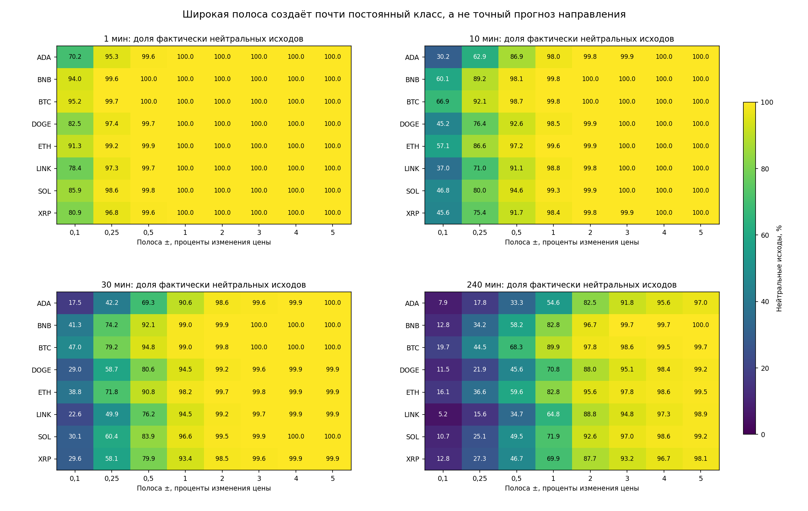
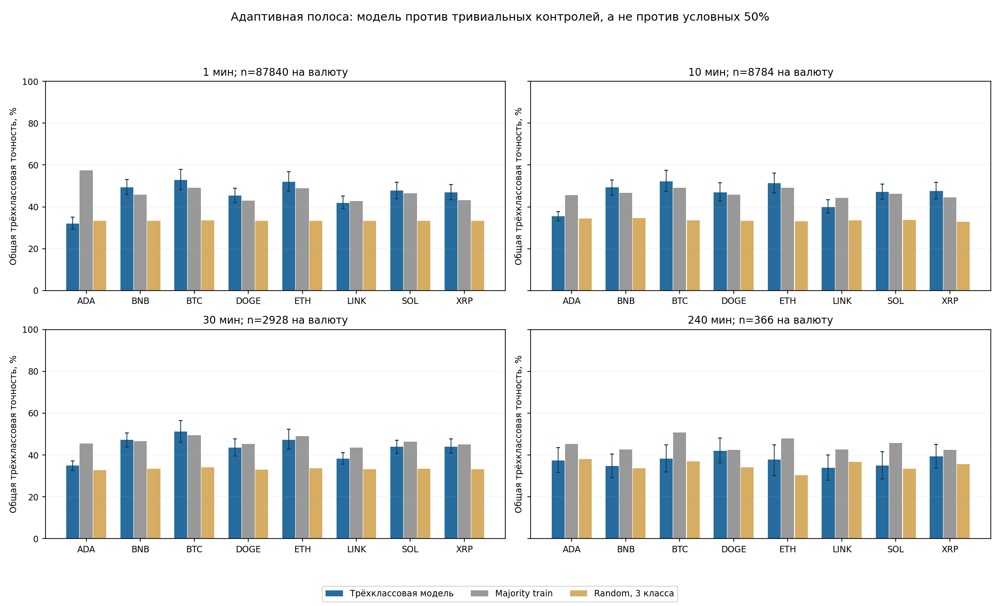
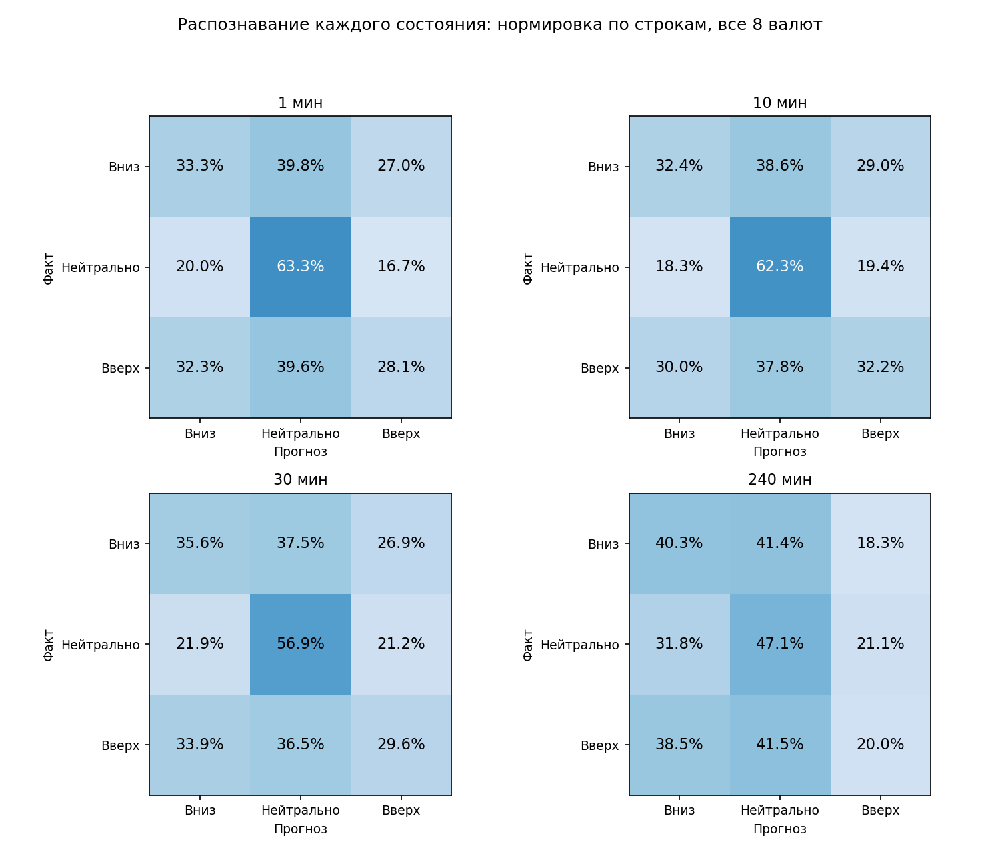

# Три состояния цены: пересчёт точности и проверка нейтральной полосы

13 октября 2026. Период: **1 августа — 30 сентября 2026 UTC**, 61 день. Это уже раскрытые исследовательские данные, не новая независимая валидация.

## Итог

Проверены точное отсутствие изменения, фиксированные полосы ±0,1/0,25/0,5/1/2/3/4/5% и предварительно заданная адаптивная полоса: медиана абсолютного будущего изменения цены только на train, отдельно для валюты и горизонта. Модель действительно переобучена на трёх классах; старые бинарные прогнозы оставлены отдельными контролями, не переименованы в трёхклассовые.

Широкие полосы дают 80–100% общей точности даже постоянному ответу «нейтрально». Это изменение определения цели, а не подтверждение 80–90% точности направления. Одного универсального порога для 1 минуты и 4 часов нет. ±0,1% меньше ±0,25%, но всё ещё широко для минутной задачи и узко для четырёхчасовой.

| Горизонт | Нейтральных при ±0,1% | Модель при ±0,1% | Нейтральных при ±0,25% | Модель при ±0,25% |
|---|---:|---:|---:|---:|
| 1 мин | 84,16% | 64,31% | 97,99% | 74,21% |
| 10 мин | 46,19% | 48,04% | 78,23% | 60,30% |
| 30 мин | 29,83% | 41,26% | 59,56% | 49,95% |
| 240 мин | 12,16% | 37,57% | 26,23% | 38,80% |

Все значения в этой сводке — медианы по восьми валютам. Точность «всегда нейтрально» равна доле нейтральных исходов. Модель — class-balanced logit; её loss не оптимизирует только overall accuracy и специально не игнорирует редкие направления.

Рисунок 1. Нейтральная полоса меняет class balance по-разному на разных горизонтах. Цвет и число — доля исходов внутри полосы, не качество обученной модели.

## Правило класса и единицы

Изменение цены измеряется в процентах: r = 100 × (P после горизонта / P в момент решения − 1). Если r < −δ — вниз; если |r| ≤ δ — нейтрально; если r > δ — вверх. Границы включены в нейтральную полосу.

δ=0,1 означает **0,1% = 10 bps**, δ=0,25 — **0,25% = 25 bps**, δ=5 — **5% = 500 bps**. «Нейтрально» при δ>0 означает небольшое движение, а не буквально неизменившуюся цену.

## Модель, данные и причинность

- Источник: замороженные `direction_multiscale_v1_20261012/tf_{1,10,30,240}m/{times,closes,features}.npy`.
- ADA, BNB, BTC, DOGE, ETH, LINK, SOL, XRP. Для каждого горизонта прогнозируется следующая свеча; горизонт, шаг примеров и решений равны 1/10/30/240 минут. Это отдельный OHLCV-блок, не стаканный однодневный эксперимент.
- Причинное переобучение раз в 3 дня: 21 origin. Rolling30d содержит 7 дней calibration; примерно 23 дня остаётся для fit. Сохранено до 4000 одинаково выбранных времён для всех схем, по 8 валют на время.
- Purge7 баров на обеих границах; label должен завершиться строго раньше cutoff. Нейтральные labels не удаляются. Scaler обучается только на fit-строках, без class/target-dependent удаления строк.
- Модель: multinomial logistic regression, 12 прежних признаков, 39 номинальных коэффициентов (3×(12+1)), C=0,1, class_weight=balanced, max_iter=120. Нет MLP, GA, tuning или торговли.
- Если в pooled train меньше 32 исходов хотя бы одного класса, estimator не обучается: используется помеченный train-prior fallback. Наличие `.joblib` в таком случае не означает обучение полноценного классификатора.
- Семь контролей: всегда нейтрально, majority train, uniform random по 3 классам, random по train priors, momentum с той же полосой, два прежних бинарных прогноза. Общая временная сетка, полное покрытие.
- Порог train_q50 вычисляется отдельно для каждой валюты на каждом origin. Он не калибруется по test или calibration. Пересчёт каждые 3 дня — зафиксированное правило, не адаптивный поиск победителя.

## Порог, учитывающий таймфрейм

Для рабочей исследовательской постановки оставлено train_q50: нижняя половина абсолютных движений в обучении считается нейтральной. Это осмысленное заранее заданное определение масштаба, **не доказанный оптимальный торговый порог**. Отдельная финансовая постановка должна учитывать costs и полезность действий.

| Валюта | 1 мин, δ% | 10 мин, δ% | 30 мин, δ% | 240 мин, δ% |
|---|---:|---:|---:|---:|
| ADA/USDT | 0,0537 | 0,1604 | 0,2720 | 0,7690 |
| BNB/USDT | 0,0175 | 0,0644 | 0,1090 | 0,3149 |
| BTC/USDT | 0,0198 | 0,0641 | 0,1094 | 0,3201 |
| DOGE/USDT | 0,0285 | 0,0994 | 0,1636 | 0,4740 |
| ETH/USDT | 0,0261 | 0,0819 | 0,1381 | 0,3629 |
| LINK/USDT | 0,0361 | 0,1209 | 0,2104 | 0,6176 |
| SOL/USDT | 0,0298 | 0,0963 | 0,1581 | 0,4811 |
| XRP/USDT | 0,0278 | 0,0900 | 0,1608 | 0,4409 |

Это медианы 21 train-порога, не дополнительные подобранные константы. Минимум и максимум по origins приведены в полной статистике. Одни и те же проценты для всех валют также могут быть несопоставимы из-за разной волатильности.

## Результат адаптивной трёхклассовой задачи

Рисунок 2. Accuracy модели сопоставляется с majority train и random3 на одинаковых исходах. Интервалы — точечные 95% calendar-block CI первого seed bank; для выводов по сравнениям ниже использованы парные simultaneous LCB обоих банков, а не пересечение этих столбиков.

### 1 минут

| Валюта | n | Модель | Majority train | Macro-F1 | Recall вниз / нейтр. / вверх | Условный знак¹ | n¹ |
|---|---:|---:|---:|---:|---|---:|---:|
| ADA/USDT | 87840 | 31,91% | 57,41% | 31,87% | 50,86% / 20,45% / 43,88% | 51,93% | 34119 |
| BNB/USDT | 87840 | 49,38% | 45,82% | 36,96% | 16,76% / 89,06% / 14,89% | 50,62% | 14869 |
| BTC/USDT | 87840 | 52,96% | 49,19% | 39,05% | 18,31% / 90,08% / 15,74% | 50,66% | 15001 |
| DOGE/USDT | 87840 | 45,47% | 42,90% | 42,72% | 36,03% / 61,26% / 31,20% | 50,86% | 33138 |
| ETH/USDT | 87840 | 52,00% | 49,01% | 43,31% | 28,29% / 78,64% / 24,50% | 51,35% | 23019 |
| LINK/USDT | 87840 | 41,94% | 42,76% | 41,22% | 42,84% / 45,61% / 35,59% | 50,62% | 38946 |
| SOL/USDT | 87840 | 47,77% | 46,42% | 43,30% | 35,78% / 65,58% / 28,95% | 50,31% | 30262 |
| XRP/USDT | 87840 | 46,92% | 43,12% | 44,23% | 38,95% / 62,12% / 31,85% | 50,50% | 35025 |

### 10 минут

| Валюта | n | Модель | Majority train | Macro-F1 | Recall вниз / нейтр. / вверх | Условный знак¹ | n¹ |
|---|---:|---:|---:|---:|---|---:|---:|
| ADA/USDT | 8784 | 35,48% | 45,64% | 35,41% | 48,28% / 22,72% / 44,17% | 51,99% | 4243 |
| BNB/USDT | 8784 | 49,26% | 46,74% | 38,51% | 20,54% / 83,93% / 17,20% | 52,01% | 1694 |
| BTC/USDT | 8784 | 52,24% | 49,11% | 39,37% | 17,81% / 87,60% / 18,42% | 53,47% | 1515 |
| DOGE/USDT | 8784 | 46,94% | 45,91% | 44,01% | 34,61% / 59,46% / 37,94% | 51,93% | 3322 |
| ETH/USDT | 8784 | 51,29% | 49,07% | 43,33% | 26,68% / 76,10% / 28,06% | 54,20% | 2260 |
| LINK/USDT | 8784 | 39,83% | 44,22% | 39,36% | 42,79% / 39,86% / 36,92% | 51,01% | 3825 |
| SOL/USDT | 8784 | 47,04% | 46,31% | 43,32% | 33,22% / 62,36% / 34,40% | 52,80% | 3021 |
| XRP/USDT | 8784 | 47,68% | 44,60% | 44,75% | 33,47% / 61,89% / 38,95% | 52,10% | 3384 |

### 30 минут

| Валюта | n | Модель | Majority train | Macro-F1 | Recall вниз / нейтр. / вверх | Условный знак¹ | n¹ |
|---|---:|---:|---:|---:|---|---:|---:|
| ADA/USDT | 2928 | 34,87% | 45,39% | 34,81% | 48,42% / 24,00% / 39,51% | 50,94% | 1378 |
| BNB/USDT | 2928 | 47,17% | 46,62% | 38,89% | 24,80% / 75,97% / 19,38% | 52,12% | 660 |
| BTC/USDT | 2928 | 51,16% | 49,42% | 39,61% | 21,75% / 83,28% / 17,98% | 51,68% | 567 |
| DOGE/USDT | 2928 | 43,58% | 45,18% | 41,47% | 37,66% / 53,29% / 33,65% | 51,44% | 1110 |
| ETH/USDT | 2928 | 47,30% | 49,04% | 40,70% | 31,64% / 68,11% / 23,14% | 52,18% | 780 |
| LINK/USDT | 2928 | 38,25% | 43,41% | 38,09% | 46,19% / 34,70% / 36,25% | 51,67% | 1314 |
| SOL/USDT | 2928 | 43,92% | 46,41% | 41,16% | 36,03% / 55,19% / 32,43% | 52,76% | 1016 |
| XRP/USDT | 2928 | 44,06% | 45,08% | 41,57% | 36,49% / 55,76% / 32,53% | 50,55% | 1096 |

### 240 минут

| Валюта | n | Модель | Majority train | Macro-F1 | Recall вниз / нейтр. / вверх | Условный знак¹ | n¹ |
|---|---:|---:|---:|---:|---|---:|---:|
| ADA/USDT | 366 | 37,43% | 45,36% | 35,10% | 52,08% / 41,57% / 17,31% | 51,52% | 132 |
| BNB/USDT | 366 | 34,70% | 42,62% | 32,41% | 26,60% / 48,08% / 23,28% | 50,49% | 103 |
| BTC/USDT | 366 | 38,25% | 50,82% | 33,61% | 23,75% / 51,08% / 26,00% | 45,45% | 99 |
| DOGE/USDT | 366 | 42,08% | 42,35% | 39,40% | 46,94% / 54,84% / 20,35% | 53,08% | 130 |
| ETH/USDT | 366 | 37,70% | 47,81% | 34,02% | 32,14% / 50,86% / 20,56% | 46,23% | 106 |
| LINK/USDT | 366 | 33,88% | 42,62% | 32,87% | 40,22% / 39,10% / 22,03% | 47,01% | 134 |
| SOL/USDT | 366 | 34,97% | 45,63% | 32,74% | 48,39% / 39,52% / 16,04% | 51,24% | 121 |
| XRP/USDT | 366 | 39,34% | 42,35% | 36,11% | 48,00% / 51,61% / 14,41% | 53,78% | 119 |

¹ Условная точность знака вычислена только там, где **и факт, и прогноз** ненейтральны. Это post-hoc диагностическая подгруппа с известным будущим, не реализуемый фильтр, не полное покрытие и не обещанная точность в торговле. Полные directional precision/recall и confusion есть в JSON.

Рисунок 3. Строки нормированы по фактическому классу. Так видно, не достигается ли overall accuracy только распознаванием нейтральных исходов. Валюты суммированы для наглядности, не объявлены независимыми рынками.

## Статистика и контроль перебора

Фиксированная сетка порогов — описательная чувствительность, без выбора лучшего по тестовой accuracy. Основная схема train_q50 задана до обучения. Общие calendar block-bootstrap banks: 61 день, блок 3 дня, 1000 повторов, два seed. Simultaneous max-t family: 448 сравнений (4 горизонта × 8 валют × 7 контролей × 2 метрики accuracy/macro-F1). 8 валют не создают восемь независимых временных периодов.

| Горизонт | Медиана accuracy | Медиана majority | Медиана macro-F1 | Положительный simultaneous accuracy-LCB против majority в обоих банках, валют |
|---|---:|---:|---:|---:|
| 1 мин | 47,35% | 46,12% | 41,97% | 1 / 8 |
| 10 мин | 47,36% | 46,11% | 41,34% | 0 / 8 |
| 30 мин | 43,99% | 45,90% | 40,15% | 0 / 8 |
| 240 мин | 37,57% | 43,99% | 33,82% | 0 / 8 |

LCB внутри уже раскрытого периода — проверка устойчивости при текущем протоколе, а не новая независимая валидация. Победа над старым binary на трёхклассовых labels ожидаема, если он никогда не выдаёт нейтральный ответ; сама по себе она не доказывает более точный знак движения.

## Воспроизводимость и ограничения

- 840 попыток обучения по конфигурациям; 449 действительно обученных estimator, 391 prior-only fallback. Дополнительно 6 синтетических fit, включая остановленный v1. Повторного обучения при аудите не было.
- 5 estimator warnings о сходимости/лимитах сохранены. Никакого увеличения итераций после просмотра теста не делалось. Их локализация — receipts моделей и `results_*m.json`.
- Аудит подтвердил 840 model/prior SHA, все causal scalers, bands, labels, legacy label parity, 2560 confusion/accuracy/macro-F1 cells и все 448 paired bootstrap columns.
- v1 остановлен до первого исторического fit: parent split допускает endpoint ровно на cutoff, v1 assertion требовал строго раньше. В v2 явно исключён endpoint равенства (не более одной строки на границе); старые helper/результаты не изменены. Это не свидетельство leakage в прежней inclusive границе: семибарный gap сохранялся. Сравнение со старым binary поэтому имеет небольшое различие train-grid на границе.
- ±0,25% включён до v1 registration. ±0,1% добавлен по прямому запросу пользователя отдельным registry v21 после начала основной работы, но до дополнительных fit и до просмотра итоговых accuracy. Главный v2 не переписывался и не переобучался из-за дополнения.
- Registry v19/v20/v21 сохранены. Это новая постановка на давно раскрытых данных; полная историческая адаптивность не устранена одним seed bank. Новый prospective-контракт не изменён.
- Выполнены py_compile отдельных файлов, 10 детерминированных проверок, strict-boundary regression, четыре независимых аудит-прогона без pytest. Все commands — foreground, один локальный шаг за раз.
- Ни сети, collector, WebSocket, торгового runtime, paper/live, credentials, ордеров или promotion. Новых OHLCV, trades/L2 не скачивалось. Трёхклассовые book-модели на декабрьском однодневном примере в этот OHLCV-эксперимент не включались.

## Практический вывод

Идея нейтрального состояния полезна: она отделяет небольшое движение от направленного значимого. Но размер полосы следует задавать по задаче и причинному масштабу каждой валюты/горизонта. Для продолжения зафиксировать train_q50 как рабочий benchmark; не выбирать ±5% ради красивых 99–100%. Проверять macro-F1, распознавание обоих направлений и добавку к majority/momentum на новом периоде. 80–90% точности направления этим пересчётом не подтверждены.

## Файлы

- [Полные таблицы по всем валютам/горизонтам/порогам и контролям](DETAILS_RU.md).
- `results.json` + соседний `direction_ternary_01pct_v1_20261013/results.json`: 2560 metric cells.
- `direction_conditioning.json`: явно условная точность знака и размер подгруппы.
- `origin_*/tf_*m.json/.npz/.joblib`: folds, cutoff, SHA моделей, train bands и каждый прогноз.
- `audit_tf_*m.json`, `checks.json`, `strict_boundary_check.json`: воспроизводимость.
- Отчёт Markdown + PNG; DOCX не запрашивался и не создавался.
