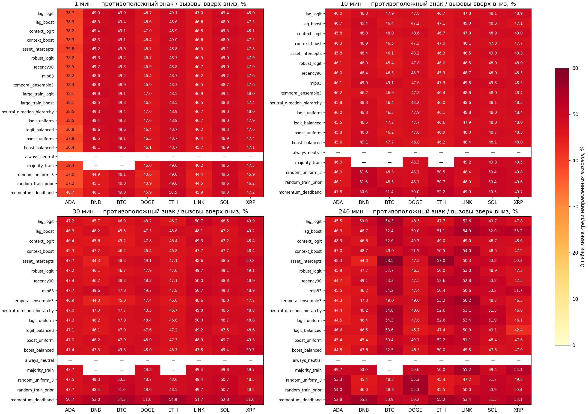
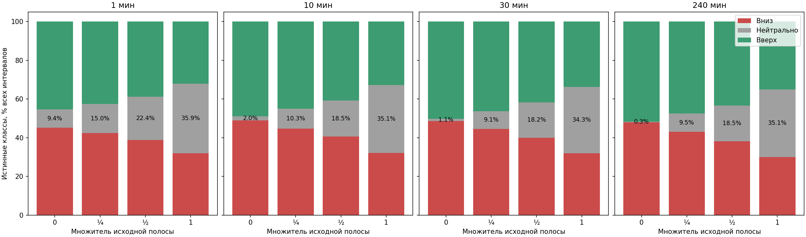
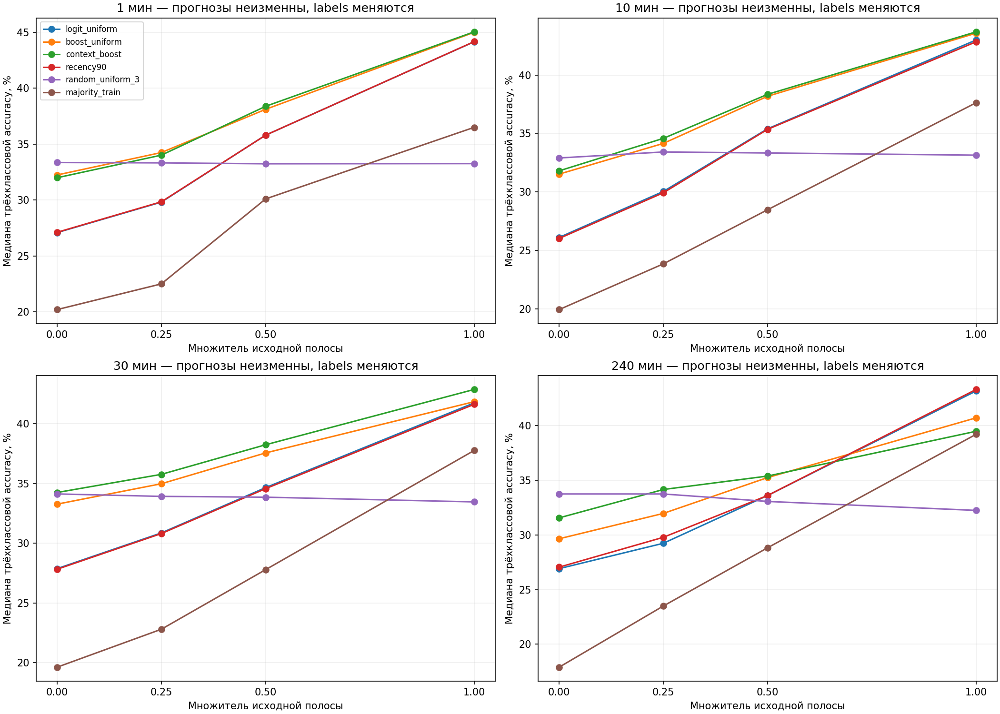

# Ошибки направления и чувствительность к нейтральной полосе

Краткие выводы и дополнительное сравнение с random при фактически ненулевых изменениях: [SUMMARY_RU.md](SUMMARY_RU.md).

Период: 1 августа — 30 сентября 2026 UTC. Анализ выполнен 14 октября 2026 без нового обучения.

## Итог и смысл проверки

Ниже отдельно измерены противоположный знак движения и движение за пределами нейтральной полосы. Они не тождественны: небольшое падение при прогнозе вверх считается ошибкой знака, но при достаточно широкой полосе относится к neutral. Уменьшение полосы не исправляет такую ошибку — лишь переносит её из категории neutral в opposite.

Исходные вероятности и решения всех моделей полностью заморожены. Проверены полосы 1×, ½×, ¼× и 0×. Это sensitivity saved predictions, **не** результаты моделей, заново обученных на более узких полосах. Порог не выбирается по наибольшей тестовой accuracy. Новых estimator fits: 0.

## Формулы и знаменатели

Opposite = N(pred=up, true=down) + N(pred=down, true=up). Основная доля = Opposite / N(pred≠neutral). Дополнительная доля = Opposite / N(всех допустимых интервалов). При отсутствии направленных вызовов основная доля не определена (—), а не 0%. Дополнительно приведены ошибки отдельно для up/down.

Для frozen направленных вызовов: верное направление + противоположное направление + истинный neutral = 100%. Прогноз neutral при реальном движении учитывается отдельно как пропуск движения. Доля противоположного направления не равна 1−общая accuracy, поскольку есть другие ошибки. Метрика среди направленных вызовов условная; модели прогнозируют на 100% интервалов, но часть прогнозов neutral.

Raw-sign opposite учитывает любое r<0 при pred=up и любое r>0 при pred=down, даже внутри полосы. Beyond-band opposite требует r<−δ либо r>δ. Exact r=0 не противоположный знак. При δ=0 эти две метрики совпадают; буквальная неизменность цены сохранена отдельным neutral. Важны обе постановки, не только более удобная для модели.

## Базовые модели: медианы долей по восьми валютам

| Мин | Модель | Вызовы вверх/вниз, % всех | Противоположный знак, % вызовов | Противоположно за полосой, % вызовов | Противоположно за полосой, % всех | Neutral-исход, % вызовов |
|---:|---|---:|---:|---:|---:|---:|
| 1 | logit_uniform | 45.82 | 48.44 | 39.21 | 18.68 | 20.03 |
| 1 | boost_uniform | 56.67 | 47.93 | 38.20 | 22.45 | 21.48 |
| 1 | random_uniform_3 | 66.66 | 45.38 | 33.85 | 22.51 | 32.57 |
| 1 | majority_train | 31.15 | 46.84 | 37.98 | 12.04 | 23.58 |
| 10 | logit_uniform | 49.42 | 47.94 | 38.02 | 18.88 | 20.81 |
| 10 | boost_uniform | 60.59 | 47.81 | 37.36 | 22.66 | 22.69 |
| 10 | random_uniform_3 | 66.66 | 49.12 | 34.28 | 22.85 | 32.19 |
| 10 | majority_train | 38.52 | 49.21 | 37.32 | 14.09 | 25.68 |
| 30 | logit_uniform | 53.98 | 48.17 | 37.47 | 20.53 | 22.87 |
| 30 | boost_uniform | 65.45 | 48.51 | 37.96 | 24.93 | 24.03 |
| 30 | random_uniform_3 | 67.47 | 49.02 | 33.86 | 23.00 | 31.83 |
| 30 | majority_train | 38.52 | 49.42 | 38.66 | 14.16 | 25.09 |
| 240 | logit_uniform | 52.87 | 49.46 | 37.37 | 19.54 | 26.50 |
| 240 | boost_uniform | 57.10 | 48.74 | 35.84 | 20.36 | 27.38 |
| 240 | random_uniform_3 | 67.21 | 49.05 | 32.95 | 22.54 | 35.32 |
| 240 | majority_train | 36.07 | 50.00 | 38.69 | 13.25 | 25.00 |

Медианы столбцов считаются отдельно и не обязаны складываться в 100%; для каждой исходной строки partition проверен точно. Все методы и активы — в DETAILS_RU.md.

## Уменьшение полосы

| Мин | Множитель | Полоса ±, % | Медиана истинного neutral, % | Frozen boost accuracy, % | Opposite за полосой, % вызовов boost |
|---:|---:|---:|---:|---:|---:|
| 1 | 1.0 | 0.020000 | 32.51 | 45.01 | 38.20 |
| 1 | 0.5 | 0.010000 | 22.12 | 38.12 | 43.11 |
| 1 | 0.25 | 0.005000 | 12.84 | 34.25 | 46.23 |
| 1 | 0.0 | 0.000000 | 9.35 | 32.25 | 47.93 |
| 10 | 1.0 | 0.064000 | 32.06 | 43.59 | 37.36 |
| 10 | 0.5 | 0.032000 | 17.21 | 38.19 | 43.11 |
| 10 | 0.25 | 0.016000 | 9.71 | 34.15 | 45.77 |
| 10 | 0.0 | 0.000000 | 1.26 | 31.52 | 47.81 |
| 30 | 1.0 | 0.109000 | 31.92 | 41.84 | 37.96 |
| 30 | 0.5 | 0.054500 | 16.51 | 37.55 | 43.46 |
| 30 | 0.25 | 0.027250 | 8.15 | 34.97 | 46.32 |
| 30 | 0.0 | 0.000000 | 0.77 | 33.27 | 48.51 |
| 240 | 1.0 | 0.320000 | 34.02 | 40.71 | 35.84 |
| 240 | 0.5 | 0.160000 | 17.08 | 35.25 | 42.15 |
| 240 | 0.25 | 0.080000 | 9.84 | 31.97 | 46.11 |
| 240 | 0.0 | 0.000000 | 0.14 | 29.64 | 48.74 |

Более узкая полоса делает neutral менее частым, но уменьшает размер движения, которое нужно предсказывать. На минутных интервалах это повышает чувствительность к цене последней сделки, tick size и bid/ask bounce. Этот OHLCV-анализ не доказывает, что эти эффекты устранены, и не определяет экономически значимую полосу через spread/costs.

Рекомендуется пока сохранить исходный контракт. Если нужна более чувствительная классификация, следующий отдельный ограниченный опыт — половина исходных полос: 1m ±0,010%, 10m ±0,032%, 30m ±0,0545%, 4h ±0,160%. Это кандидат для заранее зафиксированного обучения и нового временного теста, не выбранный здесь победитель. Четверть и zero оставлены диагностическими границами; уменьшать δ ради получения высокой accuracy нельзя.

Рисунок 1. Реально противоположный знак / все frozen направленные вызовы. Neutral-прогнозы не входят в знаменатель; — означает отсутствие таких вызовов.

Рисунок 2. Сужение полосы перераспределяет истинные классы. Показаны объединённые counts восьми активов; это не изменение прогнозов модели.

Рисунок 3. Accuracy сохранённых прогнозов при новых labels. Линии не являются кривыми качества переобученных моделей.

## Данные, проверки и ограничения

Входы: сохранённые origin_*/tf_*m.npz из direction_ternary_hypotheses_v1_20261014 и direction_ternary_fixed_v1_20261013; future return_pct берётся из фиксированного ledger, а не восстанавливается из новых цен. Обрабатываются все 624 прежние строки метод/актив/горизонт, четыре полосы — 2496 строк. Для исходной полосы daily confusion точно совпали с предыдущим frozen расчётом. Проверены формулы на конечной ручной последовательности, нулевые знаменатели и inclusive edges.

Для opposite / directional_calls сохранены marginal 95% calendar block-bootstrap CI в двух исходных banks: 1000 повторов, block 3 дня, 61 календарный день. Интервалы не поправлены по семейству, selection/promotion не выполняется. При нулевом числе calls в bootstrap replicate он исключается из условного CI; valid_replicates указаны явно. Не считать отдельные минуты независимыми наблюдениями. Август–сентябрь раскрыт; независимой валидации нет.

Навык научно-технических отчётов применён для явных знаменателей, доказательных артефактов и отделения sensitivity от переобучения. Сеть, runtime, credentials, orders, paper/live и promotion остаются false. Таблицы Markdown/JSON, графики PNG; DOCX/XLSX не создавались.
