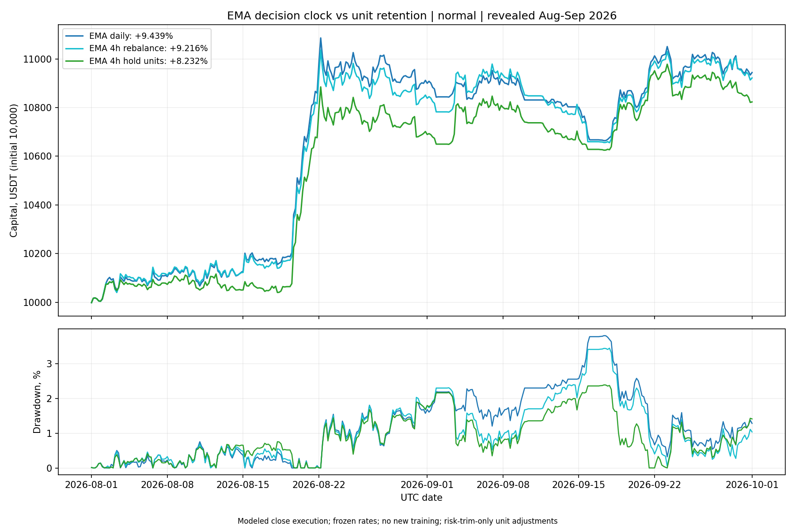
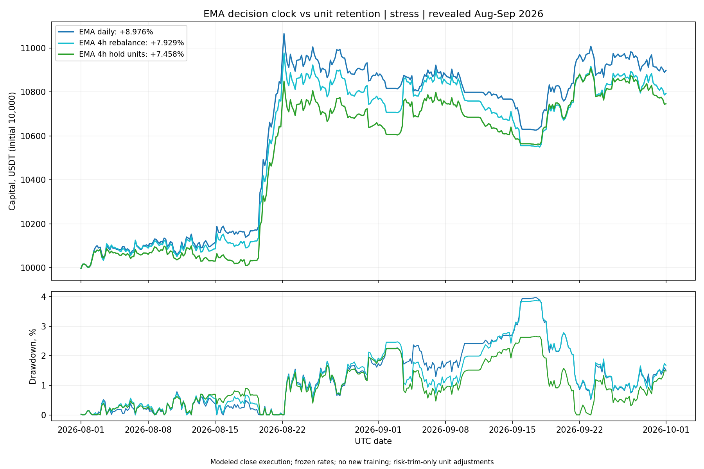

# EMA: четырёхчасовые решения с сохранением units

12 октября 2026. Исследовательский replay 1 августа — 30 сентября 2026 на уже раскрытых данных. Один новый policy arm, два cost-сценария, без обучения и подбора порогов.

## Измеряемая гипотеза

Прежний EMA 4h пересчитывал целевые units на каждом decision, поддерживая долю NAV. Новая U1 сохраняет количество монет, пока EMA-направление положительное и фактическая позиция допустима по риску. Новый вход получает те же causal EMA risk targets. Выход — по неположительной EMA. Сокращение — только при превышении asset/gross/volatility constraints. Пополнения ранее открытой позиции ради возврата к доле NAV или после risk trim отсутствуют. В конце периода позиции закрываются с costs.

Это одновременно меняет turnover и фактическую экспозицию. Разницу net-результата нельзя целиком приписать экономии costs: отдельно показаны gross PnL, funding и экспозиция.

## Общие данные, риск и исполнение

Взяты тот же full8 completed-close price/feature bank, EMA48-направление, daily covariance по 60 доходностям строго до UTC дня решения, shrinkage 20%, individual vol floor 0.2%, daily vol target 0.5%, asset cap 10%, gross cap 80%. Covariance обновляется раз в день; допустимость позиции проверяется каждые четыре часа. Используются frozen reported funding rates, включая terminal-settlement rows.

Normal costs — fee 6 + drag 2 bps на сторону; stress — fee 6 + drag 8 bps. Cash ledger начисляет costs по фактическому delta units. Signal delay 2s, modeled fill delay 2.25s, close считается неизменным до fill. Сохранены модельные fractional units; квалификация реальных fills/min lot/marks отсутствует. EMA-model SHA и covariance SHA зафиксированы в каждом решении. Старый прогнозный поток сохранён для provenance, но не используется при торговых решениях U1.

При risk breach применяется один ограниченный downscale. Нижняя оценка post-cost NAV = NAV − max cost per reference notional × (old market value + tentative market value). Затем asset, gross и volatility weights только уменьшаются. Когда позиция допустима, этого downscale нет и units сохраняются точно. Проверка применена к фактическим post-fill weights/NAV; внутрисвечной риск не наблюдается.

## Результаты

### normal

| Вариант | Итог, % | Max DD, % | Экспозиция, % | Оборот / капитал | Fills |
|---|---:|---:|---:|---:|---:|
| EMA daily | +9.4391 | 3.8066 | 19.887 | 7.380 | 351 |
| EMA 4h rebalance | +9.2156 | 3.4459 | 20.486 | 20.711 | 1989 |
| EMA 4h hold units | +8.2321 | 2.3899 | 17.793 | 12.462 | 789 |

### stress

| Вариант | Итог, % | Max DD, % | Экспозиция, % | Оборот / капитал | Fills |
|---|---:|---:|---:|---:|---:|
| EMA daily | +8.9758 | 3.9690 | 19.877 | 7.360 | 351 |
| EMA 4h rebalance | +7.9292 | 3.8971 | 20.474 | 20.576 | 1989 |
| EMA 4h hold units | +7.4579 | 2.6604 | 17.789 | 12.411 | 756 |

## Разложение приращения U1 − EMA 4h rebalance

Знаки ниже уже отражают влияние на капитал: положительные saved fees/slippage увеличивают net-результат. Сумма компонентов сверена с фактической разницей конечных капиталов.

| Costs | Δ Gross PnL, USDT | Saved fees | Saved slippage | Δ Funding | Δ Net capital |
|---|---:|---:|---:|---:|---:|
| normal | -167.3900 | +49.4965 | +16.4988 | +3.0415 | -98.3531 |
| stress | -164.3955 | +48.9903 | +65.3205 | +2.9569 | -47.1277 |

## Причины операций и соблюдение риска

| Причина | Fills | Reference notional, USDT | Fees | Slippage |
|---|---:|---:|---:|---:|
| entry | 121 | 61584.07 | 36.9800 | 49.2673 |
| risk_trim | 514 | 10579.97 | 6.3429 | 8.4640 |
| signal_exit | 119 | 51456.44 | 30.8492 | 41.1652 |
| terminal | 2 | 489.20 | 0.2933 | 0.3914 |

Решений без fills: 167 из 366; с ненулевой позицией и без fills: 148. Retained asset-decisions: 1233; risk-trim asset-decisions: 514; top-ups уже удерживаемых позиций: 0.

Фактические максимумы после решений: asset weight 9.997193%, gross 32.262777%, daily ex-ante volatility 0.499973%. Max projected NAV error 3.64e-12 USDT. Эти limits не гарантируют bar-internal или будущий drawdown.

U1 по месяцам после stress: август +6.472%, сентябрь +0.926%.

## Статистика

Парные daily log-return differences и абсолютный результат против NoTrade проверены на тех же общих primary/audit/sensitivity block banks. Primary/audit block 3 дня, sensitivity 7 дней, 5000 повторов. Audit seed не заменяет новые данные. Для 14 сравнений текущей исследовательской цепочки nominal α=0.05/14. Более ранний глобальный поиск на этих датах этим не исправляется.

| Контраст | Mean, bps/day | LCB primary | LCB audit | LCB 7d |
|---|---:|---:|---:|---:|
| U1_minus_R1 | -0.71739 | -4.61773 | -4.91585 | -5.20525 |
| U1_minus_NoTrade | +11.79169 | -9.78554 | -9.45659 | -9.67898 |

Совместный research gate положительной добавки и абсолютного результата: **False**. Independent validation и admission к real money: False.

## Вывод и следующий шаг

Сохранение units изменило stress net-капитал относительно EMA 4h rebalance на -47.1277 USDT. Экономия costs, если она есть, не обеспечила лучшего net-итога. Уменьшение оборота само по себе недостаточно; нужно учитывать потерю/изменение gross PnL и экспозиции.

Один следующий ограниченный этап — определить действие и соответствующий ему target: самостоятельное удержание четыре часа либо incremental управление многобарной EMA-позицией. Зафиксировать costs относительно фактического перехода, созревание labels и контрольную политику; затем зарегистрировать один быстрый feature block при прежней линейной архитектуре. Новый подбор порогов или MLP/GA до этого будет смешивать изменение сигнала, позиции и стоимости оборота.

## Атрибуция по активам, stress

| Актив | Gross PnL | Fees | Slippage | Funding | Net PnL |
|---|---:|---:|---:|---:|---:|
| ADA/USDT | +169.7439 | 6.4574 | 8.6099 | -2.5037 | +152.1729 |
| BNB/USDT | +96.1634 | 12.4604 | 16.6140 | -4.7708 | +62.3183 |
| BTC/USDT | +109.1613 | 6.4155 | 8.5541 | -1.3523 | +92.8394 |
| DOGE/USDT | +55.0629 | 9.9845 | 13.3127 | -2.7172 | +29.0485 |
| ETH/USDT | +60.9469 | 11.6356 | 15.5142 | -2.7295 | +31.0676 |
| LINK/USDT | +168.8803 | 6.0974 | 8.1300 | -2.9110 | +151.7419 |
| SOL/USDT | +221.7200 | 15.0275 | 20.0368 | -3.0628 | +183.5929 |
| XRP/USDT | +59.8694 | 6.3870 | 8.5160 | -1.9544 | +43.0120 |

## Воспроизводимость

Первоначальные 64 artifact pins проверены. Новый cash engine в control-mode совпал со всеми метриками, per-asset атрибуцией и bit-exact daily path сохранённого R1 при обоих costs. Engineering checks: 14; parity ledger checks: 13402; новые ledger/risk checks: 8299. Исходные эксперименты и их код не изменялись.

Зарегистрирован один новый policy arm до его расчёта. Обучений и подбора порогов — ноль. Все результаты сохранены, включая отрицательные. Команды выполнялись последовательно, foreground, одним потоком; сеть, collector, pytest и trading runtime не использовались.

- [Регистрация](registration.json)
- [Результаты и разложение PnL](analysis.json)
- [Stress ledger](replay_stress.json)
- [Предыдущие результаты](../forecast4h_positions_v1_20261012/SUMMARY_RU.md)
