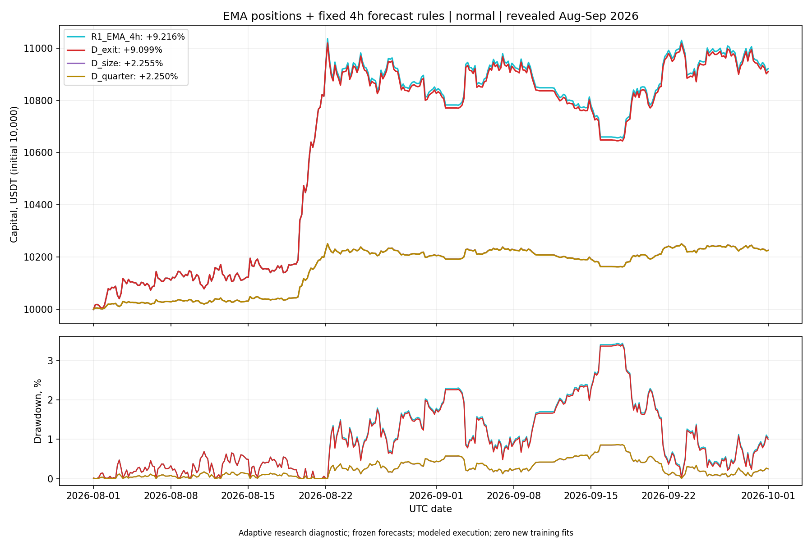

# Четырёхчасовой прогноз: итог всех четырёх проверок

12 октября 2026. Исследовательский период 1 августа — 30 сентября 2026 уже раскрыт. Первичный пилот и его инженерные amendments сохранены.

## Прогноз, частота решений и вход

Основной [отчёт первого пилота](../forecast4h_v1_20261012/REPORT_RU.md) и [подробная интерпретация](../forecast4h_v1_20261012/CONCLUSIONS_RU.md) содержат 21 причинное переобучение linear6, 2928 прогнозов и 14 исходных replay. RMSE модели 128.946 bps против 128.697 bps у исторического среднего; forecast gate не пройден. EMA daily после stress-costs дал +8.9758%, EMA 4h +7.9292%. Entry threshold 30 bps не достигнут ни разу, поскольку максимальный прогноз +10.24 bps. В исходной цепочке R2/R3/R4 торговля отсутствовала.

## Отдельная проверка управления позицией

Для завершения проверки выхода/размера зарегистрирован этот дополнительный diagnostic после просмотра исходного пилота. Это адаптивное исследование с явно увеличенным testing budget, не новая независимая валидация. Ни одного нового обучения или нового подбора порогов. Использованы прежние −14 bps exit и clip(forecast/30bps,0.25,1) sizing. Общие frozen forecasts, costs, lagged daily covariance и cash engine.

D_exit применяет forecast exit только к уже открытой EMA-позиции. Последующий EMA-вход допускается без forecast entry filter. D_size применяет только изменение размера к EMA-позициям, без forecast entry/exit filter. D_quarter — заранее заданные постоянные 25% от EMA-targets, соответствующие исходному floor; он показывает, отличается ли sizing от простого снижения экспозиции. Это не точное постфактум выравнивание средних экспозиций.

## normal

| Вариант | Итог, % | Max DD, % | Экспозиция, % | Оборот / капитал | Fills |
|---|---:|---:|---:|---:|---:|
| R1_EMA_4h | +9.2156 | 3.4459 | 20.486 | 20.711 | 1989 |
| D_exit | +9.0986 | 3.4098 | 20.469 | 20.835 | 1989 |
| D_size | +2.2548 | 0.8604 | 5.126 | 5.007 | 1989 |
| D_quarter | +2.2495 | 0.8658 | 5.121 | 4.998 | 1989 |

## stress

| Вариант | Итог, % | Max DD, % | Экспозиция, % | Оборот / капитал | Fills |
|---|---:|---:|---:|---:|---:|
| R1_EMA_4h | +7.9292 | 3.8971 | 20.474 | 20.576 | 1989 |
| D_exit | +7.8056 | 3.8666 | 20.457 | 20.698 | 1989 |
| D_size | +1.9509 | 0.9770 | 5.123 | 4.996 | 1989 |
| D_quarter | +1.9461 | 0.9822 | 5.118 | 4.988 | 1989 |

## Paired stress-проверки

Те же общие 3-day block banks, независимый audit seed и 7-day sensitivity. Для 12 сравнений текущей цепочки nominal α=0.05/12. Это учитывает 4 forecast + 5 исходных trading + 3 дополнительные trading contrasts, но не прошлые многократные исследования на этих датах.

| Контраст | Разница итогов, п.п. | LCB primary, bps/day | LCB audit | LCB 7d |
|---|---:|---:|---:|---:|
| D_exit-R1_EMA_4h | -0.12359 | -0.75130 | -0.75130 | -0.75130 |
| D_size-R1_EMA_4h | -5.97835 | -33.75512 | -35.06773 | -34.94773 |
| D_size-D_quarter | +0.00481 | -0.00228 | -0.00234 | -0.00251 |

## Интерпретация

Совпадение stress-траектории D_exit с EMA: **False**. Прогнозных строк со sizing multiplier выше floor: **17 из 2928**.

Если exit совпадает с EMA, это означает отсутствие дополнительного действия в доступных held-состояниях при выбранном фиксированном правиле, а не отсутствие любых потенциально полезных exit-моделей. Если D_size близок к D_quarter, уменьшение drawdown объясняется прежде всего уменьшением экспозиции. Значима добавка к D_quarter, её costs, риск и paired LCB; положительный итог D_size сам по себе не доказывает прогнозный edge.

Четырёхчасовой прогноз текущих шести медленных ценовых признаков не подтвердил преимущество над простыми controls. Следующий ограниченный шаг: отдельно измерить эффект мелкого rebalance при 4h decision clock с сохранением units; затем при необходимости зарегистрировать один быстрый feature block и проверить его на нескольких заранее выбранных режимах. Entry threshold следует связывать с фактическим горизонтом удержания/приращением к EMA, прежде чем подбирать значения. Подключение MLP и GA сейчас не обосновано.

В основном пилоте 40712 независимых ledger checks; здесь ещё 40206. Engineering/direct checks расширения: 22. Default parent replay после добавления pure target-rule hook сохранил точное совпадение дневной траектории. Original 52 artifact pins проверены до дополнительного расчёта.

Исполнение — условный close с модельным drag/fee; funding по reported rates и reference close, наблюдённых fills/marks нет. Базовые risk targets не гарантируют внутрисвечную просадку. Все trials сохранены. Сеть, collector, runtime и торговые разрешения не использовались.

- [Регистрация дополнительных сравнений](registration.json)
- [Результаты и атрибуция по активам](analysis.json)
- [Исходный прогнозный поток](../forecast4h_v1_20261012/vectors.json)
