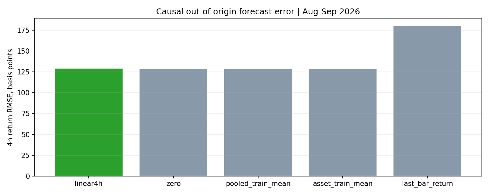
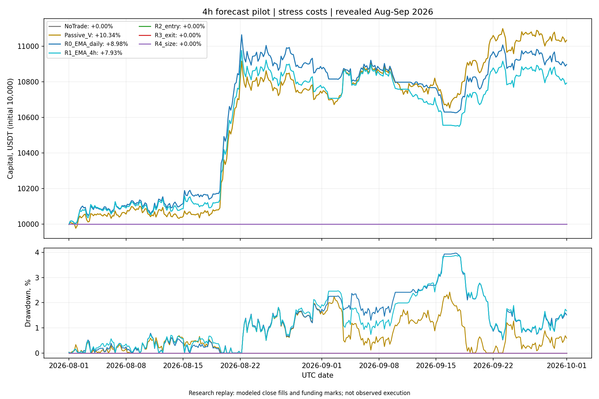
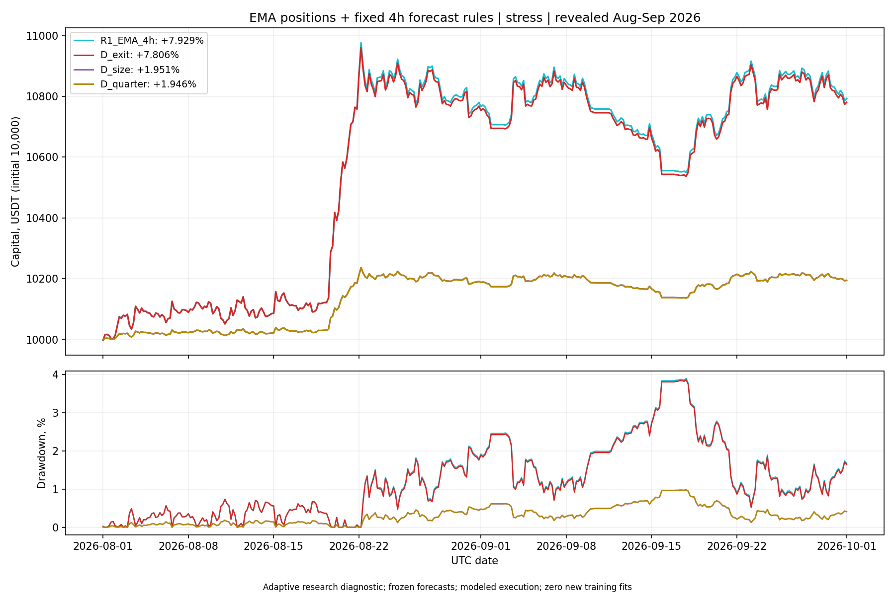

# Результат четырёхчасового эксперимента

12 октября 2026. Все четыре запрошенные проверки выполнены на 1 августа — 30 сентября 2026. Период уже раскрыт, поэтому это исследование, а не независимое подтверждение будущей доходности. Сохранены модели, прогнозы, регистрации, журналы решений и fills/funding, результаты всех вариантов и графики капитала/просадки.

## Обучение и качество прогноза

Одна pooled линейная модель: шесть прежних признаков, семь параметров, L2=0.01, uniform weighting. Горизонт и шаг обучающих labels — четыре часа, частота прогнозов и решений — четыре часа, полное переобучение — раз в три дня. Проведён 21 причинный fit с отдельным scaler. В train попадают только labels, созревшие до cutoff: purge семь баров плюс один availability bar. Учтены и положительные, и отрицательные исходы. Данные, folds, training rows, bootstrap banks, model/scaler SHA и cutoff зафиксированы.

Получено 2928 прогнозов, но число независимых наблюдений не равно числу строк. Ошибки и торговые приращения агрегированы по 61 календарному дню; bootstrap использует общие block samples для всех вариантов, отдельный audit seed и sensitivity по длине блока.

| Прогноз | RMSE, bps |
|---|---:|
| Linear4h | 128.946 |
| Нулевой прогноз | 128.777 |
| Историческое pooled-среднее | 128.697 |
| Историческое среднее по активу | 128.702 |
| Продолжение доходности последнего бара | 180.488 |

Модель не улучшила сильные простые контроли zero/mean. Gate прогнозного качества не пройден. Утверждение о полезном краткосрочном сигнале на этом feature set не подтверждено.

## Результаты после stress-costs

Единый начальный капитал 10 000 USDT; комиссия 6 bps и модельный drag 8 bps на сторону; funding по замороженным reported rates и reference close. Риск оценивается причинно по дневной covariance с target 0.5% daily volatility и ограничениями 10% на актив / 80% gross. Costs начисляются на фактическое изменение units. В конце периода позиции закрыты с costs.

| Вариант | Итог, % | Max DD, % | Комментарий |
|---|---:|---:|---|
| Пассивный риск-ограниченный портфель, 4h rebalance | +10.3415 | 2.4209 | Контроль присутствия в рынке |
| EMA, дневные решения | +8.9758 | 3.9690 | Совпадает с сохранённым прежним расчётом |
| EMA, решения каждые 4 часа | +7.9292 | 3.8971 | Более высокий оборот |
| EMA 4h + только forecast exit | +7.8056 | 3.8666 | Выход ухудшил итог |
| EMA 4h + только forecast sizing | +1.9509 | 0.9770 | Средняя экспозиция 5.123% |
| Постоянные 25% EMA 4h targets | +1.9461 | 0.9822 | Средняя экспозиция 5.118% |
| Forecast entry filter и последующие R3/R4 | 0 | 0 | Входов не было |
| NoTrade | 0 | 0 | Контроль отсутствия торговли |

Пассивный портфель имеет другую экспозицию и не является автоматически лучшим источником сигналов. Его высокий результат на этом периоде показывает необходимость отделять рыночное присутствие от прогнозного качества.

## Что означает результат каждого этапа

**Частота решений.** Более частые EMA decisions увеличили gross PnL с 1025.36 до 1105.94 USDT, но fees + slippage выросли с 103.04 до 288.06 USDT. Оборот вырос с 7.36 до 20.58 начальных капиталов. Дополнительные costs перекрыли прибавку gross PnL. Результат относится к политике rebalance на каждом decision; он не означает, что любая возможность реагировать каждые четыре часа вредна.

**Вход.** Порог 30 bps был зарегистрирован заранее: 28 bps stress roundtrip + 2 bps carry cushion. Максимальный прогноз составил 10.24 bps. Поэтому фильтр заблокировал все входы. Это не прибыльная abstention-модель: нет торгового преимущества относительно NoTrade. Порог сравнивает ожидание за четыре часа с costs полного удержания позиции, которое у EMA может длиться дольше; эта семантика нуждается в отдельной формулировке до следующего эксперимента.

**Выход.** Чтобы отсутствие входов не мешало измерению, дополнительно зарегистрирована проверка exit непосредственно на открытых позициях EMA. Использовано то же правило forecast <=−14 bps, без нового обучения или подбора порога. Net-итог уменьшился на 0.1236 п.п.; primary paired LCB разницы составил −0.7513 bps/day. Полезность этого фиксированного exit не подтверждена.

**Размер позиции.** Для EMA-позиций использовано прежнее clip(forecast/30bps,0.25,1), без entry/exit filter. Только 17 из 2928 прогнозных строк задавали multiplier выше нижней границы 0.25. Поэтому sizing в основном просто сокращал экспозицию до четверти EMA. Относительно постоянной четверти получено +0.004812 п.п., то есть около +0.48 USDT на начальные 10 000. Primary paired LCB −0.002281 bps/day. Маленькая положительная точечная разница не подтверждает прогнозный edge.

Дополнительная диагностика была зарегистрирована после просмотра исходного пилота; это явно учтено как адаптивное исследование. Проверены три дополнительные policy arms × два cost-сценария, всего 20 сохранённых successful policy replay в обоих пакетах. В дополнительной цепочке nominal α=0.05/12 для 4 forecast + 5 исходных trading + 3 дополнительных trading contrasts. Эта поправка не отменяет прошлый поиск на уже раскрытых данных.

## Следующий план

1. Отделить частоту сигналов от механического rebalance: один зарегистрированный вариант EMA принимает решения каждые четыре часа, сохраняет market units при прежнем направлении и допустимом риске, меняет позицию при изменении направления/рискового требования. Сопоставить gross PnL, costs, оборот и drawdown с сохранённым R1.
2. Определить, какую величину должен улучшать четырёхчасовой прогноз: net-эффект краткой самостоятельной сделки или incremental результат управления многобарной EMA-позицией. Привязать costs и label к выбранному действию. Историческую entry fee при решении удерживать/сокращать считать уже понесённой.
3. Зарегистрировать один быстрый feature block при сохранении linear7 и бюджета поиска. Нынешние return/efficiency 18 bars и EMA/volatility 48 bars описывают более медленную динамику. Проверить дополнительную информацию коротких returns/ranges/volume только при достаточных квалифицированных данных. Предположение о полезности этих признаков пока не проверено.
4. Повторить зафиксированный контракт на нескольких заранее выбранных раскрытых режимах. Если paired добавки к простым контролям не будет, закончить эту ветку без перехода к более сложной сети. MLP/GA имеет смысл подключать после подтверждения сигнала и конкретной ошибки, которую должна исправить дополнительная сложность.
5. После устойчивого результата — новый prospective-период с замороженным контрактом. Отдельный bootstrap seed и повторный расчёт августа–сентября новыми данными не являются.

## Проверки и границы результата

Основной ledger прошёл 40 712 независимых арифметических проверок; дополнительный — 40 206, всего 80 918. Отдельно прошли 16 исходных engineering checks и 22 проверки расширения, включая точное совпадение default parent-траектории после добавления явно передаваемого pure target-rule hook. Сохранены все инженерные исправления и исходные версии кода; модели, пороги и основной пакет результатов не перезаписывались.

Цена fill, latency и funding marks здесь модельные. Реальная ликвидность, min lot, intrabar drawdown и исполнение заявленными результатами не подтверждены. Обучение/расчёты выполнены локально по одному короткому foreground stage, без pytest, collector, WebSocket, торгового runtime, credentials или ордеров.

- [Основной полный отчёт](../forecast4h_v1_20261012/REPORT_RU.md)
- [Отдельная диагностика управления](REPORT_RU.md)
- [Регистрация диагностики](registration.json)
- [Подробные результаты и атрибуция](analysis.json)
