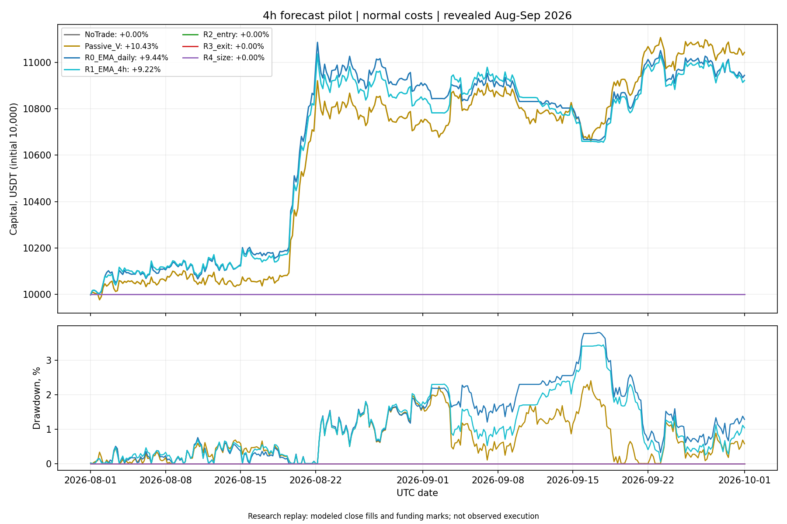

# Четырёхчасовой прогноз и управление позицией

12 октября 2026. Причинный исследовательский replay 1 августа — 30 сентября 2026; период уже раскрыт.

## Контракт

Одна pooled linear6 модель: 6 прежних ценовых признаков, 7 параметров, L2=0.01, uniform. Горизонт и шаг labels — 4 часа; решения — 4 часа; полное переобучение и отдельный scaler каждые 3 дня. Expanding train с 2022 года, только созревшие labels, purge 7 баров + один availability bar. Веса получают положительные и отрицательные исходы. Гиперпараметры, признаки и пороги по результату не менялись.

Зафиксированы registration `569f9678af18bbda59d01d86c8314e0883c7e9595e38bfc71fe0ea11726f18d9`, hashes исходного price bank, rate bank, всех исходников, временных folds, training rows и общих bootstrap samples. Выполнено 21 основных обучений, 366 временных прогнозов × 8 активов, 14 policy/cost replay. Дополнительные синтетические fit в engineering checks не являются поиском кандидатов.

Каждый прогноз и каждое решение связаны с model SHA и scaler SHA. Ошибка прогноза оценивается только по созревшим прошлым out-of-origin residuals; в начале периода её ещё недостаточно. Вероятности и квантили не заявляются. Модель считается готовой через 1 секунду после close, сигнал через 2 секунды, условный fill через 2.25 секунды; локальное время fit проверено относительно 1 секунды. Цена close в этом допущении неизменна до fill.

## Качество прогнозирования

| Прогноз | RMSE, bps | MAE, bps |
|---|---:|---:|
| linear4h | 128.946 | 82.422 |
| zero | 128.777 | 82.265 |
| pooled_train_mean | 128.697 | 82.239 |
| asset_train_mean | 128.702 | 82.246 |
| last_bar_return | 180.488 | 123.367 |

Forecast gate относительно zero и pooled train mean: **False**. Требование — положительный paired LCB улучшения MSE в primary, audit и 7-day sensitivity banks. Дневная агрегация учитывает одновременные активы и шесть прогнозов в день; независимых наблюдений здесь не 2928.

## Торговые сравнения

R0 — сохранённый EMA_V на дневной сетке; он повторно рассчитан новым ledger и сверён с сохранёнными результатами и всей дневной траекторией. R1 меняет сетку решений на 4 часа. R2 добавляет только entry filter: прогноз >30 bps = stress roundtrip 28 bps + фиксированный carry cushion 2 bps. Доли отклонённых активов не перераспределяются. Уже удерживаемая позиция не обязана снова проходить entry threshold.

R3 добавляет выход, если прогноз <=−14 bps, либо прежний EMA exit. Это фиксированное исследовательское правило на границе бара, не оптимальный внутрисвечной выход. R4 умножает целевую долю R3 на clip(forecast/30bps, 0.25, 1). Доля может восстанавливаться до базовой EMA-доли; превышение её запрещено.

Все варианты используют один lagged daily covariance estimator: 60 дневных доходностей строго до UTC дня решения, shrinkage 20%, individual floor 0.2%, дневная volatility target 0.5%, cap 10% на актив и 80% gross. После исключения активов риск при необходимости дополнительно снижается. На каждом решении выполняется rebalance по фактическому delta units: сохранение количества не создаёт новую entry fee; изменение количества создаёт соответствующие costs. Это может давать небольшие rebalance fills даже при прежнем направлении.

Normal costs: fee 6 + drag 2 bps на сторону; stress: fee 6 + drag 8 bps. Funding — frozen historical rates × текущая позиция × reference close, без наблюдённых marks. В конце интервала позиции ликвидируются с costs. Ни плеча, ни short, ни заимствования.

### normal

| Вариант | Итог, % | Max DD, % | Экспозиция, % | Оборот / капитал | Fills | Удержание, ч |
|---|---:|---:|---:|---:|---:|---:|
| NoTrade | +0.000 | 0.000 | 0.00 | 0.00 | 0 | 0.0 |
| Passive_V | +10.428 | 2.405 | 23.12 | 1.27 | 2936 | 1464.0 |
| R0_EMA_daily | +9.439 | 3.807 | 19.89 | 7.38 | 351 | 141.2 |
| R1_EMA_4h | +9.216 | 3.446 | 20.49 | 20.71 | 1989 | 61.8 |
| R2_entry | +0.000 | 0.000 | 0.00 | 0.00 | 0 | 0.0 |
| R3_exit | +0.000 | 0.000 | 0.00 | 0.00 | 0 | 0.0 |
| R4_size | +0.000 | 0.000 | 0.00 | 0.00 | 0 | 0.0 |

### stress

| Вариант | Итог, % | Max DD, % | Экспозиция, % | Оборот / капитал | Fills | Удержание, ч |
|---|---:|---:|---:|---:|---:|---:|
| NoTrade | +0.000 | 0.000 | 0.00 | 0.00 | 0 | 0.0 |
| Passive_V | +10.342 | 2.421 | 23.11 | 1.27 | 2936 | 1464.0 |
| R0_EMA_daily | +8.976 | 3.969 | 19.88 | 7.36 | 351 | 141.2 |
| R1_EMA_4h | +7.929 | 3.897 | 20.47 | 20.58 | 1989 | 61.8 |
| R2_entry | +0.000 | 0.000 | 0.00 | 0.00 | 0 | 0.0 |
| R3_exit | +0.000 | 0.000 | 0.00 | 0.00 | 0 | 0.0 |
| R4_size | +0.000 | 0.000 | 0.00 | 0.00 | 0 | 0.0 |

## Приращение после stress-costs

LCB — в bps средней дневной log-return разницы, не процент общей доходности. Общие circular block samples: 5000 повторов, 3 дня; независимый audit seed; sensitivity block 7 дней. Для 4 forecast + 5 trading contrasts α=0.05/9. Эта поправка относится только к текущему пилоту, не исправляет прошлую адаптивную настройку на раскрытом периоде.

| Контраст | Разница итогов, п.п. | LCB primary, bps/day | LCB audit | LCB 7d |
|---|---:|---:|---:|---:|
| R1_EMA_4h-R0_EMA_daily | -1.047 | -5.319 | -5.402 | -5.056 |
| R2_entry-R1_EMA_4h | -7.929 | -43.817 | -45.042 | -44.983 |
| R3_exit-R2_entry | +0.000 | +0.000 | +0.000 | +0.000 |
| R4_size-R3_exit | +0.000 | +0.000 | +0.000 | +0.000 |
| R2_entry-NoTrade | +0.000 | +0.000 | +0.000 | +0.000 |

## Атрибуция по активам и месяцам

Stress PnL ниже дан в USDT и сходится с непрерывным капиталом. Непрерывный holding episode заканчивается только при закрытии позиции; partial rebalance не создаёт новый episode.

| Вариант | Gross PnL | Fees | Slippage | Funding | Август, % | Сентябрь, % | Доля top-3 прибыльных дней |
|---|---:|---:|---:|---:|---:|---:|---:|
| NoTrade | 0.00 | 0.00 | 0.00 | 0.00 | +0.00 | +0.00 | 0.0% |
| Passive_V | 1080.89 | 7.61 | 10.14 | -28.99 | +7.36 | +2.78 | 37.5% |
| R0_EMA_daily | 1025.36 | 44.16 | 58.88 | -24.73 | +8.73 | +0.23 | 42.2% |
| R1_EMA_4h | 1105.94 | 123.46 | 164.61 | -24.96 | +7.66 | +0.25 | 40.1% |
| R2_entry | 0.00 | 0.00 | 0.00 | 0.00 | +0.00 | +0.00 | 0.0% |
| R3_exit | 0.00 | 0.00 | 0.00 | 0.00 | +0.00 | +0.00 | 0.0% |
| R4_size | 0.00 | 0.00 | 0.00 | 0.00 | +0.00 | +0.00 | 0.0% |

| Актив | R1 net PnL | R2 net PnL | R3 net PnL | R4 net PnL | Entry opportunities |
|---|---:|---:|---:|---:|---:|
| ADA/USDT | +201.51 | +0.00 | +0.00 | +0.00 | 0 |
| BNB/USDT | +38.89 | +0.00 | +0.00 | +0.00 | 0 |
| BTC/USDT | +101.83 | +0.00 | +0.00 | +0.00 | 0 |
| DOGE/USDT | +18.81 | +0.00 | +0.00 | +0.00 | 0 |
| ETH/USDT | +16.22 | +0.00 | +0.00 | +0.00 | 0 |
| LINK/USDT | +264.84 | +0.00 | +0.00 | +0.00 | 0 |
| SOL/USDT | +140.45 | +0.00 | +0.00 | +0.00 | 0 |
| XRP/USDT | +10.37 | +0.00 | +0.00 | +0.00 | 0 |

## Решение и дальнейшие работы

Наибольший итог среди зарегистрированных вариантов на этом раскрытом интервале: **Passive_V**. Это описательное сравнение, не независимый выбор будущего победителя. Gate для расширения поиска моделей: **False**; admission к реальным торгам: **False**.

Оснований сразу подключать MLP или GA этот пилот не даёт. Следующая полезная проверка — разобрать ошибки четырёхчасового прогноза по активам и режимам; затем зарегистрировать максимум один содержательно другой feature block. Если точность остаётся на уровне простых прогнозов, продолжать сравнение EMA/пассивного контроля с управлением риском, а не увеличивать сложность ради краткосрочного вектора.

Положительный net-итог при малом числе входов может означать удачную экспозицию в одном режиме. Снижение drawdown вместе со снижением экспозиции само по себе не подтверждает качество прогноза. Низкий RMSE среднего прогноза не гарантирует полезность редких прогнозов выше entry threshold; их хвостовой результат виден в отдельных policy replay.

## Проверки и ограничения

Engineering checks: 16. Независимых арифметических ledger/causality checks: 40712. Saved daily EMA parity: True. Все 21 fit, forecasts и policies сохранены, неудачные варианты не удалялись.

OHLCV replay не доказывает реализуемость fills, latency, liquidity, min lot и funding marks. Drawdown измерен по bar close и промежуточным модельным events; внутрисвечная просадка неизвестна. Nominal model-ready delay и fill price — допущения. Короткий период и bootstrap не заменяют новые данные. Успешная проверка четырёхчасового прогноза не доказывает оптимальное время закрытия внутри свечи. Данные стакана/сделок и вероятностные heads в этом пилоте не добавлялись.

При первом replay исправлена инженерная ошибка адаптера risk_covariance: из пары (matrix, metadata) требуется matrix. Исходный зарегистрированный runner сохранён побайтно; изменение отражено в [engineering amendment](engineering_amendment_01.json). Обучение, прогнозы, параметры и пороги не пересматривались.

Parity-проверка затем выявила 8 отсутствующих в раннем rate bank строк на terminal settlement. Подключён полный уже замороженный modeled rate bank прежнего evaluator; source pin подтверждён parent registration. [Второе инженерное исправление](engineering_amendment_02.json) сохраняет обе версии runner. Это reported rates с условной close valuation, не наблюдённые settlement cashflows.

Credentials, orders, paper/live, runtime, promotion и network authority остаются false. Collector, WebSocket и торговый runtime не использовались.

## Артефакты

- [Регистрация](registration.json)
- [Временные folds](folds.json)
- [Прогнозный поток](vectors.json)
- [Качество прогнозов](forecast_quality.json)
- [Сводный анализ и атрибуция](analysis.json)
- [Исходный план](../research_review_20261012_vectors_v2/REPORT_2_FORECAST_VECTOR_PLAN_RU.md)
