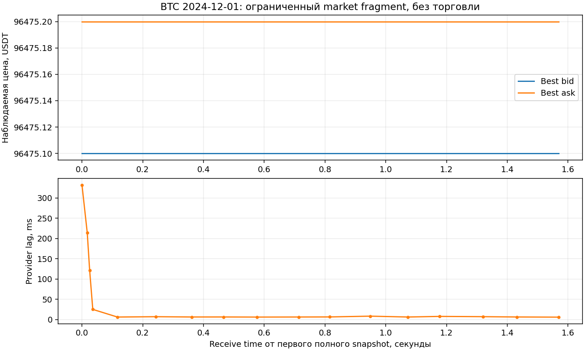

# L2 format smoke: 8 октября 2026

**31/31** bounded offline checks прошли. Реальный источник — предоставленный
BTC incremental_book_L2 2024-12-01; он прочитан read-only, не переписан.
Старый snapshot-only валидатор повторно использован и согласуется с новым
state по всем complete observed snapshots. Это не финансовый ретротест.

## Реальный ограниченный фрагмент

Parsed rows: **512**. Compressed bytes read: **4096**;
inflated bytes: **40960**. Жёсткие caps:
65536 compressed / 131072 inflated bytes,
512 parsed rows. Whole archive size по stat: 101754805 bytes.
Полный архив не прочитан; full archive SHA и весь gzip CRC не проверены.
Сохранены отдельные hashes прочитанного compressed/uncompressed prefix и rows.

Полных опубликованных snapshots: **17**, реальных delta
groups: **0**, reconstruction faults: **0**.
Последние 2 rows unclosed group отброшены.
Длина опубликованного receive-фрагмента: **1.569347 s**, depth по контракту
15 уровней на сторону, не полный depth venue. Source clocks сохранены в us.
Restore из checkpoint внутри prefix точно совпал с непрерывным расчётом.

Provider lag — local receipt minus exchange timestamp. Это не задержка
отправки/исполнения нашей заявки и не latency calibration для production.
Это короткий фрагмент 2024 года, не equity curve стратегии за 2026 год.

## Синтетические проверки и ограничения

Absolute delta replacement, zero delete, complete snapshot reset, atomic
updates, crossed/empty/duplicate levels, row/depth/event caps, повреждённый
gzip/CSV, clock regression, gaps и восстановление snapshot проверены отдельно.
Если real prefix не содержит deltas, их реальная семантика остаётся
неподтверждённой: синтетическая проверка не заменяет data evidence.

Без venue sequence ID тихо потерянный delta не обнаруживается надёжно.
В synthetic_fault_demonstration обе версии с/без одного delta формально
проходят, но дают разные asks. Поэтому venue_sequence_verified=false,
full_depth_verified=false, strategy_availability_verified=false.
Provider local timestamp не автоматически равен доступности нашему агенту.
Нельзя без отдельного адаптера округлять us в ms и терять ordering.

Источники и старое post-close evidence сохранены: 12
source hashes и 7 artifact hashes сверены.
Financial replay/training/full8-2026 qualification остаются **False**.
Новых fits, strategy-profit replays и network requests: **0**; все 9 flags false.

## Далее

Проверить небольшие fragments trades/derivative и общий receive/exchange clock,
особенно funding: predicted funding rate не равен фактическому settlement.
Затем собрать реальный full8 bundle с coverage/sequence/availability,
historical rules/fees и observed settlement marks для нужного validation и
causal training scope. BTC-файл 2024 года не подставляется в 2026 labels.
