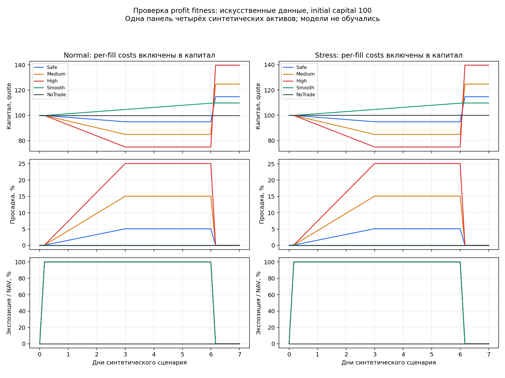
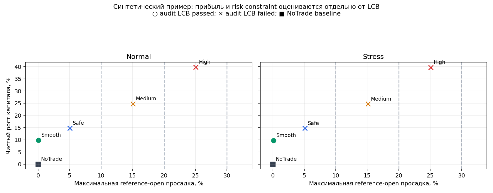

# Profit fitness v1: инженерный отчёт

Реализована цель максимизации чистого роста общего капитала при явном лимите просадки. Данные этого отчёта искусственные: четыре синтетических актива на одной общей панели. Политики фиксированы, модели не обучались. Это проверка расчётов, а не рыночное сравнение.

**32 проверок прошли**: 30 новых profit/audit-проверок и 2 регрессии предыдущего ledger/scorer.

`fitness = 10000 × ln(final_NAV / initial_capital) / calendar_days − registered_parsimony_penalties`.

Поиск использует hard drawdown gate и penalized net growth. LCB не входит ни в fitness, ни в ranking; по умолчанию search не исполняет bootstrap. Статистический аудит выполняется отдельно для final candidates.

| Политика | Normal net, % | Stress net, % | Normal DD, % | Stress DD, % | Audit LCB |
|---|---:|---:|---:|---:|---|
| Safe | 14.8161 | 14.7243 | 5.0760 | 5.1139 | failed |
| Medium | 24.8002 | 24.7004 | 15.0680 | 15.1019 | failed |
| High | 39.7762 | 39.6644 | 25.0600 | 25.0899 | failed |
| Smooth | 9.8241 | 9.7363 | 0.0799 | 0.1199 | passed |
| NoTrade | 0.0000 | 0.0000 | 0.0000 | 0.0000 | failed |

| Исследовательский DD budget | Search winner | Статистический аудит этого winner |
|---|---|---|
| 10% | Safe | failed |
| 20% | Medium | failed |
| 30% | High | failed |

В примере больший risk budget допускает больший net рост. Высокодоходные концентрированные траектории не проходят независимый LCB-аудит; Smooth проходит его при меньшем net росте. NoTrade имеет fitness=0 и остаётся базовой политикой; LCB=0 не считается доказанной положительной доходностью.

Risk constraint проверяет normal и предоставленный stress ledger. Отсутствующий stress не считается нулевой просадкой; для статистического аудита оба cost scenarios обязательны. Эти 10/20/30% являются исследовательской матрицей, а не утверждённым риском реальных торгов.

Normal: fee 6 bps и adverse drag 2 bps на каждый leg. Stress: fee 8 bps и drag 4 bps. Costs синтетические; funding coverage в fixture явно полный с пустым settlement set. Комиссии и turnover повторно не вычитаются из fitness. DD измерен на reference opens, без внутрибара экстремумов.

Один общий selection bank: seed 7; независимый audit bank: seed 19. Оба используют 64 resamples, block=2 дня, одинаковые cutoff и fold hashes. Это малый инженерный банк, не достаточная рыночная мощность проверки. Все индексы сохранены в resample_banks.npz. Fold summaries являются diagnostic, а не outer slices.

В новом scorer отсутствует запрет торговать ноль сделок ради прохождения minimum trades. Risk pass и LCB pass не дают promotion_authority; temporal_gate_passed остаётся false до отдельной temporal validation.

Новая ветка подключена к score_simulation_v4 через явный search_objective и проверенный unified ledger. Legacy суммирование доходностей не принимается новым objective. Generation log сохраняет objective SHA, risk budget и validation status; нерассчитанный LCB хранится как null.

[Точные ledger](ledgers.json) · [Fitness, аудит и hashes банков](fitness_and_audit.json) · [Входная fixture](fixture.json) · [Evidence receipt](evidence_receipt.json)

Выполнено 10 synthetic ledger replays; обучение=0, market evaluations=0, network=0. Август–сентябрьские данные и торговый runtime не читались. Следующий этап — модели и причинный rolling evaluator.
