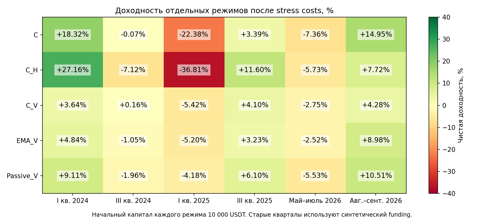

# Genetic Primus и Panteon текущее состояние системы

Аналитический отчёт для владельца проекта. Срез 12 октября 2026 года.

## Главный вывод

Проект заметно улучшил измерения, причинность обучения и проверяемость результатов. Но **доказанного устойчивого торгового преимущества обучаемой модели пока нет**. Положительный ретротест на августе–сентябре не равен готовности к реальным деньгам. Слабое место сейчас — полезность сигнала после учёта рыночной экспозиции, режима и исполнения, а не недостаточное число нейронов.

Для дальнейших исследований отобраны **Passive_V, EMA_V и Huber_H3**. Первый — сильный контроль участия в рынке, второй — простой независимый сигнал направления, третий — компактный защитный обучаемый кандидат с ограниченной проверкой. **Ridge_C/C_V** сохранён как воспроизводимый контроль, а не победитель. Настройка по умолчанию для допуска остаётся **NoTrade**.

Пакет содержит сохранённые модели, а не новый подбор на уже раскрытом периоде. Их последний fit выполнен 30 сентября 2026 в 00:00 UTC. Последние созревшие labels — 28 сентября в 00:00 UTC; 1 720 обучающих origins на модель. Указанные веса не являются актуальным торговым сигналом на 12 октября.

## Объём и надёжность проверки

Проверены пять последних цепочек исследований: cadence, label phase, robust linear, causal capital controls и position policy. Повторно сверены **800 файловых hashes** их зарегистрированных артефактов, а также закреплённые в регистрациях исходники и входы. Проверена связь completion receipt с независимым аудитом и его кодом. Перенос моделей прошёл **3 097 прямых проверок** совпадения прогнозов, признаков, весов и отказа на некорректных входах.

Предыдущий независимый аудит содержит 601 668 арифметических и структурных проверок 84 ledger. В этой работе его целостность подтверждена; все эти арифметические проверки заново не запускались. Hash доказывает неизменность относительно регистрации, но не истинность рыночных данных и не отсутствие ошибки, общей для нескольких модулей.

Архивные V4–V8 оценены по итоговым документам и выбранным участкам кода. Это не повторное исполнение всех старых тестов и не построчный security-аудит всего Panteon. Торговые процессы, аккаунт, ключи и реальные fills не исследовались. Новых fits и финансовых replay в этой работе **0**: новых квалифицированных рыночных данных не добавлено, а повторное обучение на прежних данных не сделало бы проверку независимой. Публичная сеть использована для литературного обзора и публикации Git; биржевых запросов и запуска runtime нет.

Машиночитаемые основания: [evidence.json](evidence.json), [verification.json](verification.json), [манифест публикации](release_manifest.json).

## Архитектура и границы системы

| Слой | Состояние | Существенная граница |
|---|---|---|
| Legacy Panteon и Flash | Архивная линия исполнения и агентов | В `startup.py` вызывается `legacy_panteon_live_freeze_reason`; guard блокирует Bitget external-order modes. Это не доказательство блокировки всех иных биржевых маршрутов |
| Старые Genetic Agents | В документации MLP 28 → 128 → 64 → 32 → 9, 14 345 параметров | Архивная спецификация; актуальная экономическая квалификация этих весов не установлена |
| Genetic Primus V4 | Linear 93, compact_8 275, compact_16_8 659 параметров | Другие признаки, выходы и симулятор; число параметров нельзя смешивать с нынешней linear6 |
| V5–V8 | Sparse/overlay, rolling, registry, bootstrap, gates | Значительная исследовательская инфраструктура, но не подтверждённый положительный net edge |
| Compact research | Linear6 7 параметров; MLP 6 → 8 → 1, 65 параметров | Прогноз gross 3-day return, не цена ордера и не ожидаемый net PnL |
| Последний evaluator | Причинные fits, ежедневные решения, непрерывные units и капитал | Изолированный offline-контур с модельным OHLCV-исполнением |
| Публикуемый пакет | Численный inference, признаки, риск-веса, два frozen checkpoint | Нет execution adapter, обучения на import, сети или разрешения торговать |

Девять authority-флагов исследовательских артефактов равны false, включая `credentials_allowed`, `orders_enabled`, `paper`, `live`, `promotion_authority`. Публикация checkpoint не меняет эти разрешения.

Источники: [archive README](references/legacy_README.md), [Bitget guard](references/legacy_live_freeze.py), [описание legacy genetics](references/legacy_genetics.md), [V4](references/V4.md), [текущий численный модуль](references/position_policy_v1.py). Это read-only копии для аудита; исходные пути и hashes указаны в [индексе](references/index.json).

## Данные и действующая схема расчёта

Используемый frozen bank содержит **10 404 четырёхчасовых timestamp**, от 1 января 2022 до 1 октября 2026, восемь активов: ADA, BNB, BTC, DOGE, ETH, LINK, SOL, XRP. Это последний timestamp именно проверенного банка, а не утверждение, что на всём ПК нет более свежих файлов. Все времена отчёта — UTC.

Шесть признаков: расстояние до EMA48, return за 18 баров, efficiency за 18 баров, относительный return к среднему восьми активов, volatility за 48 баров, доля активов выше EMA48. Все строятся из цен. Истории order flow, ликвидности, basis и будущего funding в этой модели нет.

Текущая причинная цепочка:

1. Только законченные бары, фиксированный порядок full8, закреплённые данные и определения признаков.
2. Forecast horizon 3 дня; labels стартуют ежедневно. Последующие трёхдневные labels перекрываются.
3. Fit раз в 3 дня. Только созревшие outcomes; purge 7 × 4 часа и ещё один консервативный бар доступности. В текущей реализации cutoff = origin − 32 часа.
4. Новый train-only scaler на каждом origin; expanding train. Ridge L2 = 0,01, unpenalized intercept. Веса получают оба знака исходов.
5. Прогноз сравнивается с порогом 20 bps. C меняет состояние ежедневно; Huber_H3 — раз в 3 дня. Сохранение позиции у бинарных политик сохраняет units.
6. Risk-controlled политики ежедневно рассчитывают target из 60 строго прошлых дневных returns. Covariance shrinkage 20%, floor индивидуальной дневной volatility 0,2%, target portfolio volatility 0,5% в день, до 10% на актив и 80% gross, без увеличения плеча.
7. Комиссия только на фактическую разницу units, затем mark-to-market и signed funding. В конце интервала все позиции ликвидируются.
8. Общие bootstrap samples для парных сравнений, отдельный audit bank, primary block 7 дней; 3 и 14 дней — чувствительность. Bootstrap не переобучает модель заново в каждом resample.

Внутри fit хранятся hashes внутренних folds, но в последней фиксированной ridge-рецептуре они не используются для настройки. Это корректная фиксированная модель, **не новая полноценная nested tuning процедура**. ESS весов не учитывает автоматически перекрытие labels, зависимость дней и корреляцию монет; код не заявляет обратного.

Капитал считается как cash плюс текущая стоимость имеющихся units. Чистое изменение капитала равно gross PnL минус комиссии и adverse slippage плюс signed funding. Drawdown считается от предыдущего максимума NAV. Здесь он наблюдается на 4h mark и модельных операциях; внутрибара он может быть больше.

## Исполнение остаётся исследовательским

Начальный капитал каждого интервала — 10 000 USDT. Fee 6 bps на исполнение, adverse drag 2 bps normal или 8 bps stress на сторону. Signal предположен через 100 ms после boundary, fill через 350 ms. Цена за это время предполагается неизменной, кроме drag. Это не наблюдаемый IOC и не проверенная скорость переобучения.

Для мая–сентября 2026 используются reported funding rates с оценкой стоимости по 4h close, не фактические settlement cashflows аккаунта. Для четырёх старых кварталов зарегистрировано **ноль доступных funding rows** и введён синтетический carry: 1 bps normal / 3 bps stress каждые 8 часов. Поэтому сравнение режимов полезно, но не является полностью исторически реалистичным futures-PnL.

Не квалифицированы full8 L2/marks на август–сентябрь, очередь заявок, partial fills, min lot/notional, impact, измеренная задержка и margin/liquidation. Audit 8 октября нашёл 0 квалифицированных из 48 требований к зарегистрированному execution bundle. Это статус конкретного input gate, не отсутствие вообще любых файлов стакана на диске.

Скачок 19–22 августа ранее подтверждён Bitget и независимыми Binance-свечами для всех восьми активов. Следовательно, его нельзя просто удалить как ошибку данных. Но реальность скачка не подтверждает возможность получить рассчитанный fill. Источники: [проверка цен](references/price_audit.md), [execution input audit](references/execution_audit.md).

## Пять основных политик на одинаковом отчётном интервале

1 августа — 30 сентября 2026 включительно, terminal liquidation 1 октября. Таблица отсортирована **только по описательному net return**, не по готовности к торговле. Все числа — stress costs.

| Место по прибыли | Политика | Конечный капитал USDT | Net | Max DD | Средняя экспозиция | Оборот / начальный капитал |
|---:|---|---:|---:|---:|---:|---:|
| 1 | C | 11 494,67 | +14,95% | 8,37% | 37,86% | 10,47 |
| 2 | Passive_V | 11 051,44 | +10,51% | 2,44% | 23,16% | 0,92 |
| 3 | EMA_V | 10 897,58 | +8,98% | 3,97% | 19,88% | 7,36 |
| 4 | C_H hysteresis | 10 772,26 | +7,72% | 10,06% | 39,70% | 4,17 |
| 5 | C_V | 10 428,26 | +4,28% | 3,87% | 14,61% | 6,15 |

Дополнительно Huber_H3: **+3,87%, DD 1,71%, средняя экспозиция 8,99%**. Это не C_H: Huber меняет оценивание регрессии, C_H меняет вход/выход прежнего C. NoTrade даёт 0% в условном номинальном USDT-бенчмарке, без моделирования дохода и рисков хранения cash.

Passive_V ежедневно изменяет размер риска; это **не** нетронутый buy-and-hold. Старый неребалансируемый PassiveEW8 получил +35,40%, а EMA с ежедневными решениями без этого risk controller — +18,23%. У них намного выше экспозиция; эти значения не доказывают превосходство сигналов и не входят в приведённый ranking.

График показывает, где получена прибыль и чем различается риск. Huber стоит отдельно по интенсивности участия в рынке; его низкий DD нельзя целиком приписать лучшему прогнозу.

## Проверка нескольких режимов меняет картину

| Политика | I кв 2024 | III кв 2024 | I кв 2025 | III кв 2025 | Май–25 июля 2026 | Август–сентябрь 2026 |
|---|---:|---:|---:|---:|---:|---:|
| C | +18,32% | −0,07% | −22,38% | +3,39% | −7,36% | +14,95% |
| C_H | +27,16% | −7,12% | −36,81% | +11,60% | −5,73% | +7,72% |
| C_V | +3,64% | +0,16% | −5,42% | +4,10% | −2,75% | +4,28% |
| EMA_V | +4,84% | −1,05% | −5,20% | +3,23% | −2,52% | +8,98% |
| Passive_V | +9,11% | −1,96% | −4,18% | +6,10% | −5,53% | +10,51% |
| Huber_H3 | Не проверено | Не проверено | Не проверено | Не проверено | −5,65% | +3,87% |

Четыре квартала дают 365 **разнесённых** календарных дней. Их геометрическое произведение — не результат непрерывно торговавшего годового счёта и не CAGR. Описательно оно равно +8,74% у Passive_V, +2,19% у C_V, +1,52% у EMA_V, −5,11% у C и −16,72% у C_H. Старые кварталы не стали независимым prospective после их ретроспективного анализа.

Для C_V pooled absolute LCB: −3,80 bps/day nominal и −5,92 после локальной поправки. Adjusted paired LCB C_V−EMA_V = −3,47, C_V−Passive_V = −4,87 bps/day. Положительный paired point result — соответственно в 2/4 и 1/4 кварталов. Удаление одного из двух прибыльных кварталов меняет суммарный знак C_V на отрицательный.

В августе–сентябре conditional exposure-matched EMA_M/Passive_M получили +6,21%/+6,23% против +4,28% C_V, при близких realised exposure и volatility. Но эти контроли используют contemporaneous бюджет C_V: они диагностические, не полностью независимые агенты для deployment.

Adjusted absolute report LCB: C −19,05; C_V −10,59; EMA_V −7,59; Passive_V −4,76 bps/day. У Passive_V nominal LCB +0,43, но выбирать именно nominal после просмотра adjusted результата нельзя. У Huber_H3 отдельный primary audit LCB −0,46 bps/day. **Ни один кандидат не получает допуск на основании этих чисел.**

## Что показали последовательные гипотезы

| Гипотеза | Что установлено | Что не установлено |
|---|---|---|
| Более сложная GA сеть даст устойчивость | В V4 ни одна из трёх архитектур не прошла temporal/risk contract | Больше параметров не доказало преимущество |
| Overlay и новые gates спасут V5/V6 | На sealed 60 origins challenger не прошёл; фактически выбран NoTrade | Это корректный отказ допуска, а не прибыльная активная модель |
| V8 GA лучше EMA | Первые 9 prospective окон: GA −1,85%, EMA −7,42% base; stress GA −2,53%, EMA −8,48% | Относительно лучше убыточной EMA не значит лучше NoTrade; окна не единый капитал |
| Compact MLP или recency лучше linear | В post-close варианте: linear uniform +17,24%, linear HL90 +1,18%, MLP uniform −1,61%, MLP HL90 +0,59% stress | Различается активность и калибровка; recency не признана вообще бесполезной |
| У A устойчивый сигнал | Смещение training-grid на +1/+2 дня меняет +17,24% на −0,76%/+2,48% | Лучший A нельзя считать устойчивым к фазе выборки |
| Чаще retrain улучшает результат | При daily labels/decisions варианты retrain 1/2/3/4/5 дней дают +14,19/+15,21/+14,95/+15,21/+14,93% | Победитель cadence не подтверждён; все пять отрицательны на development |
| Huber ограничит влияние хвостов | Report +3,87%, низкий sampled DD; без лучшего 3-дневного окна +1,75% | Primary LCB и development отрицательны, старые режимы не проверены |
| Hysteresis уменьшит потери costs | Оборот C 10,47 → C_H 4,17 | Доходность хуже, Q1 2025 DD достигает 40,80%; экономия комиссии не оправдала запоздалый выход |
| Volatility sizing создаёт alpha | Снижены realised DD/volatility | Это прежде всего управление риском; добавка сигнала C_V не доказана |

Источники: [V5](references/V5.md), [V6](references/V6.md), [V7](references/V7.md), [V8 closeout](references/V8.md), [post-close](references/compact_postclose.md), [phase](references/label_phase.md), [Huber](references/robust_linear.md), [последний эксперимент](references/position_policy.md).

## Основные проблемы и их взаимодействие

**1. Рыночная beta маскируется под качество прогноза.** Для C_V на августе–сентябре path-conditioned attribution даёт market presence +3 279 USDT, timing −1 419, asset selection −175, sizing −1 152, fee −36,90, slippage −49,19, funding −19,29; итог +428,26. Эта точная бухгалтерская декомпозиция зависит от фактического NAV и не является независимыми инвестируемыми контрфактуалами. Но она показывает, почему одной положительной прибыли мало для подтверждения ML.

**2. Единичные движения и слабая фазовая устойчивость.** После арифметического исключения лучших трёх дневных log-return C_V становится −0,86%, EMA_V +1,08%, Passive_V +2,81%. Это post-hoc диагностический срез, не рекомендация пропускать эти дни. Подтверждённый скачок не исправляет слабую переносимость сигнала на другие периоды.

**3. Forecast target и действие не совпадают.** Gross прогноз на 3 дня используется для ежедневного решения, в котором важно состояние позиции, ближайший путь цены, стоимость изменения units и funding. Порог 20 bps не является калиброванной net utility. Huber меняет оцениваемый функционал; при асимметрии хвостов он не обязан оценивать условное среднее прибыли.

**4. Исполнение и данные ограничивают точность.** Реальный fill и его capacity не подтверждены. Исторический funding в старых режимах заменён стресс-допущением. Point-in-time выбор full8, survivorship/listing bias, покрытия delisting и исторических спецификаций требуют отдельной проверки; текущий аудит их не исключил.

**5. Малый эффективный объём и накопленный поиск.** 1 720 daily origins × 8 активов — не 13 760 независимых наблюдений. Перекрытие labels, общий рынок и многочисленные переиспользования периодов уменьшают доказательную силу. Локальная Bonferroni-поправка на 8 контрастов не покрывает всю историю поиска. Единый корректный DSR/PBO для всех несопоставимых поколений здесь не рассчитан.

**6. Сложность инфраструктуры опережает экспериментальную ясность.** Много frozen версий хорошо сохраняют историю, но повышают риск перепутать clock, единицы, EMA, Huber_H3 и C_H, горизонт и вид costs. Старый README говорит об отсутствии retained checkpoints, тогда как новые research snapshots уже есть: это различие статуса и поколений нужно явно маршрутизировать через отдельный release index.

**7. Risk target не является жёстким loss limit.** Ограничения применяются к вычисленному target, а не гарантируют непрерывную intrabar-exposure и максимальную просадку. Для старых retained-unit политик веса могут вырасти выше исходных 80%. Низкая прошлая volatility не исключает скачка корреляции и gap loss.

**8. Проверки пока сильнее подтверждают вычисления, чем торговую полезность.** Правильный ledger, отсутствие look-ahead в проверенных условиях и совпадающие SHA необходимы, но не создают edge. Увеличивать число generations до получения положительного результата на тех же датах — плохая реакция на отрицательные gates.

## Решение по моделям и публикации

| Приоритет исследования | Что сохраняем | Почему | Запрет на неверную интерпретацию |
|---:|---|---|---|
| 1 | Passive_V | Сильный низкооборотный benchmark при общем risk controller | Не доказанный устойчивый доход и не untouched buy-and-hold |
| 2 | EMA_V | Простой независимо определяемый directional baseline | EMA не прошла absolute qualification и проигрывает в части режимов |
| 3 | Huber_H3 | Семь параметров, меньшая чувствительность к одному report-эпизоду, низкая активность | Требуется causal multi-regime оценка; не переносить его в daily policy незаметно |
| Контроль | Ridge_C и C_V | Воспроизводимая база для парных проверок | Не заявлять ML alpha |
| Отклонено для новой публикации как победителя | A, C_H, старые GA и MLP | Фазовая хрупкость, режимные потери или отсутствие положительных gates | Архивные артефакты не удаляются |

Пакет и условия применения: [model_bundle README](model_bundle/README.md). Он включает веса Huber_H3 и Ridge_C вместе со scaler, training identity и SHA; numerical baseline policies не имеют обученных весов. Модели не подключены к Panteon и не разрешены для денег. План исправлений и литературное обоснование находятся во [втором отчёте](REPORT_2_IMPROVEMENT_RESEARCH_RU.md).
