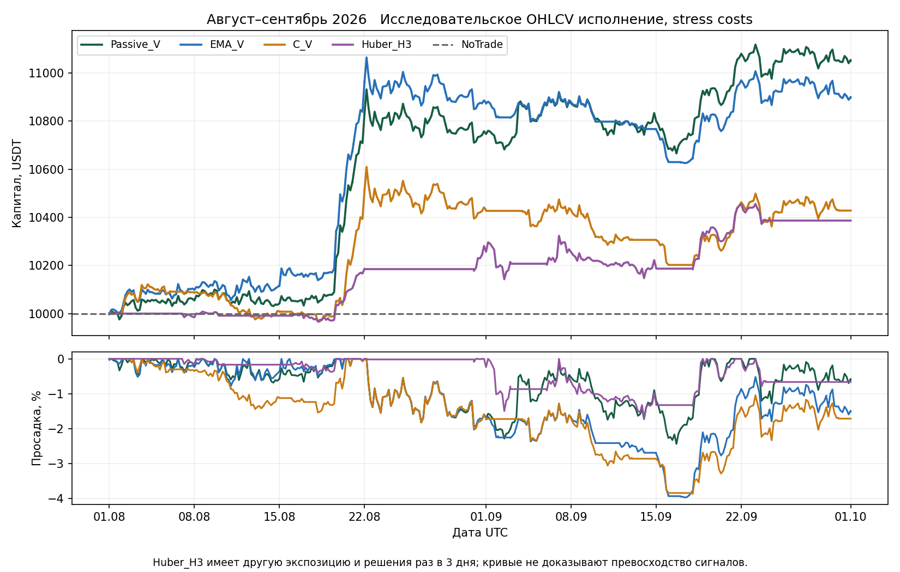

# Genetic Primus текущее состояние и роль краткосрочного прогноза

Редакция 2 от 12 октября 2026 года. Корректировка по предложению пользователя об отдельном потоке четырёхчасовых прогнозов. Это аналитическая редакция, не новый эксперимент и не релиз торговой модели.

## Решение

**Идея актуальна и заслуживает отдельного ограниченного эксперимента.** Разделение на прогноз рынка и управление позицией помогает проверить, где именно теряется полезность модели: в прогнозе, выборе сделок, размере позиции или выходе.

При этом часть предложенной архитектуры уже есть: compact-модель выдаёт прогноз, а отдельная политика превращает его в позицию. Новизна предложения — горизонт **4 часа вместо 3 дней**, регулярно обновляемый прогноз по каждому активу, описание неопределённости и явное использование этого потока для разных решений. Это не доказанный способ увеличить прибыль, а проверяемая гипотеза.

Опубликованная [редакция 1 отчёта о системе](../research_review_20261012/REPORT_1_CURRENT_STATE_RU.md), её расчёты, графики, модели и hashes сохранены неизменными. Подробная история гипотез и все прежние таблицы остаются в ней. В данной редакции обновлены архитектурная интерпретация и приоритеты дальнейшей проверки; старые результаты не переоценивались.

## Что уже реализовано и чего пока нет

| Компонент | Сейчас | Предлагается |
|---|---|---|
| Рыночные признаки | Шесть ценовых признаков на 4h барах | Сначала те же признаки; candle/volume и trade-flow блоки — отдельные последующие расширения |
| Обучаемый прогноз | Один gross close-to-close outcome за 3 дня | Отдельный outcome за следующие 4 часа |
| Модель | Linear6 с 7 параметрами, отдельно исследован Huber | Начать с такой же компактной мощности, не с большой сети |
| Поток выходов | Скалярный прогноз по активам в decision records | Версионированный прогнозный вектор по каждому активу с временем, сроком действия и происхождением |
| Неопределённость | Не является полноценным калиброванным predictive distribution | Интервалы/вероятности после проверки на прошлых out-of-origin прогнозах |
| Позиция | Порог, отдельные hysteresis и volatility sizing | Раздельно проверяемые вход, удержание/выход и размер риска |
| Частота | C: daily decisions, retrain 3 дня; Huber_H3: decisions 3 дня | Пилот: forecast 4h, labels 4h, decisions 4h, retrain по-прежнему 3 дня |
| Trades и стакан | Не входят в текущие шесть признаков; full8 execution data не квалифицированы | Только причинно доступные, синхронизированные и проверенные данные |
| Прогноз момента пика | Нет | Не следует автоматически из прогноза цены через 4 часа |

Основание: [зафиксированные признаки](../research_review_20261012/references/compact_forecast_data_v1.py), [модель](../research_review_20261012/references/compact_forecast_v1.py), [политики](../research_review_20261012/references/position_policy_v1.py).

## Что остаётся верным в результатах

На раскрытом интервале 1 августа — 30 сентября 2026, при исследовательском исполнении и stress costs:

| Политика | Net return | Max drawdown | Средняя экспозиция |
|---|---:|---:|---:|
| C | +14,95% | 8,37% | 37,86% |
| Passive_V | +10,51% | 2,44% | 23,16% |
| EMA_V | +8,98% | 3,97% | 19,88% |
| C_V | +4,28% | 3,87% | 14,61% |
| Huber_H3 | +3,87% | 1,71% | 8,99% |

Различия экспозиции запрещают трактовать эту таблицу как ranking качества прогнозов. На нескольких режимах устойчивое преимущество обучаемой модели не подтверждено. Четырёхчасовой forecaster ещё не обучен и **не имеет собственной строки с доходностью**.

Это график прежних политик, а не результат предлагаемой схемы. Новый прогнозный поток не меняет прошлые оценки и не снимает отрицательные gates. Проверяемые численные основания: [evidence](../research_review_20261012/evidence.json).

## Почему новая гипотеза полезна

У текущего решения есть смысловой зазор: прогноз суммарного движения за 3 дня используется для решения, которое может быть пересмотрено завтра. Четырёхчасовой прогноз может дать дополнительное основание, **покупать сейчас или подождать**, сохранять экспозицию до следующего решения или уменьшить её. Это особенно полезно исследовать отдельно от долгосрочного направления EMA.

Однако меньший горизонт не исправляет ошибки автоматически. Ожидаемое движение за 4 часа может быть меньше относительно spread, fees и impact, чем за 3 дня. Более частый пересмотр повышает возможности оборота, но не требует обязательных сделок. Удержание тех же units не должно порождать новую комиссию за вход.

Если новый прогноз строится из тех же цен, он не является новым независимым источником информации. Это обученное представление прежних наблюдений с другим target. Настоящее расширение входной информации появится только при добавлении проверенных данных объёма, сделок, ликвидности и других публичных рыночных наблюдений.

## Как понимать сведения о других игроках

Наблюдаемы агрегированные признаки: агрессивные покупки/продажи, размеры и частота сделок, spread, глубина, изменения и отмены заявок, иногда open interest, liquidations и announced funding. Из них нельзя достоверно восстановить личности, позиции или намерения всех участников. Крупная заявка может быть отменена; trade volume и движение стакана — разные данные.

Исследование Cont, Kukanov и Stoikov связывает краткосрочные изменения цен с order-flow imbalance на акциях. Это основание проверить такой блок признаков, но не доказательство четырёхчасовой прибыльности на наших криптоконтрактах. [The Price Impact of Order Book Events](https://arxiv.org/abs/1011.6402).

Текущие ограничения полноты и реалистичности исполнения остаются в силе. Отдельный BTC-файл другого года не заменяет синхронные full8 данные нужного интервала. Пока соответствующие входы не квалифицированы, модель должна называться price-only или OHLCV-моделью, а не моделью поведения участников.

## Изменение приоритетов

1. Сохранить общий ledger, издержки, причинность и ограничения риска. Не менять торговый runtime.
2. Спроектировать контракт 4h-прогноза и поток исторических out-of-origin прогнозов. Сначала проверить полезность прогноза без управления деньгами.
3. Отдельно измерить эффект перехода EMA с daily decisions на 4h decisions. Это контроль частоты, а не результат ML.
4. Подключать один и тот же сохранённый прогноз последовательно к фильтру входа, правилу выхода и затем размеру позиции. Не менять всё одновременно.
5. Сохранять Huber_H3 как отдельную защитную гипотезу. Его перенос на старые режимы остаётся полезным, но не является обязательной предпосылкой, чтобы исследовать другую, четырёхчасовую задачу.

Изменённый контракт, защита от утечки и ограниченная матрица сравнений приведены во [втором отчёте редакции 2](REPORT_2_FORECAST_VECTOR_PLAN_RU.md).

## Статус работы

Изменены только аналитические документы в новой папке. Новые модели не обучались, финансовые результаты не рассчитывались, данные с бирж не загружались. Исходный опубликованный пакет не изменён. Новая редакция локальная и пока не отправлялась на GitHub. Никаких разрешений на live, paper, credentials, orders или promotion не добавлено.
