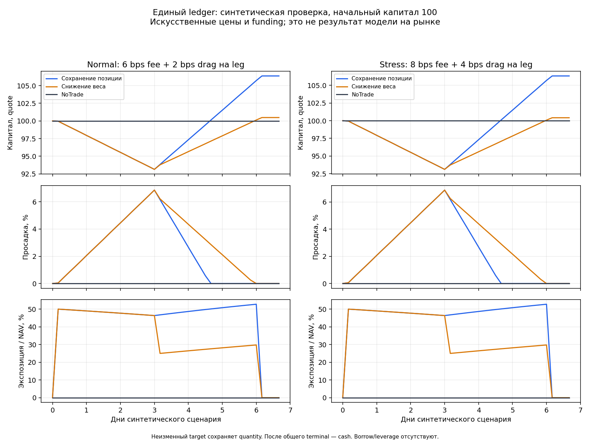

# Единые измерения: инженерная проверка v1

Это синтетическая проверка бухгалтерии, горизонтов и ranking. Цены, funding и costs искусственные; результаты не являются доходностью обученной модели. Market replay и обучение не выполнялись.

Проверок: **32**, все прошли. Шесть synthetic ledger replay; fits=0, market evaluations=0.

| Costs | Политика | Конечный капитал | Net, % | DD, % | Fills | Funding, quote |
|---|---|---:|---:|---:|---:|---:|
| normal | Carry | 106.366807 | 6.3668 | 6.8624 | 2 | 0.042866 |
| normal | Reduce | 100.476376 | 0.4764 | 6.8624 | 4 | 0.035856 |
| normal | NoTrade | 100.000000 | 0.0000 | 0.0000 | 0 | 0.000000 |
| stress | Carry | 106.321714 | 6.3217 | 6.8796 | 2 | 0.042849 |
| stress | Reduce | 100.414760 | 0.4148 | 6.8796 | 4 | 0.035839 |
| stress | NoTrade | 100.000000 | 0.0000 | 0.0000 | 0 | 0.000000 |

Весь universe использует один initial capital и один cash account. При изменении target сначала выполняются sells, затем buys; цена, fee и adverse drag фиксируются на каждом fill. Funding в момент входа не относится к новой позиции, в момент выхода относится к старой.

Число дней сценария включает cash после terminal. DD измерен на reference opens четырёхчасовой сетки и не оценивает внутрибара экстремумы. Fee/drag не являются наблюдёнными fills.

Для августа–сентября 2026 общий календарь содержит 20 полных origins: первый вход 1 августа 04:00 UTC, последний terminal 30 сентября 04:00 UTC; cash до 1 октября 00:00 UTC. Реальные данные этим checker не читаются.

Ranking теперь строится один раз: прохождение всех gates → меньше нарушений → penalized fitness → DD → turnover → complexity. Проверена фактическая paired/constrained-overlay ветка scoring.

Gross labels принимаются только open→open/18 bars и проходят новый cutoff каждого origin с purge 7 bars. Legacy open→last-close targets отклоняются. Изменение задержки между origins также отклоняется.

Проверка не включает обучение, сеть, collector, runtime, paper/live или promotion. Все девять safety-флагов false.

[Дневные измерения](daily.json) · [Непрерывные ledger и decisions](result.json) · [Точная fixture](fixture.json) · [Контрольные суммы](evidence_receipt.json)

Measurement semantic SHA256: `5b4aeca0a457ab23c293ed95f8c9f0389a87c4ef6220372ae3652501a8b9fbe4`.
